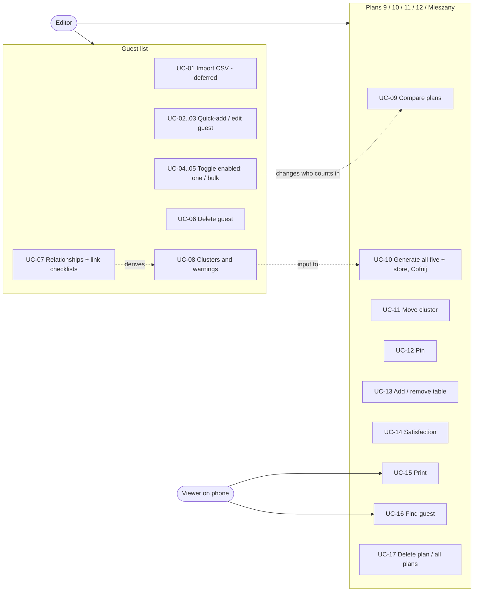

# 01 — Domain glossary, concepts and use cases

Stoliki plans the table seating of **one** wedding. This document is the shared vocabulary for every agent and for the code. Go/TS identifiers, OpenAPI schema names and DB tables use the English terms; the UI uses the Polish ones.

> Status: Phases 1–4 (tasks 001–002), updated 2026-10-02 with the user's answers and with UC-17 (delete a plan, task 005); updated 2026-10-03 for task 007 (Generate stores the plans at once, Cofnij) and task 013 (the mixed plan, a fifth plan). Items marked **[A-n]** are open assumptions (see [Assumptions](#assumptions)); confirmed answers are folded in as fact.

## 1. Requirements summary

**Goal.** Seat **~85–100 guests** at round tables. Every "must sit together" group stays intact, and plans use as few tables as possible with no table below 8 guests. Within that, as many preferred companions as possible sit together. Five plans are always produced side by side: one each for 9-, 10-, 11- and 12-seat tables, and a **mixed plan** whose tables have 9–12 seats, sized by the algorithm. The result must be visual and easy to adjust by hand.

**Actors**

| Actor | Description |
|---|---|
| Editor | Anyone who can reach the app on the tailnet or the home LAN (the couple, trusted helpers). There are no accounts and no roles: everyone has equal rights. Desktop is the primary editing surface. |
| Viewer at the venue | The same people on a phone, checking the plan (read-mostly). |
| Google Sheet (external) | Source of the guest list, exported manually as CSV. |

**Constraints.** Go + React SPA + one Docker container on a Raspberry Pi (ARM64). Reachable **only from the tailnet and the home LAN** under `/wesele`. Cost-free. Guest names are personal data (protected by tailnet / home-LAN-only access, never public). Quick app (YAGNI). The couple sits at their own table and is **not** on the guest list.

## 2. Ubiquitous language

| Term (code) | Polish (UI) | Meaning / rules |
|---|---|---|
| **Guest** | Gość | A person who may attend. Fields: **firstName** (required), **lastName** (optional), **notes** (free text), **isChild**, **enabled**. Children are ordinary guests who take a seat. |
| **Display name** | Nazwa | `firstName` + optional ` lastName`. It must be **unique, ignoring case and surrounding whitespace** (stored as `nameKey`). Names are how links are typed and imported, so two "Ania" must become "Ania Kowalska" / "Ania Nowak" (or "Ania K."). |
| **isChild** | Dziecko | A marker used for filtering and bulk toggling (e.g. "disable all children") and, since task 014, for **scoring**: a child **takes a seat** like anyone (fill, capacity, floor of 8, cluster integrity, "Potrzebne stoły") but is **not scored** — a child's satisfaction is 0, a child at the table adds nothing to anyone's satisfaction, and a child is never isolated. Hard rules ignore the flag. Rules: [03-seating-model.md](03-seating-model.md) § Children. |
| **Adult weight** | Liczba dorosłych paczki | The number of **enabled adults** (enabled, not `isChild`) in a cluster. It is the cluster's weight in satisfaction and isolation (task 014); the seated size stays the seats it takes. A cluster with adult weight 0 (only children enabled) takes seats and weighs nothing. |
| **Enabled** | Uwzględniony (przełącznik) | A quick on/off switch per guest. A **disabled** guest stays on the list, keeps all links and is **ignored by all five plans**: not seated, not counted in table fill, not scored. Typical uses: a decline, a child who cannot come, a "what-if without the children" variant. Toggling is instant and reversible. It replaces a separate attending/declined status: one switch covers both and there is nothing else to track. |
| **Link** | Powiązanie | An **undirected** relation between two guests with a **LinkLevel**. There is at most one link per pair. It can be entered from either guest and shows on both. The API stores **one symmetric row per pair with no author**, so the UI cannot tell who entered a link ("wpisany przez Emilkę"); it can only say whether the link is the shown guest's own ("wpisany bezpośrednio") or reached through someone ("przez grupę 0: X" / "przez powiązanie: X"). Showing the author would need a new contract field (possible future change, not planned). |
| **LinkLevel** | Grupa 0 / 1 / 2 | `0` = *must sit together* (hard). `1` = *preferred* (soft, weight 1.0). `2` = *acceptable if unavoidable* (soft, weight 0.5). Order of happiness: group 1 > group 2 > no link ("stranger"). |
| **Group-0/1/2 list** | Grupa 0/1/2 gościa | The *view* of one guest's relations of a given level. Not stored separately. **Group 0 of a guest is their whole cluster** (every other member, also those reached through someone else's links, e.g. Justynka's group 0 = Emilka + Maks + os. tow. when Emilka linked all three), never only the guest's own stored group-0 links. Group 1/2 = every member of each cluster with that affinity. |
| **Cluster** | Paczka | A connected component of the **group-0 graph over all guests, disabled ones included** (user-confirmed). It is the **seating unit**: all its enabled members sit at one table. Disabling the "hub" guest (e.g. Rafał, who listed his wife and mother-in-law) therefore does **not** split the family. A cluster whose members are all disabled disappears from the plans. A guest without group-0 links is a cluster of one. Derived, never stored. |
| **Seated size** | Liczba miejsc paczki | The number of **enabled** members of a cluster: the seats it takes. |
| **Cluster affinity** | Sympatia między paczkami | The group-1/2 relation **between whole clusters** (user rule): if any member of cluster A has a level-1 (or level-2) link to any member of cluster B, then **all of A** has that level with **all of B**. The relation is symmetric and not transitive. Links of disabled members still count, because the families know each other regardless. **Defensive rule for bad data only:** if links between two clusters carry different levels, the strongest wins (1 over 2) and a `conflicting_link_levels` **data warning** is shown. This is what makes partners "come along automatically" and lets the UI show "Ola — przez grupę 0: Michał". Derived, never stored. |
| **Oversized cluster** | Za duża paczka | A cluster whose seated size exceeds a scenario's capacity. That cluster cannot be seated in that scenario (violation). A data warning is also raised when the seated size exceeds 9 (does not fit the smallest, 9-seat plan), so a stray link that merges two families is noticed. |
| **Scenario** | Plan (9 / 10 / 11 / 12 / Mieszany) | One seating plan. Exactly **five** exist permanently, identified by a **PlanKey** and always listed in this order: the **uniform plans** `9`, `10`, `11`, `12` (every table has that many seats) and the **mixed plan** `mixed`. They share the guest list and links; each has its own tables, assignments and pins. They are always shown and generated together. |
| **PlanKey** | — | The identity of a plan: `"9"`, `"10"`, `"11"`, `"12"` or `"mixed"`. Used in URLs (`/scenarios/{planKey}/…`, `/plany/{planKey}`) and in `PUT /scenarios`. Stored as the pair (capacity, mixed). |
| **Mixed plan** | Plan mieszany ("Mieszany") | The fifth plan (task 013): tables of **different sizes, 9–12 seats**, chosen by the algorithm (the user enters no table inventory). Same hard rules as the 12-seat plan (capacity 12, floor 8). It may use **one table more** than the fewest possible, but only when that **strictly lowers the number of isolated guests**. Rules: [03-seating-model.md](03-seating-model.md) § The mixed plan. |
| **Table size** | Rozmiar stołu (stół 9- / 10- / 11- / 12-osobowy) | The number of seats the venue must provide at a table. Uniform plan: its capacity. Mixed plan: **derived from the fill**, never stored: the smallest of 9, 10, 11, 12 that holds the fill (fill ≤ 9 → 9, so 8 guests sit at a 9-seat table; 10 → 10; 11 → 11; ≥ 12 → 12, above 12 the table is also `over_capacity`). An empty table has no size. A manual move changes the size at once. |
| **Potrzebne stoły** | Potrzebne stoły | Per plan: how many tables of each size the venue must provide, e.g. "5 × 12, 3 × 11, 1 × 9" (empty tables not counted). Uniform plan: "k × capacity". Derived on the client from the table fills. |
| **Delete a plan** | Usuń plan / Usuń wszystkie plany | Resets one scenario to an **empty plan**: all its tables, assignments and pins are removed (disabled guests' assignments too) and its `version` is bumped. The scenario itself is never deleted (there are always five). Irreversible (no undo; a confirmation dialog stands in). An empty plan with enabled guests has an `unseated_guests` violation, so it shows **Needs recalculation**. "Usuń wszystkie plany" = the same for all five plans. |
| **Capacity** | Liczba miejsc | The most guests a table of a plan may hold: 9, 10, 11 or 12 for the uniform plans, **12 for the mixed plan**. Hard upper bound. |
| **Floor** | Minimalne obłożenie | **8 guests** (was 6 until 2026-10-03), a hard lower bound for every table in all five scenarios, waived only when the whole scenario needs a single table. Any fill between 8 and capacity is equally good: evenness is not rewarded. Some guest counts cannot meet it with small tables (e.g. 10–15 guests at capacity 9); the plan then shows `under_floor` violations ([03-seating-model.md](03-seating-model.md) § Feasibility). |
| **Table** | Stół | A table in a scenario, numbered 1…k with no gaps (removing a table renumbers the later ones). No seat positions inside a table. |
| **Assignment** | Przydział | "Guest g sits at table t in scenario s." At most one per guest per scenario. Assignments are always changed **per cluster**. Disabled members keep their assignment and move with their cluster. A re-enabled guest **must** sit with their cluster, so they reappear at the family's table even if it is full. That table then gets an `over_capacity` violation, and the plan is flagged **Needs recalculation** (user-confirmed). |
| **Unseated** | Bez stołu | An enabled guest with no assignment in a scenario (e.g. added after the plan was generated). Shown in the unseated tray. |
| **Pin** | Przypięcie | "Keep this cluster at this table when plans are regenerated." Stored on the members' assignments. A cluster is pinned if any member is pinned; pinning or unpinning always applies to the whole cluster. |
| **Generate** | Generuj plany | Runs auto-seating for **all five scenarios at once** and **stores the five results straight away**, replacing the five plans atomically (all or none; pins kept). The new tables and assignments are visible at once; there is no preview and no per-plan accept. Rules: [03-seating-model.md](03-seating-model.md) § Storing a Generate. |
| **Cofnij (undo Generate)** | Cofnij | Restores the five plans (tables, assignments, pins) as they were before the **last Generate made in this browser tab**. Possible only while no plan has been changed since that Generate (otherwise 409, "Nie można cofnąć"). The only undo in the app. |
| **Proposal** | Propozycja | The intermediate output of auto-seating for one scenario (`POST /scenarios/calculate`): tables, assignments, evaluation, `basedOnVersion`. Generate stores it immediately; the user never sees it as a separate thing. |
| **Evaluation** | Ocena | Derived facts about a scenario or proposal: table count, fill per table, **satisfaction**, **violations**. Recomputed by the backend whenever a scenario is read or changed. |
| **Satisfaction** | Zadowolenie | For an enabled **adult** g: the sum over enabled **adult** table-mates h outside g's cluster of `w(affinity)`, where `w1 = 1.0`, `w2 = 0.5` and a stranger counts 0, **minus 1 if g is isolated**. Always 0 for a child (task 014). Also reported as "k of n preferred companions at this table" (adults counted). Table and scenario scores are sums over adults (whole numbers, can be negative). |
| **Isolated guest** | Bez znajomych przy stole | A seated enabled **adult** who has at least one group-1/2 partner (an enabled **adult** of a cluster with an affinity to theirs, seated or not) but **none** at their table (children are never isolated and a partner cluster with only children enabled is no partner, task 014): they sit only with their own cluster and strangers. Always the whole cluster at once. A guest with no partners at all is never isolated. Not a violation; satisfaction −1 per guest, and auto-seating **excludes** it whenever the hard rules allow: fewest isolated guests comes before satisfaction ([03-seating-model.md](03-seating-model.md) § Isolation). |
| **Violation** | Naruszenie | A broken hard rule in a stored plan: cluster split, over capacity, under floor, unseated guests, oversized cluster. Violations never block saving; they are displayed. |
| **Needs recalculation** | Wymaga przeliczenia | Derived flag on a stored plan: true when the plan has at least one violation (e.g. a re-enabled guest overfills the family's table, or a new guest is unseated). The UI shows a prominent "Przelicz / Generuj" call to action. The server **never regenerates on its own**: the user clicks Generate (which stores the new plans at once). Exposed as `SeatingPlan.summary.needsRecalculation`. |
| **Data warning** | Ostrzeżenie | A problem in the guest data rather than the plan: cluster > 9 (`cluster_exceeds_9`), cluster > 12 (`cluster_exceeds_12`), conflicting link levels. |
| **Guest import** | Import listy | **Deferred (post-MVP).** For the MVP, guests and links are entered manually. Loads the guest list from a CSV export of the Google Sheet. A **dry run** returns an **Import report**. A **commit** replaces all guests and links and clears all five scenarios. |
| **Import report** | Raport importu | Counts (guests, children, links, clusters) and problems per row. **Errors** block the commit: missing first name, duplicate name, malformed file. **Warnings** do not: an unmatched or ambiguous name reference (that link is dropped), a self-link, conflicting levels for one pair (the strongest is kept). |

## 3. Entities vs value objects

| Concept | Kind | Identity / lifecycle | Persisted |
|---|---|---|---|
| Guest | **Entity** (aggregate root of the guest list) | Surrogate id. Created, edited, enabled/disabled, deleted. `version` for optimistic locking | yes |
| Link | Value object owned by the guest pair | Unordered pair + level; replaced, not mutated | yes (one row per pair) |
| LinkLevel, Capacity, PlanKey, display name | Value objects | — | columns |
| Scenario | **Entity** (aggregate root) | Fixed five, keyed by PlanKey = (capacity, mixed). `version` | yes (seeded by migration) |
| Table | Entity inside Scenario | Number within the scenario | yes |
| Assignment (+ pin) | Entity inside Scenario | (scenario, guest) | yes |
| Cluster, Cluster affinity, Seated size, Adult weight | Value objects, **derived** | Recomputed from guests + links | no |
| Proposal, Evaluation, Satisfaction, Violation, Data warning, Import report | Value objects, **derived** | Per request | no |
| Table size, Potrzebne stoły | Value objects, **derived** (client, from fill) | Per render | no |

Rule: **store only explicit user input** (guests, links, tables, assignments, pins). Clusters, affinities, scores, violations and warnings are derived from it, so they can never go stale when a guest is toggled or a link changes.

## 4. Use cases

All paths are relative to `/wesele/api`. The contract is [`docs/openapi.yaml`](../openapi.yaml) (source in `docs/openapi/`). No use case needs a login (tailnet / home-LAN-only access).

| # | Use case | Endpoint(s) |
|---|---|---|
| UC-01 | **[DEFERRED, post-MVP]** **Import guest list** from CSV: dry run → review report → commit (replaces everything) | `POST /guest-imports?dryRun=true` (default) → `POST /guest-imports?dryRun=false` |
| UC-02 | **Quick-add guests** (MVP data entry, first-class): type "Imię Nazwisko", press Enter, and the input stays focused for the next one. A sticky "Dziecko" checkbox marks every following add as a child until unticked. Many guests can be added in a row without the mouse | `POST /guests` (one call per guest) |
| UC-03 | **Edit guest** | `PATCH /guests/{guestId}` (version-checked) |
| UC-04 | **Toggle one guest** enabled/disabled | `PATCH /guests` with `{guestIds: [id], enabled}` (no version check) |
| UC-05 | **Bulk toggle**: filter in the UI (e.g. children), then enable/disable all selected | `PATCH /guests` with `{guestIds, enabled}` |
| UC-06 | **Delete guest** (typo, duplicate): removes their links and assignments | `DELETE /guests/{guestId}` |
| UC-07 | **Review and edit a guest's relationships**: the relationships panel ("Powiązania: X") shows groups 0/1/2 with the reason for each person ("wpisany bezpośrednio" / "przez grupę 0: X" / "przez powiązanie: X"); names open that person. Editing one group is a **checklist** of all guests (search, "Tylko zaznaczeni"); "Zapisz" applies the difference (removals first, then moves/adds). A missing guest can be created from the search ("Dodaj «X» jako nowego gościa": created and ticked, linked on Zapisz). "Pokaż na liście" filters the guest list to this person and their relations | `PUT` / `DELETE /guest-links/{linkKey}` (one call per changed pair); create: `POST /guests` |
| UC-08 | **Review clusters and data warnings** | `GET /clusters` |
| — | Liveness | `GET /health` |
| UC-09 | **View / compare the five plans**: table count, fill, satisfaction, violations, isolated guests, **potrzebne stoły** (tables per size) | `GET /scenarios` |
| UC-10 | **Generate all five plans and store them at once** ("Generuj plany", no preview, no confirmation); then optionally **Cofnij** to restore the five previous plans (last Generate in this tab, only if no plan changed since) | `GET /scenarios` (undo snapshot) → `POST /scenarios/calculate` → `PUT /scenarios` (all five, atomic, version-checked). Cofnij: `PUT /scenarios` with the snapshot |
| UC-11 | **Move a cluster** to another table or back to the tray (drag & drop or keyboard) | `PUT` / `DELETE /scenarios/{planKey}/assignments/{guestId}` |
| UC-12 | **Pin / unpin a cluster** at its table | `PUT /scenarios/{planKey}/assignments/{guestId}` with `pinned` |
| UC-13 | **Add or remove a table** in a plan (removing one unseats its guests and renumbers) | `POST /scenarios/{planKey}/tables`, `DELETE /scenarios/{planKey}/tables/{tableNumber}` |
| UC-14 | **Inspect satisfaction** of a guest or table | part of the scenario payload |
| UC-15 | **Print** a plan (browser print of a print view) | client only |
| UC-16 | **Find a guest** ("where does Ania sit?") | client-side over the cached data |
| UC-17 | **Delete a plan** ("Usuń plan") or all five ("Usuń wszystkie plany") after a confirmation: the plan becomes empty (no tables, everyone unseated, pins gone) | `DELETE /scenarios/{planKey}/tables` (one call per plan; "all" = five calls) |

*Legend:* rounded nodes are actors; boxes are use cases grouped by aggregate (guest list, scenarios); dotted arrows are data dependencies (links → derived clusters → plans; toggles change which guests count).

## Assumptions

Confirmed by the user on 2026-10-02 and folded in above: tailnet-only with no app login and equal rights; single-size plans, always generated together (four sizes, 9/10/11/12, since 2026-10-03; originally 8/10/12; **plus the mixed plan since task 013, 2026-10-03**: user answers "Algorytm sam dobiera rozmiary", "Tak, piąty plan", "Może dać o 1 stół więcej"); no hard "must not sit together"; the couple is not on the list, so no head table or seat order; floor 6 on every table, and fewest tables always beats satisfaction; whole-cluster moves + pins + preview, no undo (**superseded 2026-10-03, task 007, user decision "Zapisuj od razu": Generate stores the plans immediately, no preview; Cofnij undoes the last Generate**); CSV replace-all import with a dry run; browser print; weights 1.0 / 0.5; ~85–100 guests; cluster-to-cluster link semantics; enabled toggle + child flag.

Also confirmed (2026-10-02, second round): clusters are computed over all guests, disabled included (A-13); a re-enabled guest returns to their cluster's table, and an overfilled table flags the plan **Needs recalculation** with no automatic regeneration (A-14 + A-17); CSV import is **deferred** to post-MVP, and the MVP relies on fast manual entry (A-15).

Still open (defaults chosen; ranked by impact):

| # | Assumption | Impact if wrong |
|---|---|---|
| A-15 | (Deferred feature) CSV format: header `imie,nazwisko,dziecko,grupa0,grupa1,grupa2,uwagi`; names separated by `;` or `,`; a reference matches a full name, or a first name if unique. To be confirmed when import is picked up. | Low now (post-MVP). |
| A-16 | Display names are unique, case-insensitive. | Low. |
| A-18 | No scheduled backup inside the app; `server backup` is run manually or by cron. | Low. |
| A-19 | **Needs recalculation** = "the plan has any violation". There is no separate "data changed since the last Generate" staleness flag: link or toggle changes that do not break a hard rule only change the score. | Low. |
| A-21 | (Task 013) The mixed plan has **no objective of its own beyond the 12-seat rules**: at k0 tables it is computed exactly like the 12-seat plan, so with the same pins and no isolation to remove it has the **same tables as plan 12**, only with per-table size labels (e.g. on the live list of 2026-10-03, which has 0 isolated guests at capacity 12). It differs only when one extra table strictly lowers the isolated count, or after hand edits. "Minimum 8 jeśli konieczne" is read as "8 guests at a 9-seat table" (there are no 8-seat tables). | Medium: if the user expected a visibly different plan (e.g. fewer empty seats, smaller tables preferred), the objective needs a tertiary term — a user decision. |
| A-22 | (Task 014) **The floor of 8 and table fill count children** (a child takes a seat; only scoring ignores them). Scores shown after task 014 are adults-only and **not comparable** with earlier ones (on the live list of 2026-10-03 plan 12 lost the ~19% that was children's own satisfaction). A cluster whose only enabled members are children (e.g. the parents declined) is pulled towards nobody: it sits wherever the hard rules put it. | Low: the user may later want the floor to count adults only, or children-only clusters seated near their family's friends — a user decision, not done now. |
| A-20 | Quick-add creates one guest per Enter (one `POST /guests` each, no batch endpoint). Typing speed is the limit, and ~100 sequential requests on a LAN are instant. | Low: a batch endpoint can be added later if needed. |
