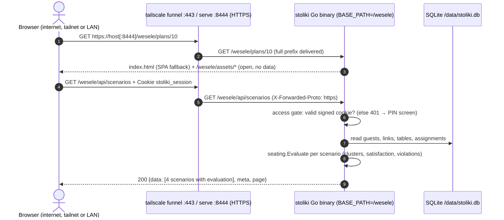

# 02 — System context, runtime shape and cross-cutting rules

How Stoliki is built and deployed **today**. Diagrams: [C4](diagrams/001-c4-context.md), [state machines](diagrams/001-state-machine.md), [ERD](diagrams/002-erd.md). Domain: [01-domain-glossary.md](01-domain-glossary.md). Seating rules: [03-seating-model.md](03-seating-model.md). Data model, DTOs and repositories: [04-data-model.md](04-data-model.md). Access gate (task 009): [05-access-gate.md](05-access-gate.md). API contract: [`docs/openapi.yaml`](../openapi.yaml).

## Shape at a glance

- **One container** (`stoliki`) on the Raspberry Pi (ARM64). A static Go binary serves both the REST API and the built React SPA. There is no Nginx container and no database container.
- **SQLite** database file on a named Docker volume `stoliki-data` (mounted at `/data`; file `/data/stoliki.db`).
- Reachable from three places, all under `/wesele/` (user decision 2026-10-03, task 009):
  - **public internet** via Tailscale Funnel on `:443`: `https://<pi-host>.<tailnet>.ts.net/wesele/`;
  - **tailnet** via the non-funnelled serve mapping on `:8444`: `https://<pi-host>.<tailnet>.ts.net:8444/wesele/`;
  - **home LAN**: `http://<pi-lan-ip>:8094/wesele/`.
- **Shared-PIN access gate on every one of them** (no trusted-network exception): the SPA opens with a PIN screen; a correct PIN gives a signed session cookie valid 30 days (sliding); "Wyloguj" logs out. Everyone with the PIN can edit everything. Design: [05-access-gate.md](05-access-gate.md).

## Repository layout

```
stoliki/
├── backend-go/
│   ├── go.mod
│   ├── cmd/server/main.go        composition root; subcommands: (default) serve, healthcheck, backup <dest>
│   ├── internal/                 packages added as tasks land: seating (pure core), guests, scenarios, importcsv, httpapi, store
│   ├── db/migrations/            goose SQL migrations: single source of schema truth (Architect-owned), embedded in the binary
│   ├── db/queries/*.sql          sqlc input (Backend-Go)
│   └── sqlc.yaml
├── frontend-web/                 Vite + React 19 + TypeScript SPA
├── infra/                        Dockerfile (node → go → distroless), compose.yml, .env.example
├── docs/
│   ├── architecture/             living docs (this folder) + diagrams/
│   ├── adr/                      decision records (reasoning only)
│   ├── openapi/                  OpenAPI 3.1 source tree (edit here)
│   └── openapi.yaml              bundled contract (generated by `make openapi-bundle`; never edit)
└── Makefile                      openapi-bundle, openapi-lint (+ later cross-cutting targets)
```

## The `/wesele` prefix

The prefix is **kept on every request inside Stoliki**. Whatever routes traffic to Stoliki must deliver the full `/wesele/...` path.

| Layer | Setting |
|---|---|
| Tailscale mapping (public) | **Wired 2026-10-03 (task 009):** `sudo tailscale funnel --bg --https=443 --set-path /wesele http://127.0.0.1:8094/wesele` — an extra handler on the already-funnelled `:443` listener next to investing-app's `/` → `localhost:80`. URL: `https://<pi-host>.<tailnet>.ts.net/wesele/`. Same target (with the `/wesele` suffix) as the tailnet mapping. Rollback: `sudo tailscale funnel --https=443 --set-path /wesele off` (never `reset`). |
| Tailscale mapping (tailnet) | **Wired and verified (2026-10-02):** `sudo tailscale serve --bg --https=8444 --set-path /wesele http://127.0.0.1:8094/wesele` — tailnet-only (`tailscale serve status` shows "tailnet only"; the port is absent from `tailscale funnel status`). Final URL: `https://<pi-host>.<tailnet>.ts.net:8444/wesele/`. Verified through the real hostname: `/wesele/api/health` 200, `/wesele` 301 → `/wesele/`, `/wesele/`, `/wesele/goscie`, `/wesele/druk/10` all 200. Because the Go server only serves full `/wesele/...` paths and answers 200 through the mapping, the prefix reaches the container intact: the target's `/wesele` suffix is required (the mount path is consumed and the target path re-added). The pre-existing mappings (`/`, `/sibling-a/`, `/sibling-b/`, `:8443`) were diffed against a snapshot taken before the change and still answer 200. The `sudo` is needed once because the user is not a Tailscale operator; never run `serve reset` / `funnel reset`. This mapping stays tailnet-only (`:8444` cannot be funnelled). |
| Go server | `BASE_PATH=/wesele`. Routes: `/wesele/api/*` (API); `/wesele/*` (static SPA from `WEB_ROOT`, falling back to `index.html` for unknown non-API paths); `/wesele` → 301 `/wesele/` |
| Vite | `base: '/wesele/'` (dev: proxy `/wesele/api` → `http://localhost:8080`) |
| React Router | `basename: '/wesele'` |
| API client | one constant `API_BASE = '/wesele/api'` |



*Legend:* shows the three invariants of this doc. The prefix is preserved end-to-end, every API call except health/login/logout passes the PIN gate, and every read returns a freshly derived evaluation (nothing derived is stored). The home-LAN path (`http://<pi-lan-ip>:8094`) skips Tailscale but hits the same gate.

## Access control

- **Public, behind a shared PIN** (task 009, user decision 2026-10-03, live the same day). One Go middleware on the API sub-router requires a signed `HttpOnly` `stoliki_session` cookie (30 days, sliding) on every API operation except `GET /health`, `POST /session` (login) and `DELETE /session` (logout); missing/invalid → 401. State-changing requests also need `X-Stoliki-Request: 1` (CSRF; 403). Failed logins are throttled in memory. The static SPA shell (with the PIN screen) is open; it holds no personal data. Full design and threat model: [05-access-gate.md](05-access-gate.md).
- **The same gate on every network**: public Funnel URL, tailnet `:8444` URL and home-LAN URL (plain HTTP, so PIN and cookie cross the home Wi-Fi unencrypted — accepted). No roles: everyone with the PIN can edit everything.
- **The one secret** is `STOLIKI_PIN`, only in the gitignored `infra/.env` (mode 600). Compose refuses to run without it (`${STOLIKI_PIN:?…}`), so the deployment can never start open. Changing it + restart logs every device out. A short PIN is weak against a targeted guesser; a longer one is recommended.
- **Known gap:** it is not verified that `tailscale serve`/`funnel` sends `X-Forwarded-For`. If it does not, all proxied clients share one throttle key, so one attacker's failed guesses also block other people's *new* logins for a while (existing sessions keep working).
- Exposure rules: only the `/wesele` handler on `:443` is funnelled (plus the tailnet-only `:8444` mapping); never `tailscale serve reset` / `funnel reset`; never touch other apps' handlers; never forward port 8094 on the router. Rollback of public access: `sudo tailscale funnel --https=443 --set-path /wesele off`.
- Personal-data hygiene still applies: **never log guest names, notes, CSV content or request bodies**; logs carry ids and counts only. Response header `X-Robots-Tag: noindex`. Request body limit 1 MB (CSV import 2 MB).
- The host port is published on `${STOLIKI_BIND:-0.0.0.0}:8094` (compose), so the local Tailscale daemon and the home LAN reach it; `STOLIKI_BIND=127.0.0.1` restricts it to loopback (Tailscale only, no LAN).

## Persistence

- SQLite via `modernc.org/sqlite`, with pragmas `journal_mode=WAL`, `foreign_keys=ON` and `busy_timeout=5000`. The pool has a single connection for writes (`SetMaxOpenConns(1)` is acceptable at this scale).
- The schema changes only through **goose** migrations in `backend-go/db/migrations/` (`NNNNN_slug.sql`), embedded and applied at startup before the server listens (each one in a transaction, so a failed migration leaves the file as it was). Changing a `CHECK` or other column constraint on a table that is the parent of `ON DELETE CASCADE` foreign keys is done by **rebuilding the parent and its children together** (create `*_new` tables → copy rows with their ids → drop old child-first → rename): with `foreign_keys=ON`, dropping only the parent would cascade-delete the children, and the pragma cannot be switched off inside goose's transaction. `00002_capacity_9_10_11_12.sql` is the worked example. sqlc reads the same directory. No auto-DDL, no manual DDL.
- SQLite conventions: `STRICT` tables; surrogate `INTEGER PRIMARY KEY`; timestamps as RFC 3339 UTC `TEXT`; booleans as `INTEGER` with `CHECK (x IN (0,1))`; bounded values enforced with `CHECK`.
- Stored: guests, guest links, scenarios (4 rows: 9, 10, 11, 12), dining tables, assignments (+pin). **Not** stored: clusters, affinities, proposals, evaluations, warnings.
- Backup: `docker compose exec stoliki /app/server backup /data/backups/stoliki-<date>.db` (`VACUUM INTO`, consistent while running).
- Tests: a real SQLite file in `t.TempDir()`, migrated with the embedded migrations. The DB is never mocked.

## Concurrency

- A handful of editors, rarely at the same time. No live push; the SPA refetches when the window regains focus.
- **Optimistic locking** via `version` on **Guest** (`PATCH /guests/{id}`) and **Scenario** (`PUT /scenarios`: storing a Generate and its Cofnij, all four plans atomically). A mismatch returns `409` with error code `version_conflict`; the client refetches.
- Last write wins, with no version check, for: cluster moves, pins, table add/remove (each bumps the scenario version), toggles (single and bulk) and link edits.
- Each command runs in one transaction; SQLite serialises writers.

## Where logic lives

Class-level design: [diagrams/003-backend-design.md](diagrams/003-backend-design.md) (Go packages, interfaces, class diagram), [diagrams/003-frontend-design.md](diagrams/003-frontend-design.md) (SPA modules, components, state ownership), [diagrams/003-sequences.md](diagrams/003-sequences.md) (UI-driven flows).


| Concern | Location |
|---|---|
| Clustering, affinity, feasibility, scoring, Propose/Evaluate | Go, pure package `internal/seating` (no I/O, no DB or HTTP types) |
| Persistence | Go, sqlc queries behind the store types in [04-data-model.md](04-data-model.md). Rows → domain → DTO; rows never reach handlers |
| HTTP | oapi-codegen strict server on chi; one shared error-mapping helper (error envelope) |
| CSV import | Go edge adapter: `io.Reader` → guests + links + report. Replaceable without touching the core |
| Floor plan, drag & drop, optimistic moves, filters/bulk selection, print view | React SPA. Fill counters may be computed client-side for optimistic display; **scores, violations and warnings always come from the server** |

## Technology stack

| Layer | Choice |
|---|---|
| Backend | Go (current stable), chi v5, oapi-codegen v2 (strict server), sqlc, goose v3, `modernc.org/sqlite`, `log/slog` |
| Frontend | React 19, TypeScript strict, Vite, React Router v7 (basename `/wesele`), TanStack Query v5, Tailwind v4, shadcn/ui, `@dnd-kit/core`, `openapi-typescript` + `openapi-fetch`; Zod for forms only |
| Contract | OpenAPI 3.1. Source in `docs/openapi/`, bundled to `docs/openapi.yaml` and linted with `@redocly/cli@2.57.0` (`make openapi-bundle`, `make openapi-lint`, `make openapi`) |
| Packaging | One multi-stage image → `gcr.io/distroless/static-debian12:nonroot`, `linux/arm64`; compose v2; named volume `stoliki-data` |
| Config (env) | `BASE_PATH=/wesele`, `PORT=8080`, `DB_PATH=/data/stoliki.db`, `WEB_ROOT=/app/web`; the one secret `STOLIKI_PIN` (from gitignored `infra/.env`, required by compose; unset = gate off, dev/tests only) and the generated `/data/session.key` |

## Pattern evaluation (system level)

| Candidate | Verdict | Why |
|---|---|---|
| Layered architecture (handler → service → store/sqlc) | **adopted** | The Go idiom; enough for this size |
| Hexagonal (full ports & adapters) | rejected | One DB, one UI. Interfaces are added only where a real seam exists (import adapter) |
| Functional core, imperative shell | **adopted** | `internal/seating` is pure; services do the I/O around it |
| Repository | **adopted, concrete** | Two store types over sqlc (see 04-data-model). Go interfaces are declared consumer-side only if a test seam is ever needed; integration tests use the real DB |
| Strategy (seating algorithms) | rejected | One algorithm; capacity is a parameter |
| Command + Memento (undo/redo) | rejected as a pattern | Generate stores at once (task 007); its one-step **Cofnij** is a plain client-held snapshot of the four plans re-sent through `PUT /scenarios` (a Memento in spirit, no undo stack, no Command objects). No other undo |
| Observer / live push | rejected | Few editors; refetch on focus |
| Adapter | **adopted** (import edge) | CSV now; a Sheets API source could replace it |
| Optimistic Offline Lock | **adopted** | `version` on Guest and Scenario |
| DTO + Mapper | **adopted** | Boundary between sqlc rows, domain types and OpenAPI DTOs |
| Authentication middleware | **adopted (task 009, live)** | Shared-PIN gate as one chi middleware on the API sub-router; see [05-access-gate.md](05-access-gate.md) |
| Separate Nginx container | rejected | Go serves SPA + API |
