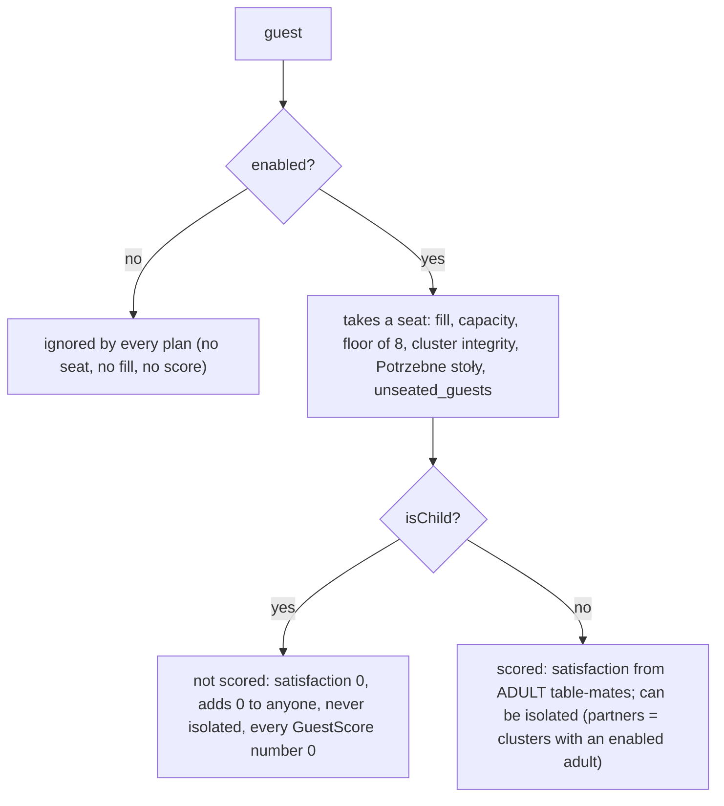
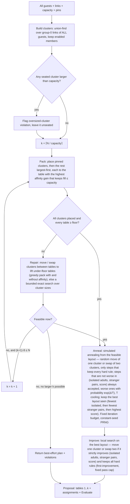
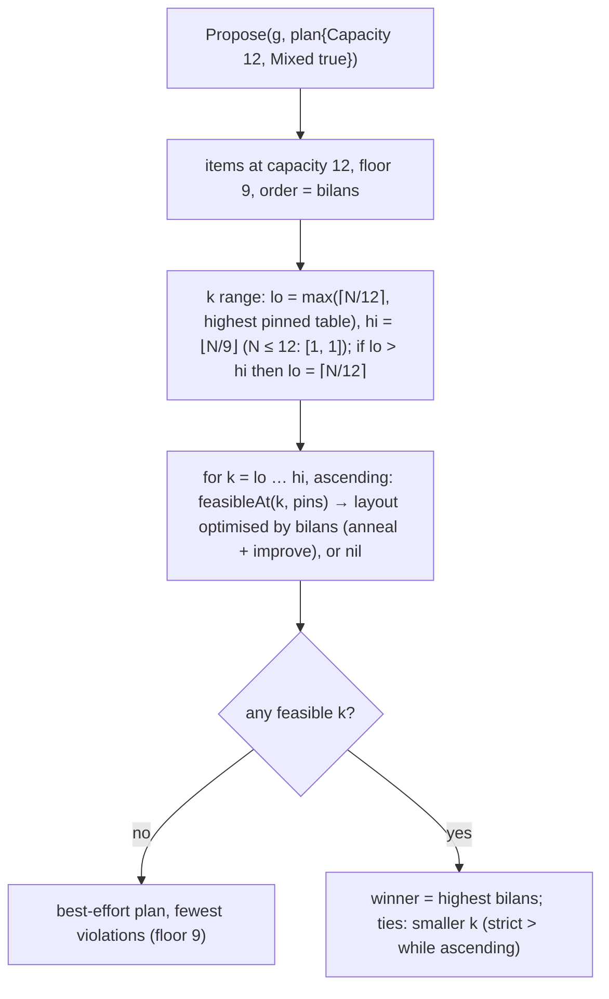

# 03 — Seating model: rules, scoring, auto-seating

The rules the seating code (`backend-go/internal/seating`, pure Go, no I/O) implements. Terms: [01-domain-glossary.md](01-domain-glossary.md).

## Inputs and outputs

- **Input:** all guests, each with an `enabled` flag and an `isChild` flag (task 014); links (pair, level); and, per scenario, its capacity ∈ {9, 10, 11, 12} and whether it is the **mixed plan** (capacity 12, `Plan.Mixed`), its current tables, assignments and pins.
- **Outputs:**
  - `Clusters(guests, links)` → clusters (all members, plus the enabled subset) + cluster affinities + data warnings.
  - `Evaluate(scenario state)` → per guest/table/scenario satisfaction, fill, violations, and **`needsRecalculation` = (at least one violation)**. Called on every scenario read and after every mutation.
  - `Propose(scenario state)` → a Proposal (tables + assignments + its evaluation). Writes nothing.
- **Generate** ("Generuj plany") = `Propose` for all five scenarios (one request, `POST /scenarios/calculate`; the five runs are independent and differ only in capacity and, for the mixed plan, in floor (9), table count (free) and objective (bilans), § The mixed plan), **then the five results are stored at once**, atomically, replacing the five plans (`PUT /scenarios`, see § Storing a Generate below). There is no preview and no per-plan accept: the new tables and assignments are visible straight away in the normal plan views. The previous plans can be restored once with **Cofnij** (§ Undoing a Generate).

## Who counts

- **Clusters** are connected components of the group-0 graph over **all** guests, disabled ones included. Disabling the guest who wrote a family's group-0 list does not split the family.
- Only **enabled** members take seats and count towards fill. A cluster's *seated size* is its number of enabled members. A cluster with seated size 0 is ignored by Propose and Evaluate.
- Only **enabled adults** are scored (task 014, § Children): children take seats but neither receive nor give satisfaction and are never isolated. A cluster's *adult weight* is its number of enabled adults; it replaces the seated size wherever satisfaction or isolation is counted, never where seats are counted.
- **Affinity** is a relation between whole clusters. It is computed from the links of all members, disabled ones included: if any member of A has a level-1 (or level-2) link to any member of B, then A↔B has that level. If the data contains both levels between the same two clusters (should not happen), level 1 wins and a `conflicting_link_levels` data warning lists the guests involved. No other combining logic exists.

## Rules, in strict priority order

1. **Hard — cluster integrity:** all enabled members of a cluster sit at exactly one table.
2. **Hard — capacity:** fill (enabled guests) ≤ capacity.
3. **Fewest tables:** use the smallest feasible table count *k*. Uniform plans only: the mixed plan has no table-count rule (any k with 9–12 guests per table, § The mixed plan).
4. **Hard — floor:** every table has ≥ 8 enabled guests (the four uniform plans; was 6 until 2026-10-03; **9 in the mixed plan**, task 015), unless the scenario has a single table. Fewest tables always beats satisfaction.
5. **Exclude isolation** (task 011, "wykluczanie izolacji"): among the layouts allowed by rules 1–4 and 8, use one with the **fewest isolated guests** (§ Isolation below). Soft only in the sense that rules 1–4 and pins beat it: it never adds a table, never breaks the floor or capacity, never moves a pin. Within those rules it is **lexicographically above** rules 6 and 7: no amount of satisfaction or of avoided strangers buys one more isolated guest.
6. **Avoid strangers** (task 015, "maksymalnie unikać obcych"): among the layouts with that fewest number of isolated guests, use one with the **fewest stranger pairs** (§ Stranger pairs below). Soft in the same sense as rule 5 (never adds a table, never breaks a hard rule or a pin; zero stranger pairs is reached whenever the data and the hard rules allow it, otherwise the fewest the search finds). Lexicographically above satisfaction: no amount of satisfaction buys one more stranger pair.
7. **Maximise satisfaction** (group 1 > group 2 > stranger) among the layouts with those fewest isolated guests and stranger pairs. Evenness beyond the floor is *not* rewarded **by satisfaction**; but rule 6 does prefer smaller tables where strangers are unavoidable (a pair count grows with the square of the table's adults, § Stranger pairs, example J). "Rebalance only as much as needed" falls out of rules 3–7: with 28 guests at capacity 12, 12 + 12 + 4 is infeasible (floor), so the optimiser picks among feasible splits (e.g. 12 + 8 + 8, 11 + 9 + 8, 10 + 10 + 8, 10 + 9 + 9) the best one.
8. **Pins:** pinned clusters keep their table; the optimiser only moves unpinned clusters.

*(Rule numbers since task 015: avoiding strangers was inserted as rule 6; satisfaction is rule 7, pins rule 8. Older sections of the design docs that say "rule 6" for satisfaction or "rule 7" for pins mean the same rules.)*

## Scoring

```
affinity(A, B) = the level of the links between members of A and members of B
                 (1 or 2; none if no link; strongest + data warning if inconsistent)
w(1) = 1.0, w(2) = 0.5, w(none) = 0

IsolationPenalty = 1

adult(h)        = h is enabled AND NOT h.isChild

satisfaction(g) = 0                                                        if g is a child (task 014)
                = Σ over ADULT table-mates h with cluster(h) ≠ cluster(g) of w(affinity(cluster(g), cluster(h)))
                  − (IsolationPenalty if isolated(g))                      otherwise
table score     = Σ satisfaction(g) for g at the table   (= Σ over the adults at the table)
scenario score  = Σ table scores
```

Also reported per enabled guest for the UI: `preferredTotal` (enabled adult effective group-1 companions), `preferredAtTable`, `fallbackAtTable` (group-2 adults at the table), `strangersAtTable` (other adults at the table); all **adults only**, and all 0 for a child (task 014). The weights and the penalty are fixed in code.

The table and scenario scores are always whole numbers (a group-2 pair of clusters with adult weights a and b adds 0.5·b to each of a's adults and 0.5·a to each of b's, a·b in total; the penalty is a whole number per guest). Only a single guest's satisfaction can end in ,5. Scores can now be negative.

### Isolation ("bez znajomych przy stole")

```
partners(A)   = clusters B ≠ A with a group-1 or group-2 affinity to A and at least one ENABLED ADULT
                (seated or not, anywhere; group-0 mates never count — they are A itself;
                 a cluster whose enabled members are all children is no partner, task 014)
isolated(g)   = g is an enabled ADULT AND seated
                AND partners(cluster(g)) ≠ ∅
                AND no enabled adult of any cluster in partners(cluster(g)) sits at g's table
              ⇔ g is a seated adult, has partners, and preferredAtTable(g) + fallbackAtTable(g) = 0
```

- **Per guest, the whole cluster at once:** isolation is a property of the cluster at its table, so every enabled **adult** of an isolated cluster is isolated; its children are not (Michał, Martyna, Zuzia and Zosia, all adults: four isolated guests, −4 on the score; if Zuzia and Zosia were children: two, −2, task 014).
- **No partners at all → never isolated** (satisfaction 0, as before): nothing can be done for them. Same when every partner cluster is fully disabled.
- **Partner exists but cannot be at the table** (unseated, an oversized cluster, or capacity/floor make it impossible) → isolated. Shown, not hidden.
- **Unseated guests** are not isolated (they have no table; `unseated_guests` already covers them).
- **Not a violation.** `needsRecalculation` and the violation list are unchanged: "Przelicz" cannot help when isolation is unavoidable at the fewest tables, and a plan with an avoidable isolation made by hand is a quality issue, like low satisfaction. The UI marks isolated guests and counts them per plan ([diagrams/003-frontend-design.md](diagrams/003-frontend-design.md) §12).
- **Two numbers, two roles.** The displayed satisfaction takes −1 per isolated guest (what the user sees in the scores). The optimiser does **not** trade that −1 against satisfaction: it compares layouts by the triple (isolated guests ↑, stranger pairs ↑, scenario score ↓), lexicographically (rule 5 before rule 6 before rule 7; the pair (isolated, score) until task 015). Within an equal isolated count, "higher score" is the same as "higher group-1/2 satisfaction", since the penalty part is then equal.

**Worked examples** (capacity 12; sizes in brackets, all members adults; gains are scenario points: a group-1 pair of clusters of adult weights a and b adds 2·a·b, group 2 adds a·b — with adults only, the weight equals the size).

*A. The Michał case (a shared partner).* M[4] —1— P[2] —1— Q[6] —1— R[2]; strangers S1[4], S2[4], S3[2]; 24 guests, k = 2, both tables exactly 12 (floor and capacity).

| Layout | Group-1/2 points | Isolated guests | Displayed score | Old objective (satisfaction only) | New objective (isolated, score) |
|---|---|---|---|---|---|
| a: {P, Q, R, S3} + {M, S1, S2} | P–Q 24 + Q–R 24 = 48 | M: 4 | 48 − 4 = **44** | **chosen** (48) | (4, 44) |
| b: {M, P, Q} + {R, S1, S2, S3} | M–P 16 + P–Q 24 = 40 | R: 2 | 38 | 40 | (2, 38) |
| d: {M, P, S1, S3} + {Q, R, S2} | M–P 16 + Q–R 24 = 40 | 0 | **40** | 40 | **(0, 40) chosen** |

M can never sit with Q and P together (4 + 2 + 6 = 12 leaves R alone, which is layout b). Without the rule, M sits with strangers only. A soft penalty of −1 per guest would not change that (44 > 40); it takes 3 per guest to flip it, and other data needs more: hence the lexicographic rule rather than a weight. The price is visible: the displayed score drops from 48 (old) to 40, because P now sits with M instead of with the bigger Q.

*B. Unavoidable at the fewest tables.* M[4] whose only partner is X[10]: 14 > 12, so they never share a table. M (4) and X (10) are isolated in every plan; the plan is valid, has no violation, and the 14 guests carry the "bez znajomych przy stole" marker. Nothing the optimiser does changes it; the user can only change links.

*C. Avoidable only with one more table.* M[3] —1— P[5]; strangers [6], [2], [5], [3]; 24 guests. k = 2 (two tables of 12): M + P = 8 would need exactly 4 more seats and no cluster or pair of clusters makes 4, so M and P sit apart, both isolated (8 isolated guests). With k = 3 (three tables of exactly 8): {M, P}, {6, 2}, {5, 3}, nobody isolated. Fewest tables wins (rule 3 before rule 5), so the plan has 2 tables and 8 isolated guests. In the uniform plans Propose never adds a table on its own; the mixed plan may (§ The mixed plan: there M[3] + P[5] alone are below its floor of 9, so it would seat them with others). The diagnostic in [diagrams/003-backend-design.md](diagrams/003-backend-design.md) §8.6 reports these k vs k + 1 numbers on the real data.

### Stranger pairs ("pary obcych", task 015)

User requirement (2026-10-03): "osoba nie może siedzieć z ludźmi spoza grupy 1 i 2", clarified as **"Maksymalnie unikać obcych"**: not a hard rule (a plan is never invalid because of strangers), but the optimiser avoids strangers as much as the hard rules and isolation allow, reaching zero whenever the data allows it; the user completes the missing links over time (§ Missing-links report below).

```
known(A, B)        = A = B  OR  affinity(A, B) is level 1 or level 2          (level 1 and 2 are equal here)
stranger pair      = two seated enabled ADULTS g, h at the same table with NOT known(cluster(g), cluster(h))
strangerPairs(t)   = Σ over unordered pairs of clusters {A, B} at table t, A ≠ B, NOT known(A, B), of adults(A)·adults(B)
                   = crossPairs(t) − knownPairs(t), where
                     crossPairs(t) = (A_t² − Σ_{A at t} adults(A)²) / 2      (A_t = enabled adults at t)
                     knownPairs(t) = Σ over pairs {A, B} at t with an affinity of adults(A)·adults(B)
plan strangerPairs = Σ_t strangerPairs(t)
                   = ½ · Σ over seated enabled adults g of strangersAtTable(g)     (each pair seen from both ends)
```

- **Adults only** (task 014): children never form a stranger pair, with anyone. A cluster of only children adds nothing.
- **Group-0 mates are never strangers** (they are one cluster). A cluster split over two tables by hand still counts its members as one cluster (as `strangersAtTable` does).
- **Unseated guests** form no pairs. **Disabled** guests do not exist for scoring; their links still make clusters known (affinity is computed from all members, as everywhere).
- **Not a violation**, not in `needsRecalculation`, not in the score: the displayed satisfaction is unchanged (a stranger already adds 0). The UI shows the count per plan and per table ([diagrams/003-frontend-design.md](diagrams/003-frontend-design.md) §15). It is derived from the existing `GuestScore.strangersAtTable`, no contract field.
- **Order**: isolated adults first, stranger pairs second, satisfaction third (rules 5–7), never a weighted sum. An isolated adult always sits with strangers only (or alone with the own cluster), so rule 5 already removes the worst cases; rule 6 then removes the rest.
- **Consequence (flagged, glossary A-24): rule 6 prefers smaller tables when strangers are unavoidable.** Pairs grow with the square of the adults at a table, so of two feasible splits the one with more even adult counts at the tables with strangers has fewer pairs (example J). Satisfaction still never rewards evenness. Within the fewest tables k this only chooses among fills 8–capacity; it never adds a table (rule 3 first). The mixed plan instead weighs strangers against satisfaction in one bilans and may add tables (§ The mixed plan, example L).

**Worked examples** (capacity 12; all members adults; `[size]`).

*I. A table of two acquaintance cliques.* A[5] —1— B[5]; clique {A, C[2], D[2]} (A—C, A—D, C—D, all level 2); clique {B, E[2], F[2]} (B—E, B—F, E—F, level 2); G[2] has no links; N = 20, k = 2, fills 8–12.

| Layout | Group-1/2 points | Isolated | Stranger pairs | (isolated, score) before 015 | (isolated, strangers, score) |
|---|---|---|---|---|---|
| a: {A, B, G} + {C, D, E, F} | A–B 50 + C–D 4 + E–F 4 = 58 | 0 | A–G 10 + B–G 10 + {C, D}×{E, F} 16 = **36** | **(0, 58) chosen** | (0, 36, 58) |
| b: {A, C, D, G} + {B, E, F} | 10 + 10 + 4 + 10 + 10 + 4 = 48 | 0 | G with A, C, D: 10 + 4 + 4 = **18** | (0, 48) | **(0, 18, 48) chosen** |
| c: {A, C, D} + {B, E, F, G} | 48 | 0 | 18 (mirror of b) | (0, 48) | (0, 18, 48), tie with b |

Layout a is the old optimum: the big group-1 pair A–B sits together, and table 2 is two cliques that do not know each other (16 stranger pairs) plus G next to A and B. G knows nobody, so it is a stranger wherever it sits; 18 is the minimum (G's table needs ≥ 6 other guests, and {A, C, D} + G costs 18 with nothing else). The new objective picks b or c (tie: whichever the deterministic search returns; B1 pins one). Price: 10 points of satisfaction, A and B apart.

*J. No links at all: rule 6 evens the tables.* 20 single adults, no links, capacity 12, k = 2. Every pair at a table is a stranger pair: 12 + 8 gives 66 + 28 = 94, 11 + 9 gives 55 + 36 = 91, 10 + 10 gives 45 + 45 = **90**. Before task 015 any split was equally good (score 0); now 10 + 10.

*K. Motivating data (live list, 2026-10-03; counts only, names stay in the chat).* 105 enabled guests in 45 families: 21 guests (11 families) belong to no mutually acquainted group (one clique of the "known" relation over clusters) of ≥ 8 people, the table floor, so they cannot sit at any table without strangers; 47 cannot sit at a stranger-free table of 10 or 11, 65 not at one of 12; 41 know fewer than 11 people in groups 0/1/2 (own family included). A strict "everyone knows everyone at the table" rule would make every plan infeasible today; hence rule 6 is soft and the missing-links report tells the user which links to add.

### Missing-links report ("Braki powiązań", task 015)

A read-only report on the guests page (client-derived from `GET /guests` + `GET /clusters`, no endpoint; [diagrams/003-frontend-design.md](diagrams/003-frontend-design.md) §15.3). Per family (a cluster with at least one enabled adult):

```
seats(A)          = seatedSize(A)       (enabled members, children included: the floor counts seats)
knownPeople(A)    = seats(A) − 1 + Σ seats(B) over clusters B with an affinity (1 or 2) to A
                    ("how many people one member knows in groups 0/1/2", own family included, self excluded)
bestGroup(A)      = the maximum-weight clique containing A in the graph
                    nodes = clusters with seats > 0, edges = affinity (level 1 or 2), weight = seats
reach(A)          = Σ seats over bestGroup(A)            ("the largest group of people who all know each other")
status(A)         = reach < 8  → no stranger-free table at all (floor 8)
                    8 ≤ reach < 12 → a stranger-free table only up to `reach` seats   (reach 8: uniform plans only — the mixed plan's floor is 9)
                    reach ≥ 12 → enough for any table size
```

- **Conservative on purpose (A-23):** children-only clusters join a group only through their own links, although strictly they form no stranger pairs; the report never promises a stranger-free table that needs unrelated children to fill it. A large `reach` is necessary, not sufficient: the cliques of different families compete for the same people, and cluster sizes must still add up to 8–capacity.
- **Exact** max-weight clique (Bron–Kerbosch with pivoting over ≈ 50 nodes of a sparse graph, average degree ≈ 4: microseconds to milliseconds in the browser).
- Families are sorted worst first (`reach` ascending, then `knownPeople`, then name); only families with `reach < 12` are listed, the rest are counted ("pozostałe rodziny: OK").

## Children (task 014)

User requirement (2026-10-03): "Czy dzieci i ich zadowolenie wlicza się do wyniku?? (Nie powinno)". Children (`isChild`) **take seats but are not scored**.



*Legend:* hard rules (rules 1–4, 8) see seats; soft rules (5, 6, 7) see adults. One flag, read in one place per concern (a cluster's adult weight); no new rule, no Strategy.

**What changes, exactly.**

| Concern | Counts | Unchanged? |
|---|---|---|
| Fill, capacity, floor of 8, k, feasibility, oversized cluster, "Potrzebne stoły" (mixed-plan table sizes) | every enabled guest (children included) | yes |
| Cluster integrity, moves, pins, `ExpandDisabled`, violations, `needsRecalculation` | every member | yes |
| Affinity between clusters (from links of all members, disabled included) | — | yes |
| A guest's satisfaction | adults receive from adult table-mates; a child receives 0 | **changed** |
| Partners (for isolation), `preferredTotal`, `preferredAtTable`, `fallbackAtTable`, `strangersAtTable` | adults only; 0 for a child | **changed** |
| Isolated guests (score penalty, the optimiser's first objective) | adults only | **changed** |
| Optimiser weights: pair gain `2·w·A_a·A_b`, isolated seats `A_a` | adult weight `A` instead of seated size | **changed** |

**Edge cases.**

- *Cluster with only children enabled* (the parents declined): it takes its seats and sits together, counts towards fill and the floor, scores 0 and is never isolated. Its adult weight is 0, so nothing pulls it towards any table: it lands where packing and the hard rules put it (deterministic, as everything else). Flagged as assumption A-22 in the glossary.
- *Partner cluster of only children*: it is **not** a partner. An adult whose only partner it is has no partners, so is never isolated, and sitting next to it adds 0.
- *Adult cluster with children* (a family): its adults are scored and can be isolated; its children are not. Its weight in the optimiser is the number of its adults.
- *Floor*: counts children (A-22). A table of 5 adults + 3 children has fill 8 and meets the floor.

**Worked examples** (capacity 12; `[seats / adults]`).

*D. A family with children no longer outweighs a couple of friends.* F[2/2] —1— K[5/2] (Anna, Piotr, three children) and F —1— L[3/3]; K and L are pinned to different tables, strangers fill both tables to ≥ 8, so F joins one of them.

| F sits with | Isolated (before → after task 014) | Pair points before (`2·size·size`) | Pair points after (`2·adults·adults`) | Displayed score after | Chosen |
|---|---|---|---|---|---|
| K | L: 3 → 3 | 20 | 8 | 8 − 3 = 5 | before (iso 3 < 5) |
| L | K: 5 → **2** | 12 | 12 | 12 − 2 = 10 | **after** (iso 2 < 3, and a higher score) |

The three children made K count as five people both in the gain and in the isolation count; now K weighs two.

*E. A partner cluster of only children.* Tomek (disabled, declined) is in group 0 with his children Zosia and Kuba (enabled): cluster T = [2/0]. Ewa and Jan E[2/2] have a group-1 link to Tomek, and no other link. Before: T was E's partner (sitting together +8; apart, E isolated −2). After: T is no partner, so E has no partners: never isolated, satisfaction 0 at any table; T's children 0.

*F. A cluster of only children.* T of example E: 2 seats at one table, counted in fill and the floor, both `GuestScore`s all 0, no isolation mark. Anneal moves of T change nothing in the objective (delta (0, 0)), `improve` never moves it (no strict improvement), so it stays where packing put it.

*G. Fill and floor unchanged.* 5 adults + 3 children → fill 8, no `under_floor`; 5 + 2 → fill 7, `under_floor` (k > 1); 10 + 3 at capacity 12 → fill 13, `over_capacity`; mixed plan, 6 + 3 → a 9-seat table.

*H. (Historical, task 014; the mixed plan's k0 / k0 + 1 rule it describes was replaced in task 015, § The mixed plan.) The mixed plan counted isolated adults.* Example C with M = 1 adult + 2 children [3/1], P[5/5]: at k0 = 2 the isolated count is 1 + 5 = 6 (was 8); k0 + 1 = 3 gives 0, so still 3 tables. If M's adult is disabled (M = [2/0]), P has no partner (children are not partners), k0 = 2 has 0 isolated and the mixed plan keeps **2** tables. (Note: with M's adult disabled N drops by one, so (k0 + 1)·8 > N and the extra table would not have been tried before task 014 either; the backend test keeps N unchanged by giving M a disabled adult plus three enabled children, and asserts 2 tables and 0 isolated.)

**Consequences to know.** Displayed table and plan scores drop (on the live list of 2026-10-03, plan 12: 594 of which 112 — 19% — was children's own satisfaction, plus the part children gave to adults) and are **not comparable** with scores from before task 014. The "Bez znajomych przy stole: N os." counts can drop too (children are no longer counted). The optimiser may pick different layouts (example D), so a Generate after the deploy can change plans the user knew.

## Feasibility of table count k

With N enabled guests, capacity C, floor F = 8 (F = 0 when k = 1):

- necessary: `k·F ≤ N ≤ k·C` and every seated cluster size ≤ C;
- sufficient: the packing step below finds an assignment of clusters to k tables with every fill in [F, C].

k starts at `⌈N / C⌉` and increases until packing succeeds or `k·F > N`. If no k works (e.g. oversized cluster, or cluster sizes that cannot be split to satisfy the floor), Propose returns the best plan with the fewest violations, and the violations are listed — the UI shows them instead of failing.

**When the floor cannot be met (floor 8).** By head count alone, k tables hold between 8k and C·k guests (k ≥ 2), or 1–C guests at k = 1. With the small capacities this leaves gaps:

| Capacity | Enabled guests N with **no** feasible k | Feasible for every N ≥ |
|---|---|---|
| 9 | 10–15, 19–23, 28–31, 37–39, 46–47, 55 | 56 |
| 10 | 11–15, 21–23, 31 | 32 |
| 11 | 12–15, 23 | 24 |
| 12 | 13–15 | 16 |
| mixed (capacity 12, floor 9) | 13–17, 25–26 | 27 |

At the expected ~85–100 guests every capacity is feasible by head count; infeasibility can still come from cluster sizes (e.g. big families that cannot be combined into fills of 8–C). Expected behaviour (as implemented by `Propose` / `Evaluate`, unchanged by the floor value):
- `Propose` tries k = ⌈N / C⌉, ⌈N / C⌉ + 1, … while (k + 1)·8 ≤ N; when no k packs, it returns the best-effort layout with the **fewest violations** among the tried ones, never an error. Example: 12 guests at capacity 9 → k = 2 is tried (3·8 > 12 stops the loop) → two tables from the greedy tries, whichever has fewer violations (e.g. 9 + 3 with one `under_floor`, rather than 6 + 6 with two). Backend tests pin the exact result.
- `Evaluate` reports `under_floor` for every table below 8 when the plan has more than one table; `needsRecalculation` is true. Generate stores such a plan anyway (violations never block saving); the UI shows the violations.
- Plans stored before the floor change keep their tables; tables of 6–7 guests now show `under_floor`, so those plans show **Needs recalculation** until they are regenerated.

## Auto-seating algorithm (heuristic, deterministic)

Greedy packing decides the table count; simulated annealing and a final local search then optimise (isolated adults, stranger pairs, score) within the hard rules (task 008; objective tasks 011, 015).



*Legend:*
- **Objective of the optimiser (task 011; adults only since task 014; stranger pairs since task 015).** A layout is better when it has **fewer isolated adults**; at an equal count, **fewer stranger pairs** (§ Stranger pairs); at equal counts, a **higher scenario score** (adults' satisfaction; every weight is an adult weight, § Children). A lexicographic triple, never a weighted sum, so no "big M" and no overflow question. The repair step, anneal, the restart winner and improve all compare by this triple in the four uniform plans; the **mixed plan** compares by one scalar, the bilans (§ The mixed plan). Pack is unchanged (it only builds a starting layout). The anneal now runs whenever a movable item has an adult (with no affinity at all the stranger term still varies, example J); before task 015 it was skipped when no item had an affinity.
- **Two stages.** Everything up to the "yes" into **J** decides **feasibility and the table count k**; the anneal and improve stages only improve (isolated adults, stranger pairs, score) of a layout that is already feasible. They never change k, never break a hard rule (capacity, floor 8 — waived for k = 1, clusters atomic, pinned clusters never move; oversized clusters are not items at all), so every intermediate layout is feasible. The result is never worse than the layout the anneal started from in that order: the best-seen layout includes the start, and improve only accepts strict improvements. Isolation and strangers never increase k (rule 3 before rules 5 and 6).
- **Isolation and strangers are heuristic targets, too.** Like the score, "fewest isolated guests" and "fewest stranger pairs" are what the search finds, not proven minima; improve tries every single move and every swap, so a layout where one such step would remove an isolation, or remove stranger pairs without adding an isolation, without breaking a hard rule is never returned. Zero stranger pairs is found reliably when a partition into stranger-free tables exists and is reachable by moves and swaps (test S-P2), not proven in general.
- **Why annealing.** Greedy packing fills tables to capacity; on nearly full tables almost every single move or swap breaks capacity or the floor, so a strict-improvement local search stops early (task 008 audit on the real list: capacity 12 scored 172 against ≈ 308 reachable). Accepting some worse steps lets the search leave those local optima. It is still a **heuristic, not a proven optimum**; it reaches the best known score on the ~100-guest test fixture.
- **Determinism (hard requirement).** Same input → same proposal. Clusters and tables are processed in a stable order (by smallest guest id); the anneal draws from a **small PRNG implemented in the package (e.g. splitmix64 / xorshift) with a constant seed**, never `math/rand`'s global source or the clock; the run length is a **fixed iteration budget** (a constant, or a pure function of the input size), never a wall-clock cut-off. Several restarts are allowed, each with its own constant seed, best result wins. The randomness is therefore *pseudo*-randomness fully fixed by the input — the package stays a pure function.
- **Time budget (a target, not a cut-off; task 012).** Search effort is a fixed budget, not a clock: `annealRestarts = 32` independent walks of `min(1 500 000, 700 × m²)` steps each, `m` = movable items (the swap neighbourhood grows with m²: 46 items on a real ~107-guest list get ~1.48M, 20 items 280k), skipped when no item has any affinity. The restarts of one `Propose` run in parallel goroutines (each on its own layout clone and PRNG; the winner is chosen after all finished, by objective, earliest index on ties, so the result does not depend on scheduling) and the `scenarios` service proposes the five plans in parallel goroutines (pure functions over a read-only `Graph`, results kept in plan order 9, 10, 11, 12, mixed). Target on the Pi (4 cores): Generate (five plans) ≲ 5 s for ~107 guests in ~46 clusters, memory flat (peak RSS of the benchmark process 11 MB before and after; each walk copies only a ~46 x 12 table of ints). Checked by `BenchmarkProposeTight` (`go test -bench ProposeTight ./internal/seating`; with `STOLIKI_TUNE_INPUT` pointing at a JSON of ids/links it runs on a real-shaped file instead); the measured numbers are recorded below.
- **Patterns:** functional core — every box is a pure function over in-memory data; no Strategy/Template pattern (one algorithm, capacity is a parameter; annealing is a stage of that algorithm, not an alternative to it).

*Measured before task 011 (task 008 Phase B, on the Pi, ARM64, 4 cores; `go test -bench ProposeFixture ./internal/seating`, synthetic fixture of 106 guests in 25 clusters):* 4 restarts × up to 400 000 steps per capacity (`min(400 000, 16 000 × movable items)`; 25 items hit the cap), temperature 6 → 0.8 geometric, constant seeds. `Propose` ≈ 57-64 ms per capacity (9: 63 ms, 10: 64 ms, 11: 57 ms, 12: 57 ms); `Generate` (four capacities, sequential, no goroutines needed) ≈ 240 ms. Capacity-12 score on the fixture: 306 (pack + repair + improve alone: 253), equal to the best of 12 independent 3M-step runs; a single restart reaches it in ~90% of seeds, so four restarts make a miss very unlikely.

*Measured after task 011 (isolation objective; same Pi, benchmark and fixture; `annealIsoWeight = 1`, scrambled restart seeds, same 4 × up to 400 000 steps):* `Propose` ≈ 68-81 ms per capacity (9: 76 ms, 10: 81 ms, 11: 71 ms, 12: 68 ms); `Generate` (four capacities, sequential) ≈ 296 ms (live `POST /scenarios/calculate` on the real list: 0.43 s including HTTP). Still a heuristic: on the live list (2026-10-03, 107 enabled guests) a 3M-step × 24-run search finds the same objective at capacities 9, 10 and 11 but a 12% higher score at capacity 12 (558 vs 498, both with 0 isolated guests); at capacity 9 the 9 isolated guests (4 families) at k = 12 are structural (the long run does not remove them; k = 13 leaves 2).

*Measured after task 012 (larger budget; same Pi, 4 cores, live list of 2026-10-03: 107 enabled guests, 46 clusters, 100 affinity pairs; the live ids file is never committed):* 32 restarts × 1.48M steps (the old 4 × 400k was well below what capacity 12 needs), temperature 6 → 3 (a warmer end finds the deep basins of nearly full tables more often than the former 0.8; the final `improve` settles the layout). Objective (isolated guests, score) over 24 seed offsets: capacities 9, 10, 11 give (9, 357), (0, 558), (0, 590) in 24/24; capacity 12 gives (0, 568) in 9/24, (0, 566) in 7, (0, 560) in 7, (0, 562) in 1, never below the earlier 3M × 24 reference (558); a 128 restarts × 4M run reaches 568 in 3/3, which is taken as the optimum, so 568 is a ~40% chance per seed offset and the deployed constants return it for this list. Former budget at capacity 12: (0, 498). `Propose` ≈ 0.77-0.85 s per capacity on the live list (was ≈ 0.1 s); `Generate` (four capacities in parallel goroutines) ≈ 3.2 s (was ≈ 0.4 s sequential). Synthetic tight fixture (`tightFixture(4)`, 46 clusters at capacity 12, one free seat): former pipeline 392, now 408 = best of three 128 × 3M runs. A smaller budget misses capacity 12 more often (objective range over 8-24 seed offsets; the first two at the former end temperature 0.8): 8 × 400k gives 522-556, 16 × 1M 532-568; at 6 → 3: 32 × 1M 558-568, 32 × 1.5M 560-568. Capacities 9-11 already match at 8 × 400k.

*Measured after task 014 (children not scored; same Pi, 4 cores, idle):* the budget and the pipeline are unchanged (the weights change, not the work per step; one extra `adults[]` read per delta term). `BenchmarkProposeTight` `generate5` on the synthetic tight fixture (`tightFixture(4)`, 46 clusters at capacity 12, no children): ≈ 4.3 s (4.28 and 4.31 s, 3 iterations each) against ≈ 4.2 s for the code before task 014 measured the same way on the same machine (+2%, within noise); target ≲ 5 s holds. Not measured on the live list (the guest list is behind the PIN; Phase C measures `POST /scenarios/calculate` live).

*Measured live after the task 014 deploy (2026-10-03, list of 107 enabled guests incl. 16 children, `POST /scenarios/calculate` in the container):* ≈ 4.5 s for all five plans. Scores (before → after): plan 9: 460 → 328, plan 10: 580 → 432, plan 11: 626 → 456, plan 12 and mixed: 620 → 420 (about −32% on plan 12: children's own satisfaction plus what children gave to adults); tables, seated count and violations unchanged; 0 children with a non-zero satisfaction (were 16 per plan).

*Measured live after the task 015 deploy (2026-10-03, 105 enabled guests incl. children, `POST /scenarios/calculate` in the container):* ≈ 6.2 s for all five plans (target ≲ 8-10 s, no coarse-then-full pass needed). Per plan (tables, score, stranger pairs, isolated adults): 9: 12 tables, 315, 92, 7; 10: 11, 424, 64, 0; 11: 10, 468, 72, 0; 12: 9, 450, 116, 0; **mixed: 10 tables (fills 12,12,12,11,11,11,10,10,9,9), score 536, 32 stranger pairs, bilans 472, 2 isolated adults** (plan 12: bilans 218). The mixed plan trades 2 isolated adults for 84 fewer stranger pairs, as glossary A-25 allows.

*Measured after task 013 (five plans incl. mixed; live list 2026-10-03, 107 enabled guests; `POST /scenarios/calculate` inside the container):* ≈ 4.1 s wall time for all five plans (the four capacities and the mixed plan run in parallel on the 4 cores; the mixed plan costs one solve while plan 12 has 0 isolated guests, up to two otherwise, worst case ≈ 4.8 s). `BenchmarkProposeTight` `generate5` ≈ 4.0 s idle, ≈ 6.1 s while another CPU-heavy process is running. Peak container memory stays ≈ 8 MB.

*Measured after task 015 (Phase B1: stranger pairs in the four uniform plans, the mixed plan solved per table count k; same Pi, 4 cores, `BenchmarkProposeTight` on `tightFixture(4)`: 46 clusters, 107 guests; the live list is not read by the agents, Phase C measures `POST /scenarios/calculate` live):* budget unchanged (32 × `min(1.5M, 700·m²)`). One more O(1) term per delta; `place`/`unplace` now touch only the item's neighbours (`nbr[a]`) instead of every item, which makes link-poor inputs much cheaper (the 92-singles test went from 67 s to 3 s). Per uniform plan ≈ 0.74-0.82 s (9: 0.76, 10: 0.82, 11: 0.81, 12: 0.74 s; unchanged from task 012 despite the extra term); the mixed plan solves k = 9, 10, 11 in turn ≈ 2.8 s; `generate5` ≈ 5.95 s (code before task 015, same machine, same minute: 4.31 s, which had one mixed solve). Target ≲ 8-10 s holds, no coarse pass needed. `annealStrangerWeight` tuning (total stranger pairs left over 30 stranger-free-partition instances, 12 random child instances and three fixtures at capacities 9-12; isolated adults equal for every value): w = 0: 2056, 1: 2023, 2: 2017, 4: 2017, 8: 2029; every w reaches 0 on all 30 partition instances; 2 kept. Best known triples (3 runs of 96 restarts × 3M steps agree): `tightFixture(4)` capacity 12 (0 isolated, 245 stranger pairs, score 383), was (0, 408) under the old order; `annealFixture` capacity 12 (12, 105, 272), was (12, 278) under the old order.

## The mixed plan ("Mieszany", tasks 013 and 015)

User requirements (2026-10-03): task 013 "plan mieszany — różne stoły od 9 do 12", a **fifth plan** generated with the other four, sizes chosen by the algorithm; **replaced in task 015** by: "W ogóle w wariancie mieszanym priorytetem powinna być maksymalizacja zadowolenia. Nieważne ile stołów" and "gdyby jednak wprowadzić niezadowolenie z powodu siedzenia z obcymi … Np. w Stole1 siedzi 9 osób, w stole2 12, w Stole3 10 … Nie upychamy na siłę do 12, 11 czy 10 osób, tylko patrzymy jaki układ da najlepszy wynik. W ogóle nie obchodzi nas liczba stołów, tylko żeby było min 9 osób przy każdym".

**Rules (mixed plan only; the four uniform plans keep § Rules unchanged).**

1. Hard — cluster integrity, as rule 1.
2. Hard — **9 to 12 guests at every table** (capacity 12, floor **9**; floor waived when the plan has a single table). Children count as seats (as everywhere).
3. **Any number of tables**: k ∈ [⌈N/12⌉, ⌊N/9⌋] (N = enabled guests to seat, oversized clusters excluded; N ≤ 12 → one table). No "fewest tables" rule.
4. Pins: pinned clusters keep their table. Because k is free here, the range starts at **max(⌈N/12⌉, highest pinned table number)** so that every pinned table exists; only if that is above ⌊N/9⌋ does the range stay [⌈N/12⌉, ⌊N/9⌋], and pins above k are released (as in the uniform plans).
5. **Maximise the bilans** (net satisfaction) — one scalar — over all k in the range and all layouts; ties → **fewer tables**:

```
bilans = score − 2·λ·strangerPairs        λ = StrangerPenalty = 1 (a constant in code)
       = 2·(group-1 adult pairs) + 1·(group-2 adult pairs) − 1·(isolated adults) − 2·(stranger pairs)
```

Each adult of a stranger pair loses λ = 1, mirroring the +1 an adult gets from a group-1 companion: two adults at one table add +2 together at group 1, +1 at group 2, 0 within their own cluster, **−2 as strangers**. A table is worth having when the known pairs at it outweigh the strangers.

**Why one scalar here and a lexicographic triple in the four uniform plans.** In a uniform plan k is fixed by rule 3 and only the arrangement varies; there the user's "maksymalnie unikać obcych" is a **priority** (strangers before satisfaction), and a penalty would just be another weight letting two group-1 pairs buy a stranger pair. In the mixed plan the **number and sizes of the tables** are free, and a priority on strangers would then always win by splitting into the smallest tables (example J: fewer adults per table, fewer pairs) whatever satisfaction is lost — the opposite of "priorytetem maksymalizacja zadowolenia". A scalar bilans weighs the two: an extra table is taken when the stranger pairs it removes are worth more than the companions it separates (example L). λ = 1 is the symmetric choice; at λ = 0 the mixed plan would maximise satisfaction alone, which favours few full tables (example L picks k = 3 then).

**Isolation in the mixed plan** is not a separate priority: the score already takes −1 per isolated adult, and an isolated adult sits with strangers only, so the stranger penalty adds −λ per stranger at the table on top. A mixed plan *can* therefore keep an isolated adult that a uniform plan would avoid, when everything else outweighs it (glossary A-25; expected to be rare).

**What is displayed (all five plans, comparability).** The **score** ("Zadowolenie") stays the classic one in every plan: groups 1/2 plus the isolation penalty, adults only, so the five scores remain directly comparable. Next to it every plan shows **"Pary obcych: N"** and **"Bilans: B"** (B = score − 2·N), both derived by the client from `guestScores` (no contract field; the `PlanSummary` description states the formula). The mixed plan is the one that maximises B; a uniform plan may show a lower B (it puts strangers first, within the fewest tables, then score).

**Table size (derived, never stored).** The smallest of {9, 10, 11, 12} ≥ fill; for a valid table (9–12 guests) that **is** its fill. Fill 1–8 (after a hand move) → shown as a 9-seat table with the `under_floor` violation; > 12 → 12 with `over_capacity`; fill 0 → no size, not needed. **Potrzebne stoły** = non-empty tables per size, largest first ("1 × 12, 1 × 10, 1 × 9"), from `PlanTable.fill` on the client (contract: `Capacity`). In the uniform plans the size of every non-empty table is the capacity.

**Evaluate** treats the mixed plan as capacity 12 with **floor 9** (`under_floor` below 9 guests when the plan has more than one table; the uniform plans keep 8). Scores, isolation and stranger counts are computed exactly as in the other plans. **Stored mixed plans from before task 015** with a table of 8 show `under_floor` and **Needs recalculation** until the next Generate.

**Feasibility.** k tables hold 9k–12k guests: no feasible k for **N = 13–17 and 25–26**; every N ≥ 27 (and N ≤ 12, one table) is feasible by head count. Cluster sizes can still rule out a k (e.g. clusters of 6 cannot make a table of 9 to 11); such k are skipped. With no feasible k the mixed plan returns the best-effort plan (fewest violations, as § Feasibility, floor 9), e.g. N = 13 → two tables, one `under_floor`.



*Legend:* the same pipeline as the uniform plans (`feasibleAt` → `optimise`) run once per k, with floor 9 and a scalar order; deterministic (constant seeds, k ascending, strict comparison). No Strategy: the order is a two-valued field of the items ([diagrams/003-backend-design.md](diagrams/003-backend-design.md) §12).

**Worked examples** (all adults; `[size]`; links level 1).

*L. An extra table removes strangers.* Two acquainted groups of 18: A = six clusters [3], every pair of them linked; B the same; no link between A and B; N = 36, k ∈ [3, 4]. A pair of known clusters [3]–[3] is worth 2·3·3 = 18.

| k | Best layout | Score | Stranger pairs | Bilans (λ = 1) |
|---|---|---|---|---|
| 3 (3 × 12) | {A×4}, {B×4}, {A×2, B×2} | 108 + 108 + 36 = 252 | 6·6 = 36 | 252 − 72 = 180 |
| 4 (4 × 9) | {A×3}, {A×3}, {B×3}, {B×3} | 4 · 54 = 216 | 0 | **216, chosen** |

(At k = 3 the alternative {A×3, B}, {A×3, B}, {B×4} has 216 − 108 = 108.) Plan 12 (fewest tables) is k = 3 with 36 stranger pairs; the mixed plan is "Potrzebne stoły: 4 × 9" with none. At λ = 0 the mixed plan would take k = 3 (252 > 216); the break-even is λ = 0.5.

*M. The user's shape: 9 + 12 + 10.* N = 31 → k ∈ [3, 3]: three tables, sizes free. Three acquainted groups of 9, 12 and 10 people with no links between groups → tables of exactly 9, 12 and 10, no stranger pair, bilans = score; "Potrzebne stoły: 1 × 12, 1 × 10, 1 × 9".

*N. Satisfaction keeps a group together.* One acquainted group of 24 (eight clusters [3], all pairwise linked): k ∈ [2, 2] → 2 × 12, each table 6 known pairs × 18 = 108, bilans 216. The head count fixes k here; the bilans only arranges.

*O. Edge cases.* N = 8 → one table (floor waived). N = 13–17 or 25–26 → best-effort plan with `under_floor`, shown as for any infeasible plan. A cluster of 13+ → `oversized_cluster`, as in plan 12.

**Time budget.** The number of k values is ⌊N/9⌋ − ⌈N/12⌉ + 1 ≈ N/36 + 1 (live list, N = 105: k = 9, 10, 11, three values). Each k is one full solve (`feasibleAt` → `optimise`, today's budget, 32 restarts in parallel goroutines), run **sequentially** (one solve already saturates the 4 cores). Generate = 4 uniform solves + 3 mixed solves ≈ 6.5–7.5 s on the Pi (target ≲ 8–10 s; the user accepts the wait; **measured 5.95 s** on the synthetic 107-guest fixture, § Auto-seating). Only if B1 or Phase C measures > 10 s: a coarse pass per k (e.g. 8 restarts × ¼ steps) and a full solve for the best two (not built before).

## Manual edits and violations

- A move or pin addressed to any guest applies to that guest's **whole cluster, disabled members included**. A split can only arise from link changes (e.g. a new group-0 link between guests at different tables) and then shows as a `cluster_split` violation; the next move of that cluster reunites it.
- Saving is never blocked by violations; they are returned in the evaluation and shown in the UI.
- **Toggle off:** nothing in the plans is written. The guest stops counting in fill and score but keeps the assignment. **Toggle on:** the guest **must** sit with their cluster, so they reappear at the cluster's table even when it is full. The resulting `over_capacity` violation sets `needsRecalculation`, and the UI shows "Przelicz / Generuj". If the guest had no assignment, they appear in the tray (`unseated_guests` → also `needsRecalculation`). **New guest:** unseated in all scenarios. None of these regenerates plans automatically.
- **Deleting a plan** (UC-17, `DELETE /scenarios/{planKey}/tables`) removes all its tables, assignments and pins in one transaction and bumps the version; nothing else is touched (guests, links, the other four plans). Evaluating the empty plan follows the normal rules: every enabled guest is unseated, so with at least one enabled guest it has one `unseated_guests` violation and `needsRecalculation = true` (with no enabled guest it has no violation). Generate then starts from scratch (no pins). It bumps the version, so a pending **Cofnij** of an earlier Generate is no longer possible (409).

## Storing a Generate

`PUT /scenarios` replaces **all five plans in one transaction, or none** (a half-applied Generate is worse than none). The same call stores a Generate and undoes it. For each plan:

- `basedOnVersion` must equal the stored version, else 409 `version_conflict` and **nothing** is written (any of the five stale → all five untouched). Validation errors (unknown guest, guest twice, table numbers not 1..k, pinned guest not at that table, a plan key missing or repeated) → 422, nothing written.
- Its tables and assignments are replaced by the given tables (empty tables and `tables: []` are allowed). Each listed guest is seated as given; then each cluster's **disabled members ride along**: every unlisted disabled member of a cluster is seated at the table of the cluster's lowest-id listed enabled member (`seating.ExpandDisabled`, unchanged). A cluster with no enabled member gets no assignment.
- **Pins are explicit:** a cluster is pinned when any of its listed members is in `pinnedGuestIds`, and the pin is stored on all its seats. Generate keeps pins because `Propose` keeps pinned clusters at their table and marks them `pinned`; the client copies those flags into `pinnedGuestIds`. (Before task 007 the server copied pins from the stored plan; now it stores what it is given, which is what makes an exact undo possible.)
- Violations never block saving; each plan's version is bumped by 1, and the response is the five evaluated plans.

**Generate, end to end** (client-orchestrated, sequence [diagrams/003-sequences.md](diagrams/003-sequences.md) §1): (1) read the current five plans fresh (`GET /scenarios`) and keep them as the **undo snapshot**; (2) `POST /scenarios/calculate`; (3) `PUT /scenarios` with the five proposals' tables and `basedOnVersion` = the **snapshot's** versions. Using the snapshot's versions guarantees that what was overwritten is exactly the snapshot; if anything changed in between (milliseconds, another device) the PUT is a 409, nothing changes, and the user clicks again. **No confirmation dialog** before overwriting, even when plans have hand edits: Cofnij covers it (fewer clicks).

## Undoing a Generate ("Cofnij")

- Scope: only the **last Generate made in this browser tab**, until the page is reloaded. The snapshot lives in client memory (the query cache), never on the server: no snapshot table, no migration.
- Cofnij = `PUT /scenarios` with the snapshot's five plans (tables, guests, pins mapped from `PlanTable.clusters`) and `basedOnVersion` = the versions the Generate's PUT returned. It restores tables, assignments and pins as they were.
- **If a plan was edited after the Generate** (move, pin, add/remove table, delete plan, another Generate, from this or another device), its version moved on: the server answers **409 and changes nothing**. The UI says "Nie można cofnąć — plany zmieniono po wygenerowaniu" and drops the Cofnij offer. The client hides Cofnij as soon as it sees such a change (any current version ≠ the version Generate produced), so the 409 is only hit in a race. A guest deleted in between → 422 (unknown guest), same message and same outcome.
- Guest toggles and link edits do not bump plan versions, so they do not block Cofnij; the restored plans are re-evaluated with today's guests and links (violations show as usual).
- Known, accepted approximations (the undo restores what the plan views show): disabled guests of a cluster with no enabled member had an invisible assignment, which is not restored (they are unseated if re-enabled later); a disabled guest who sat apart from their cluster is restored at the cluster's table.
