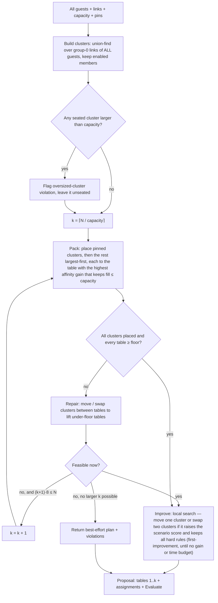

# 03 — Seating model: rules, scoring, auto-seating

The rules the seating code (`backend-go/internal/seating`, pure Go, no I/O) implements. Terms: [01-domain-glossary.md](01-domain-glossary.md).

## Inputs and outputs

- **Input:** all guests, each with an `enabled` flag; links (pair, level); and, per scenario, its capacity ∈ {9, 10, 11, 12}, current tables, assignments and pins.
- **Outputs:**
  - `Clusters(guests, links)` → clusters (all members, plus the enabled subset) + cluster affinities + data warnings.
  - `Evaluate(scenario state)` → per guest/table/scenario satisfaction, fill, violations, and **`needsRecalculation` = (at least one violation)**. Called on every scenario read and after every mutation.
  - `Propose(scenario state)` → a Proposal (tables + assignments + its evaluation). Writes nothing.
- **Generate** = `Propose` for all four scenarios in one request; the four runs are independent and differ only in capacity.

## Who counts

- **Clusters** are connected components of the group-0 graph over **all** guests, disabled ones included. Disabling the guest who wrote a family's group-0 list does not split the family.
- Only **enabled** members take seats, count towards fill and are scored. A cluster's *seated size* is its number of enabled members. A cluster with seated size 0 is ignored by Propose and Evaluate.
- **Affinity** is a relation between whole clusters. It is computed from the links of all members, disabled ones included: if any member of A has a level-1 (or level-2) link to any member of B, then A↔B has that level. If the data contains both levels between the same two clusters (should not happen), level 1 wins and a `conflicting_link_levels` data warning lists the guests involved. No other combining logic exists.

## Rules, in strict priority order

1. **Hard — cluster integrity:** all enabled members of a cluster sit at exactly one table.
2. **Hard — capacity:** fill (enabled guests) ≤ capacity.
3. **Fewest tables:** use the smallest feasible table count *k*.
4. **Hard — floor:** every table has ≥ 8 enabled guests (all four capacities; was 6 until 2026-10-03), unless the scenario has a single table. Fewest tables always beats satisfaction.
5. **Maximise satisfaction** (group 1 > group 2 > stranger). Evenness beyond the floor is *not* rewarded — "rebalance only as much as needed" falls out of rules 3–5: with 28 guests at capacity 12, 12 + 12 + 4 is infeasible (floor), so the optimiser picks among feasible splits (e.g. 12 + 8 + 8, 11 + 9 + 8, 10 + 10 + 8, 10 + 9 + 9) the one with the best satisfaction.
6. **Pins:** pinned clusters keep their table; the optimiser only moves unpinned clusters.

## Scoring

```
affinity(A, B) = the level of the links between members of A and members of B
                 (1 or 2; none if no link; strongest + data warning if inconsistent)
w(1) = 1.0, w(2) = 0.5, w(none) = 0

satisfaction(g) = Σ over ENABLED table-mates h with cluster(h) ≠ cluster(g) of w(affinity(cluster(g), cluster(h)))
table score     = Σ satisfaction(g) for g at the table
scenario score  = Σ table scores
```

Also reported per enabled guest for the UI: `preferredTotal` (enabled effective group-1 companions), `preferredAtTable`, `fallbackAtTable` (group-2 people at the table), `strangersAtTable`. The weights are fixed in code.

## Feasibility of table count k

With N enabled guests, capacity C, floor F = 8 (F = 0 when k = 1):

- necessary: `k·F ≤ N ≤ k·C` and every seated cluster size ≤ C;
- sufficient: the packing step below finds an assignment of clusters to k tables with every fill in [F, C].

k starts at `⌈N / C⌉` and increases until packing succeeds or `k·F > N`. If no k works (e.g. oversized cluster, or cluster sizes that cannot be split to satisfy the floor), Propose returns the best plan with the fewest violations, and the violations are listed — the UI shows them instead of failing.

**When the floor cannot be met (floor 8).** By head count alone, k tables hold between 8k and C·k guests (k ≥ 2), or 1–C guests at k = 1. With the small capacities this leaves gaps:

| Capacity | Enabled guests N with **no** feasible k | Feasible for every N ≥ |
|---|---|---|
| 9 | 10–15, 19–23, 28–31, 37–39, 46–47, 55 | 56 |
| 10 | 11–15, 21–23, 31 | 32 |
| 11 | 12–15, 23 | 24 |
| 12 | 13–15 | 16 |

At the expected ~85–100 guests every capacity is feasible by head count; infeasibility can still come from cluster sizes (e.g. big families that cannot be combined into fills of 8–C). Expected behaviour (as implemented by `Propose` / `Evaluate`, unchanged by the floor value):
- `Propose` tries k = ⌈N / C⌉, ⌈N / C⌉ + 1, … while (k + 1)·8 ≤ N; when no k packs, it returns the best-effort layout with the **fewest violations** among the tried ones, never an error. Example: 12 guests at capacity 9 → k = 2 is tried (3·8 > 12 stops the loop) → two tables from the greedy tries, whichever has fewer violations (e.g. 9 + 3 with one `under_floor`, rather than 6 + 6 with two). Backend tests pin the exact result.
- `Evaluate` reports `under_floor` for every table below 8 when the plan has more than one table; `needsRecalculation` is true. Accepting such a proposal is allowed (violations never block saving); the UI shows the violations.
- Plans stored before the floor change keep their tables; tables of 6–7 guests now show `under_floor`, so those plans show **Needs recalculation** until they are regenerated.

## Auto-seating algorithm (heuristic, deterministic)



*Legend:* functional core — every box is a pure function over in-memory data; no Strategy/Template pattern (one algorithm, capacity is a parameter). Determinism: clusters and tables are processed in a stable order (by smallest guest id), so the same input gives the same proposal (testable). Sized for ~85–100 guests: a time budget of 1 s per scenario (4 s for Generate) is ample on the Pi. The algorithm is a heuristic, not a proven optimum.

## Manual edits and violations

- A move or pin addressed to any guest applies to that guest's **whole cluster, disabled members included**. A split can only arise from link changes (e.g. a new group-0 link between guests at different tables) and then shows as a `cluster_split` violation; the next move of that cluster reunites it.
- Saving is never blocked by violations; they are returned in the evaluation and shown in the UI.
- **Toggle off:** nothing in the plans is written. The guest stops counting in fill and score but keeps the assignment. **Toggle on:** the guest **must** sit with their cluster, so they reappear at the cluster's table even when it is full. The resulting `over_capacity` violation sets `needsRecalculation`, and the UI shows "Przelicz / Generuj". If the guest had no assignment, they appear in the tray (`unseated_guests` → also `needsRecalculation`). **New guest:** unseated in all scenarios. None of these regenerates plans automatically.
- **Deleting a plan** (UC-17, `DELETE /scenarios/{capacity}/tables`) removes all its tables, assignments and pins in one transaction and bumps the version; nothing else is touched (guests, links, the other three plans). Evaluating the empty plan follows the normal rules: every enabled guest is unseated, so with at least one enabled guest it has one `unseated_guests` violation and `needsRecalculation = true` (with no enabled guest it has no violation). Generate then starts from scratch (no pins). A proposal generated before the delete carries the old `basedOnVersion`, so accepting it is a 409.
- **Accepting a proposal** for a scenario (version-checked) replaces its tables and assignments in one transaction. Proposals list enabled guests only; on accept, the server also assigns each cluster's disabled members to the same table so they ride along. Pinned clusters are already at their pinned table in the proposal and keep `pinned`. A cluster with no enabled member gets no assignment.
