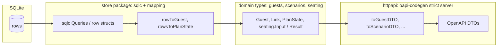

# 04 — Data model: rows → domain → DTOs, and the stores

How data crosses the three boundaries in the backend. Schema: [diagrams/002-erd.md](diagrams/002-erd.md) / `backend-go/db/migrations/`. Contract: [`docs/openapi.yaml`](../openapi.yaml). Terms: [01-domain-glossary.md](01-domain-glossary.md).



*Legend:* **DTO + Mapper** (PoEAA). Each boundary has exactly one mapping function per type, so nothing is duplicated (DRY).
- sqlc row structs never leave the store package.
- OpenAPI DTOs never enter services or `seating`.
- Mappers are plain functions, not mapper objects (KISS).
- Derived data (clusters, evaluation) is created in `seating` and mapped only on the HTTP side.

## 1. Domain types (Go, framework-agnostic)

These are what services and stores exchange. They hold no sqlc or oapi types. Field names are fixed here; package-level structure and method sets are finalised in the Phase 5 class diagram.

```go
// package guests
type Guest struct {
    ID        int64
    FirstName string
    LastName  *string   // nil = no surname
    Notes     string
    IsChild   bool
    Enabled   bool
    Version   int64
    CreatedAt time.Time
    UpdatedAt time.Time
}
func (g Guest) DisplayName() string // FirstName + " " + *LastName (if any)
func NameKey(first string, last *string) string // strings.ToLower(strings.TrimSpace(display name)); stored in name_key

type Link struct {           // undirected; constructor normalises A < B
    A, B  int64
    Level seating.LinkLevel   // 0, 1, 2
}
func (l Link) Key() string   // "A-B"

type ImportLink struct {     // link between guests that have no ids yet (CSV import)
    AIndex, BIndex int        // indexes into the imported []Guest
    Level          seating.LinkLevel
}

// package scenarios
type PlanState struct {      // one stored plan, as loaded for evaluation
    Version int64
    Plan    seating.Plan     // Capacity (9/10/11/12) + Tables (ordered 1..k) + Seats{Guest, Pinned}
}
```

`internal/seating` takes plain values (guests as id + enabled, links, `seating.Plan`) and returns a `Graph`, an `Evaluation` or a proposed `Plan`. The exact signatures are in [diagrams/003-backend-design.md](diagrams/003-backend-design.md) §2.

## 2. Mapping tables

### Guest

| DB column (`guest`) | sqlc type | Domain `guests.Guest` | DTO `Guest` | Rule |
|---|---|---|---|---|
| `id` | `int64` | `ID` | `id` | — |
| `first_name` | `string` | `FirstName` | `firstName` | Trimmed on write |
| `last_name` | `sql.NullString` | `LastName *string` | `lastName` (string or null) | Empty string on input → 422 (use null to clear) |
| `name_key` | `string` | — (computed by `NameKey` on write) | — | Not exposed; UNIQUE violation → `duplicate_name` (422) |
| — | — | `DisplayName()` | `displayName` | Derived |
| `notes` | `string` | `Notes` | `notes` | — |
| `is_child` | `int64` | `IsChild bool` | `isChild` | `!= 0` |
| `enabled` | `int64` | `Enabled bool` | `enabled` | `!= 0` |
| `version` | `int64` | `Version` | `version` | Bumped on every update |
| `created_at`, `updated_at` | `string` | `time.Time` | `createdAt`, `updatedAt` (date-time) | Parse/format RFC 3339 UTC |
| `guest_link` rows touching the guest | — | `[]Link` (loaded once for all guests) | `links: [{guestId, level}]` | The HTTP mapper projects each link onto both guests |

### Link

| DB (`guest_link`) | Domain `guests.Link` | DTO `GuestLink` |
|---|---|---|
| `guest_a_id`, `guest_b_id` | `A`, `B` (A < B) | `guestIds: [A, B]`, `key: "A-B"` |
| `level` | `Level` | `level` |

`linkKey` path parameter → parse `"x-y"`, reject `x == y` (422 `validation_failed`), normalise to `min-max`.

### Scenario / plan

| DB | Domain | DTO |
|---|---|---|
| `scenario.capacity`, `scenario.version` | `PlanState.Plan.Capacity`, `PlanState.Version` | `Scenario.capacity`, `.version` |
| `dining_table.number` | `seating.Table.Number` | `PlanTable.number` |
| `assignment.guest_id`, `.pinned` | `seating.Seat{Guest, Pinned}` | Grouped by cluster → `PlanTable.clusters[] (ClusterPlacement)` |
| — (derived by `seating.Evaluate`) | evaluation value | `SeatingPlan.summary`, `tables[].fill/score`, `unseated`, `guestScores`, `violations` |
| — (derived by `seating.Propose`) | proposal value | `Proposal { capacity, basedOnVersion = PlanState.Version, plan }` (returned by `POST /scenarios/calculate`; the SPA stores it at once via `PUT /scenarios`) |
| — (derived by `seating.Clusters`) | clusters + warnings | `ClusterOverview` |

`ClusterPlacement.guestIds` lists **enabled** members only. Disabled members keep their assignment rows but are invisible in plan DTOs (they are visible in `GET /guests` and `GET /clusters`).

### Requests → domain

| DTO | Domain / store call |
|---|---|
| `GuestCreate` | `guests.NewGuest` (defaults) → `GuestStore.Create` |
| `GuestUpdate` (partial, `version`) | load → apply non-nil fields → `GuestStore.Update(g, expectedVersion)` |
| `GuestBulkToggle` | `GuestStore.SetEnabled(ids, enabled)` |
| `GuestLinkUpsert` + `linkKey` | `guests.Link` → `GuestStore.UpsertLink` |
| CSV body (**deferred**) | `importcsv.Parse(io.Reader)` → rows + index links + report → dry run returns the report; commit → `GuestStore.ReplaceAll(newGuests, importLinks)` |
| `ScenariosReplace` (`PUT /scenarios`, task 007) | `fromScenariosReplace`: each `ScenarioLayout` → `scenarios.PlanInput{Capacity, BasedOn, Tables []seating.Table}` (one `Seat{Guest, Pinned: id ∈ pinnedGuestIds}` per listed guest) → `scenarios.Service.Replace` validates all four, spreads each pin to the whole cluster's seats, `seating.ExpandDisabled` → `ScenarioStore.ReplacePlans([]PlanReplace)` (ONE transaction) |
| `AssignmentSet` + guestId | service resolves the cluster's guest ids (all members) → `ScenarioStore.SeatCluster(capacity, guestIDs, tableNumber, pinned)` |
| DELETE assignment | `ScenarioStore.UnseatCluster(capacity, guestIDs)` |
| DELETE `/scenarios/{capacity}/tables` (delete plan, no body) | `ScenarioStore.ClearPlan(capacity)` |

### Domain errors → error envelope

| Domain sentinel (package `apperr` or per package) | HTTP | `code` |
|---|---|---|
| `ErrNotFound` | 404 | `not_found` |
| `ErrVersionConflict` | 409 | `version_conflict` |
| `ErrDuplicateName` (UNIQUE on `name_key`) | 422 | `duplicate_name` |
| validation error (field + message) | 422 | `validation_failed` |
| import with errors on commit | 422 | `import_invalid` (one `ErrorItem` per blocking problem, `field: "row N"`) |
| malformed JSON / bad path param | 400 | `bad_request` |
| body too large | 413 | `payload_too_large` |
| anything else | 500 | `internal_error` (logged with request id, **no guest data**) |

One shared helper in `httpapi` performs this mapping (DRY).

## 3. Stores (repository definitions)

Two concrete store types over sqlc in `internal/store` (`store.Guests`, `store.Scenarios`), one per aggregate root. The interfaces below are declared **in the consuming packages** (`guests.Store`, `scenarios.Store`, `scenarios.GuestSource`; see [diagrams/003-backend-design.md](diagrams/003-backend-design.md) §2), which Go needs to avoid a store↔domain import cycle. Every method is **one transaction**. Integration tests run them against a real SQLite file. The signatures below are the contract. Services may declare a narrower interface on the consumer side if they ever need a test seam (YAGNI otherwise; the DB is never mocked).

```go
// GuestStore — aggregate root: Guest (+ its links)
type GuestStore interface {
    List(ctx context.Context) ([]guests.Guest, []guests.Link, error)       // all guests ordered by name_key + all links
    Get(ctx context.Context, id int64) (guests.Guest, error)               // ErrNotFound
    Create(ctx context.Context, g guests.NewGuest) (guests.Guest, error)    // ErrDuplicateName
    Update(ctx context.Context, g guests.Guest, expectedVersion int64) (guests.Guest, error)
                                                                            // WHERE id=? AND version=?; 0 rows → ErrNotFound | ErrVersionConflict; version+1
    SetEnabled(ctx context.Context, ids []int64, enabled bool) ([]guests.Guest, error)
                                                                            // ErrNotFound if any id is missing (nothing changed); version+1 for changed rows
    Delete(ctx context.Context, id int64) error                             // cascades links + assignments
    UpsertLink(ctx context.Context, l guests.Link) (guests.Link, error)     // INSERT … ON CONFLICT(guest_a_id, guest_b_id) DO UPDATE SET level
    DeleteLink(ctx context.Context, a, b int64) error                       // ErrNotFound
    ReplaceAll(ctx context.Context, gs []guests.NewGuest, ls []guests.ImportLink) error   // DEFERRED (import)
                                                                            // import commit: delete assignments, tables, links, guests;
                                                                            // insert guests (ids assigned), resolve ImportLink indexes → ids,
                                                                            // insert links; bump all four scenario versions
}

// ScenarioStore — aggregate root: Scenario (+ tables, assignments)
type ScenarioStore interface {
    List(ctx context.Context) ([]scenarios.PlanState, error)               // always 4, ordered by capacity (9, 10, 11, 12)
    Get(ctx context.Context, capacity int) (scenarios.PlanState, error)
    ReplacePlans(ctx context.Context, ps []scenarios.PlanReplace) ([]scenarios.PlanState, error)
                                                                            // task 007, replaces ReplacePlan. ONE transaction for all given plans:
                                                                            // per plan: UPDATE scenario SET version = version+1 WHERE capacity=? AND version=?
                                                                            // (0 rows → roll back everything, ErrVersionConflict naming that capacity);
                                                                            // delete its tables (cascade) → insert tables 1..k + assignments(+pinned).
                                                                            // Returns the new states ordered by capacity.
    // type PlanReplace struct { Capacity int; ExpectedVersion int64; Plan seating.Plan }   (package scenarios)
    SeatCluster(ctx context.Context, capacity int, guestIDs []int64, tableNumber int, pinned bool) (scenarios.PlanState, error)
                                                                            // upsert assignment per guest; ErrNotFound if table missing; version+1
    UnseatCluster(ctx context.Context, capacity int, guestIDs []int64) (scenarios.PlanState, error) // delete assignments; version+1
    AddTable(ctx context.Context, capacity int) (scenarios.PlanState, error)                         // number = max+1; version+1
    RemoveTable(ctx context.Context, capacity int, number int) (scenarios.PlanState, error)
                                                                            // delete (cascade unseats) → renumber number>n down by 1; version+1
    ClearPlan(ctx context.Context, capacity int) (scenarios.PlanState, error)
                                                                            // delete plan: delete ALL its tables (existing query DeleteScenarioTables;
                                                                            // assignments + pins go by cascade) → version+1; no version check; ErrNotFound for an unknown capacity
}
```

Notes for implementers:
- Renumbering tables (`UPDATE dining_table SET number = number - 1 WHERE scenario_id = ? AND number > ?`) would collide with `UNIQUE (scenario_id, number)` mid-update in SQLite. Do it in two steps inside the transaction: `SET number = number + 1000 WHERE number > n`, then `SET number = number - 1001 WHERE number > 1000`. A negation trick would break `CHECK (number >= 1)`.
- `ReplaceAll`, `ReplacePlans` and `ClearPlan` are the only bulk deletes; everything else is a row-level upsert or delete. `ClearPlan` needs no new SQL and no migration: it reuses `DeleteScenarioTables` (also used per plan by `ReplacePlans`) and the `dining_table → assignment` cascade.
- Reads for a scenario response: the service loads `GuestStore.List` (guests + links) and `ScenarioStore.Get/List`, then calls `seating.Evaluate`. At ~100 guests that is a few small queries; there is no caching (YAGNI).

## Pattern evaluation (Phases 3–4)

| Candidate | Verdict | Why |
|---|---|---|
| REST over HTTP/JSON (Skill 8) | **adopted** | SPA ↔ one backend, same origin. GraphQL/gRPC add tooling for no gain; no push channel needed |
| CQS | **adopted** | Queries: `GET /guests`, `/clusters`, `/scenarios`, and `POST /scenarios/calculate` (a pure computation, POST only because it is expensive and not cacheable). Commands return the updated resource so the UI needs no extra round-trip. Generate = query (`calculate`) + command (`PUT /scenarios`), so calculate stays pure (task 007) |
| Repository | **adopted, 2 stores** | One per aggregate root (Guest, Scenario); sqlc stays inside |
| Unit of Work | rejected | Each store method is its own transaction. The two multi-aggregate writes are single store methods: import (`ReplaceAll`) and storing/undoing a Generate (`ReplacePlans`, four scenarios in one transaction, task 007) |
| DTO + Mapper | **adopted** | Plain functions per boundary |
| Optimistic Offline Lock | **adopted** | `version` on guest and scenario |
| Identity Map / caching | rejected | ~100 rows; reload per request |
| Bulk endpoints in general | rejected except toggle and `PUT /scenarios` | "Disable all children" needs bulk (`PATCH /guests`). Generate needs all four plans replaced atomically (a half-applied Generate is worse than none), hence `PUT /scenarios` (task 007), which also serves Cofnij. "Usuń wszystkie plany" stays four per-plan calls (each is safe alone) |
| Separate `/guest-links` list endpoint | rejected | Links are embedded in `Guest.links`, so the guest screen needs one call |
| Separate `GET /scenarios/{capacity}` | rejected | `GET /scenarios` returns all four (small payload); mutations return the single updated scenario |
