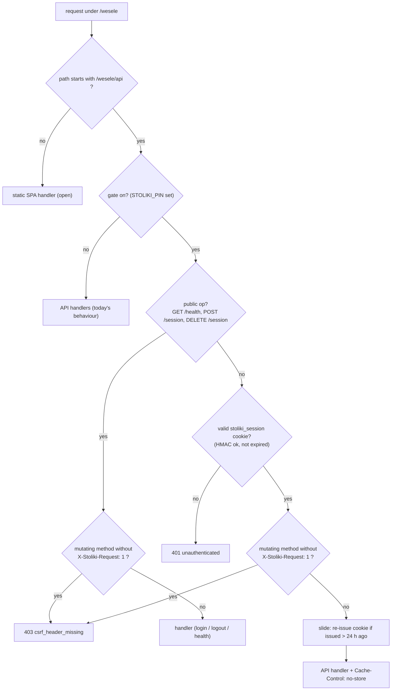

# 05 — Access gate (shared PIN) and public exposure

**Status (2026-10-03): live.** The gate is deployed with `STOLIKI_PIN` set in `infra/.env`, and the app is **publicly reachable through Tailscale Funnel** (option A of § 7) at `https://<pi-host>.<tailnet>.ts.net/wesele/`; the tailnet URL (`:8444`) and the home-LAN URL stay and go through the same gate. Verified after the change: unauthenticated `GET /wesele/api/guests` → 401, `GET /wesele/api/health` → 200, SPA shell open, and the login `Set-Cookie` carries `Secure` behind serve/funnel (so `X-Forwarded-Proto` arrives). **Not verified:** whether `X-Forwarded-For` reaches the server through serve/funnel. If it does not, every proxied client has the same throttle key (the loopback peer), so the per-client limit of § 4 acts as a second global limit: one attacker's failures also lock out the other users' new logins (existing sessions are unaffected). A short PIN is weak (§ 5); a longer one is a one-line change in `infra/.env` + restart, which logs everyone out. Decision record: ADR-001 § "Amendment (2026-10-03, task 009)".

Contract: [`docs/openapi.yaml`](../openapi.yaml) (`/session`, `securitySchemes.sessionCookie`, 401 on every protected operation, 403 on every state-changing one, 429 on login). Class level: [diagrams/003-backend-design.md](diagrams/003-backend-design.md) §7, [diagrams/003-frontend-design.md](diagrams/003-frontend-design.md) §10. Flows: [diagrams/003-sequences.md](diagrams/003-sequences.md) §6. States: [diagrams/001-state-machine.md](diagrams/001-state-machine.md) §5.

> **The PIN is a secret.** Its value lives only in `infra/.env` (gitignored) as `STOLIKI_PIN`. It never appears in code, tests, docs, examples, logs, commit messages or `.env.example` (which carries a placeholder). Docs and tests use `<PIN>` or obviously fake values.

## 1. What is protected, what is open

One gate, **the same everywhere**: tailnet, home LAN and the public internet (Funnel) all go through the same Go middleware. There is no "trusted network" exception (user decision 2026-10-03: one code path).

| Route (all under `BASE_PATH=/wesele`) | Gate on | Why |
|---|---|---|
| `GET /wesele/api/health` | **open** | compose healthcheck; returns only `{status: ok}` |
| `POST /wesele/api/session` (login) | **open** (CSRF header required) | the way in; throttled |
| `DELETE /wesele/api/session` (logout) | **open** (CSRF header required) | always able to clear the cookie |
| every other `/wesele/api/*`, every method (incl. `GET /session`) | **cookie required** → 401 `unauthenticated` | all guest data and every command |
| `/wesele`, `/wesele/` and static SPA files `/wesele/*` (JS, CSS, `index.html` fallback, `/wesele/druk/...`) | **open** | the built SPA contains no personal data; every screen (incl. the print view) gets its data from the API. The PIN screen is part of this shell |

So the gate is **API-only**. Putting it in front of the static handler as well would gain nothing (no data there) and would need a server-rendered login page instead of the SPA's PIN screen.

*Legend:* one chi middleware (**Decorator**, like the existing request-id/log/body-limit ones) on the API sub-router only. Order inside the API router: `RequestID → recoverer → requestLog → gate → bodyLimit → strict handlers`, so 401/403 are logged with their status like any response. The session check comes before the CSRF check so a logged-out SPA always sees 401 (→ PIN screen), never 403.

## 2. Configuration and the mode switch

| Variable | Effect |
|---|---|
| `STOLIKI_PIN` **unset or empty** | **Gate off** — today's behaviour exactly (no 401/403/429, no cookie, `GET /session` → `pinRequired: false`). The server logs one `WARN access gate off (STOLIKI_PIN not set)` line at start. Used by dev runs and by the existing tests. (Empty = unset, matching how `loadConfig` already reads every variable.) |
| `STOLIKI_PIN` non-empty | **Gate on.** Any length and charset; compared byte-for-byte (no trimming, no normalisation). |

- **The deployed instance can never run open:** `infra/compose.yml` passes `STOLIKI_PIN: ${STOLIKI_PIN:?set STOLIKI_PIN in infra/.env}`, so `docker compose up` itself fails when the variable is missing **or empty**. This is the "public mode refuses to start without a PIN" guard, with no extra server variable (YAGNI). Side effect: every `docker compose -f infra/compose.yml …` command (ps, logs, exec, down, `infra/backup.sh`) needs `infra/.env` to define it — which it always does after C1.
- At start the server keeps only `pinDigest = SHA-256(pin)` and drops the string; it is never logged, echoed in errors, or written anywhere.
- **Session key:** a per-install random secret, 32 bytes from `crypto/rand`, in the file `session.key` next to the database (`/data/session.key`, i.e. `filepath.Dir(DB_PATH)`, mode 0600, created on first start if missing). Not a new env var. Not included in `VACUUM INTO` backups (it does not need to be: losing it only logs everyone out). The HMAC key is derived: `key = HMAC-SHA256(secret, "stoliki-session-v1" || pinDigest)` — so **changing `STOLIKI_PIN` and restarting logs out every device**, and so does deleting `session.key`.
- *Rejected:* a random per-start key (simpler by a few lines, but every redeploy would log out all devices — redeploys are frequent); storing sessions in SQLite (a table + migration for no benefit, YAGNI).
- **Recommendation to the user (not enforced):** a longer PIN is a one-line change in `infra/.env` (`STOLIKI_PIN` accepts any length/charset) plus a restart. See § 5.

## 3. Session cookie

| Attribute | Value |
|---|---|
| Name | `stoliki_session` (no `__Host-` prefix: it requires `Path=/`) |
| Value | `base64url(payload) "." base64url(HMAC-SHA256(key, payload))`, payload = `v1|<issuedAt unix>|<expiresAt unix>` |
| `Path` | `BASE_PATH` (`/wesele`) — not sent to other apps on the same host (`/sibling-a`, `/sibling-b`, `/`) |
| `HttpOnly` | always |
| `SameSite` | `Lax` |
| `Secure` | **only when the request came over HTTPS**: `r.TLS != nil` or `X-Forwarded-Proto: https` (set by `tailscale serve`/`funnel` — verified 2026-10-03: logins over the HTTPS URLs get `Secure`). Plain-HTTP LAN requests (`http://<pi-lan-ip>:8094`) get no `Secure`, otherwise browsers would drop the cookie and the LAN could never log in. Spoofing the header only adds `Secure` to the spoofer's own cookie, so trusting it is harmless. |
| `Max-Age` | 30 days (2 592 000 s) |
| Sliding | on any authenticated API request whose token was issued more than 24 h ago, the gate re-issues the cookie with a fresh 30-day expiry (at most one `Set-Cookie` per device per day) |
| Verification | `hmac.Equal` on the MAC, then `expiresAt > now`. Bad format, bad MAC, expired → treated as "no cookie" (401). No server-side session store. |
| Logout | `DELETE /session` → `Set-Cookie: stoliki_session=; Path=/wesele; Max-Age=0; HttpOnly; SameSite=Lax`. Stateless: a copied cookie stays valid until it expires; "log out everywhere" = change the PIN (or delete `session.key`) and restart. |

Cookies are not port-isolated: the tailnet URL (`:8444`) and a public URL on the same hostname share the cookie (same app, same key — fine). The LAN URL is a different host, so it logs in separately.

**CSRF:** `SameSite=Lax` keeps the cookie off cross-site subrequests (`fetch`, form `POST`, images), and every POST/PUT/PATCH/DELETE must also carry `X-Stoliki-Request: 1` (403 `csrf_header_missing` otherwise). A cross-site page cannot add a custom header without a CORS preflight, which the server never approves (no CORS headers at all). The rule also covers `POST /session` and `DELETE /session` (blocks login/logout CSRF). Only while the gate is on. *Rejected:* synchronizer tokens / double-submit cookies (YAGNI given SameSite + custom header).

**Other response hygiene (gate on):** gated API responses carry `Cache-Control: no-store`, so no browser or proxy cache keeps guest data. `X-Robots-Tag: noindex` stays on everything.

## 4. Login throttling (in memory)

The PIN space may be tiny, so the real protection is the attempt budget, not the PIN. Two limits, both in memory (a restart clears them; an attacker cannot trigger a restart):

| Limit | Parameter | Value |
|---|---|---|
| **Per client** (key: rightmost `X-Forwarded-For` entry if present, else the TCP peer IP — not yet verified that serve/funnel sends the header; see Status) | free failures | 3 |
| | lock after failure *n* ≥ 4 | 30 s × 2^(n−4), capped at **1 h** (30 s, 1 min, 2 min, 4 min, … 1 h) |
| | forget the client | 24 h after its last failure, or on its successful login |
| | table size | at most 4096 clients; when full, expired entries are pruned; if still full, unknown clients are refused (429, fail closed) |
| **Global** (all clients together) | failures in a rolling 24 h window | **20**; when reached, **every** login attempt is refused until the oldest failure leaves the window. A successful login does **not** reset it. |

Rules that keep the throttle from leaking anything:

- **When locked (client or global) the PIN is not evaluated at all.** The response is 429 `too_many_attempts` with `Retry-After: <seconds>` (the longer of the two locks), identical for a right and a wrong PIN, so a lock never confirms a guess. Refused attempts do not count as failures.
- When not locked, the PIN is checked with `subtle.ConstantTimeCompare(SHA-256(input), pinDigest)` (fixed-length digests: no timing or length leak). Wrong → 401 `invalid_pin`, one generic message, no "attempts left". The attempt that crosses a threshold still answers 401; the *next* one gets 429.
- Empty `pin` (or > 128 chars, or an unparseable body) → 422/400 before the throttle: not counted, not evaluated.
- Logs: `INFO login ok`, `INFO login failed client_failures=<n>`, `WARN login lock client_lock_s=<s>` / `WARN login lock global`. Never the PIN, never the attempted value, never the client IP (personal data); counts only.

**What this buys:** at most 20 wrong guesses per day from the whole internet, i.e. ≤ 600 in 30 days. For a PIN drawn uniformly from 10 000 four-digit values that is ≤ 0.2 % per day and ≤ 6 % per month for a patient distributed attacker (≤ 18 % over three months). A single IP is down to ~1 guess per hour after ~10 failures.
**What it costs:** an attacker who burns the global budget blocks *new* logins for up to 24 h. Devices that already hold a cookie keep working (sessions are not affected by the throttle), and a container restart clears the counters. Accepted for a one-wedding app; if it ever bites, the fix is a longer PIN (which makes the global limit unnecessary), not a smarter limiter.
*Rejected:* storing attempts in SQLite (survives restarts, but needs a table and migration — YAGNI); CAPTCHA (third-party or heavy); per-IP only (a botnet or a shared Funnel source would make it worthless).

## 5. Threat model

| Threat | Covered? | How / why not |
|---|---|---|
| Stranger on the internet reads or edits guest data | **yes** | every data operation needs a valid signed cookie; the only open endpoints return no personal data |
| Online brute force of the PIN | **mostly** | throttle § 4 bounds guessing to ≤ 20/day globally; constant-time compare; no difference between "wrong" and "locked" that reveals the PIN |
| **Common / guessable PIN** | **no** | throttling limits the *number* of guesses, not their *order*. Attackers try the most common PINs first (sequences, repeated digits, years), so a PIN from that short list can fall within the first handful of attempts, before any limit matters. **Weak-PIN caveat: with a 4-digit PIN the gate keeps out casual visitors and scanners, not a targeted guesser.** Recommendation to the user: a random 6–8 digit PIN or a short passphrase (one line in `infra/.env`; the PIN screen and the server already accept it). |
| Forged or modified cookie | yes | HMAC-SHA256 with a 256-bit per-install secret; expiry inside the signed payload |
| Cookie theft (XSS) | mitigated | `HttpOnly`; the SPA renders guest text as React text nodes (no `dangerouslySetInnerHTML`) |
| Cookie sniffing | **partly** | HTTPS on the tailnet and Funnel (`Secure` set). **The home-LAN URL is plain HTTP**: anyone on the home Wi-Fi who sniffs traffic can copy the cookie or see the PIN being typed. Accepted (home network, user decision: PIN on the LAN too); prefer the HTTPS URL on shared networks |
| Stolen/forgotten logged-in device | partly | cookie valid up to 30 days (sliding). "Wyloguj" logs out that browser; changing the PIN + restart logs out everyone |
| CSRF (a malicious site making the browser edit plans) | yes | `SameSite=Lax` + required `X-Stoliki-Request` header on every state-changing request; no CORS |
| Discovery / indexing | partly | Tailscale HTTPS certificates appear in public Certificate Transparency logs, so the hostname *will* be found by scanners. They get the SPA shell and a PIN screen; `X-Robots-Tag: noindex` keeps it out of search engines. Guest names are never in the shell |
| Lockout DoS by an attacker | no (accepted) | see § 4 "What it costs" |
| Logs leaking data | yes | ids/counts only, never PIN, attempt values, IPs, bodies or guest names (existing rule, extended) |
| Per-person accountability | no | one shared PIN: everyone with it can edit everything (same as today) |

## 6. Frontend flow (summary)

Details: [diagrams/003-frontend-design.md](diagrams/003-frontend-design.md) §10, states [001-state-machine.md](diagrams/001-state-machine.md) §5.

- At start the root route renders `AccessGate`, which asks `GET /session` once. 200 → the app (Layout, tabs, pages) renders as today; `pinRequired: true` also shows **"Wyloguj"** in the header. 401 → the full-screen **PIN screen** ("Podaj PIN").
- **Any 401** from any query or mutation (except the login itself) puts the app back to the PIN screen: the global `QueryCache`/`MutationCache` `onError` sets the session state to `pinRequired` and removes every other cached query (no guest data stays in memory behind the PIN screen). The URL is not touched, so after the correct PIN the user is on the same route and the queries refetch.
- PIN screen: one large password field with `inputMode="numeric"`, "Wejdź" button, Enter submits. Wrong → "Zły PIN" (field cleared, focus kept). 429 → "Za dużo prób — spróbuj za chwilę" and the button stays disabled for `Retry-After` seconds. Other errors → the generic error copy. The PIN is never stored client-side.
- "Wyloguj" → `DELETE /session` → clear the whole query cache → PIN screen.
- The API client sends `X-Stoliki-Request: 1` on **every** request (harmless when the gate is off).

## 7. Public exposure via Tailscale Funnel

**Live (2026-10-03): option A.** The user ran `sudo tailscale funnel --bg --https=443 --set-path /wesele http://127.0.0.1:8094/wesele`. Resulting Tailscale config:

| Listener | Funnel | Handlers |
|---|---|---|
| `:443` | **on** (public) | `/` → `localhost:80` (investing-app, unchanged); **`/wesele` → `http://127.0.0.1:8094/wesele`** (Stoliki, new) |
| `:8443` | on | → `localhost:8123` (another app, untouched) |
| `:8444` | off (tailnet only) | `/wesele` → `http://127.0.0.1:8094/wesele` (Stoliki, kept) |

Public URL: `https://<pi-host>.<tailnet>.ts.net/wesele/`. Tailnet URL: `https://<pi-host>.<tailnet>.ts.net:8444/wesele/`. LAN URL: `http://<pi-lan-ip>:8094/wesele/`.

**Rollback (removes only the public handler; the tailnet and LAN URLs keep working):** `sudo tailscale funnel --https=443 --set-path /wesele off`. Never `tailscale serve reset` / `funnel reset`, never `--https=443` without `--set-path` (that would replace investing-app's `/` handler); check `tailscale serve status` and `tailscale funnel status` before and after.

The rest of this section is the option analysis made before the change.

**Facts (from the docs, not re-checked with any `tailscale` command in phase A):**
- Funnel can only listen on **443, 8443 and 10000**, and is switched on **per listener port**.
- `:443` is already **funnelled**: `/ → http://localhost:80` (investing-app's edge Nginx, which also serves `/sibling-a` and `/sibling-b`; `tailscale serve status` lists `/`, `/sibling-a/`, `/sibling-b/` on that listener — DevOps confirms which of those are Tailscale handlers vs Nginx locations).
- `:8443` is **taken**: `:8443 → http://localhost:8123` (another app; whether that listener is funnelled is not recorded — check).
- `:10000`: not used, per the docs.
- Stoliki today: `tailscale serve --https=8444 --set-path /wesele http://127.0.0.1:8094/wesele`, tailnet-only. **8444 cannot be funnelled.**

**Options:**

| Option | Public URL | Effect on other apps | Verdict |
|---|---|---|---|
| **A. Add a `/wesele` handler to the already-funnelled `:443` listener:** `sudo tailscale funnel --bg --https=443 --set-path /wesele http://127.0.0.1:8094/wesele` | `https://<pi-host>.<tailnet>.ts.net/wesele/` | none intended: `:443` is already public; Tailscale picks the longest matching mount, so only `/wesele…` changes owner (today those paths fall through to investing-app's Nginx — DevOps checks first that it serves nothing there). No change in the investing-app repo. Edits the shared `:443` serve config **additively** | **recommended** (least invasive: no new public port, nobody's exposure changes, clean URL) |
| B. New funnelled listener `:10000`: `sudo tailscale funnel --bg --https=10000 --set-path /wesele http://127.0.0.1:8094/wesele` | `https://<pi-host>.<tailnet>.ts.net:10000/wesele/` | does not touch any existing listener | fallback if the user prefers not to touch `:443` at all; opens one more public port; odd URL; some mobile/office networks block non-standard ports |
| C. `:8443` (the example in the task file) | — | **rejected**: the port already maps to `localhost:8123`; adding a funnelled `/wesele` there would make that listener public, **exposing the other app on 8123** if it is not funnelled already | rejected |
| D. A `/wesele` location in investing-app's edge Nginx | `https://…/wesele/` | cross-repo change in `../investing-app` | rejected unless the user asks for it (AGENTS.md: do not touch that repo without asking) |

In all options the **`:8444` tailnet mapping stays** (same app, same gate; removing it would be one more shared-config change for no gain) and the LAN URL stays. The Go side needs nothing per option: the target keeps the `/wesele` suffix exactly as the verified `:8444` mapping does.

**C2 procedure (DevOps, after the user's explicit yes):** confirm the CLI syntax with `tailscale funnel --help` (read-only); save `tailscale serve status --json` and `tailscale funnel status` to a file; run the one chosen command (never `reset`, never `--https=443` without `--set-path`); diff status before/after — exactly one new handler (`/wesele` on the chosen port) and nothing else changed; `/`, `/sibling-a/`, `/sibling-b/`, `:8443` still answer as before; from outside the tailnet (phone on mobile data): `/wesele/` shows the PIN screen, `GET /wesele/api/guests` → 401, `GET /wesele/api/health` → 200. **Undo:** `sudo tailscale funnel --https=<port> --set-path /wesele off` (removes only that handler — verify the exact syntax in `--help` first).

**User decisions (2026-10-03):** option **A**; keep the `:8444` tailnet mapping; keep the 4-character PIN for now (the weak-PIN caveat of § 5 stands; a longer PIN remains recommended); go public.

## 8. Pattern evaluation

| Candidate | Verdict | Why |
|---|---|---|
| Middleware (Decorator over `http.Handler`) for the gate | **adopted** | Same mechanism as the existing request-id/log/body-limit middleware; one place enforces the rule for every route |
| Intercepting Filter / Chain of Responsibility (separate CSRF, session, throttle filters) | rejected | One middleware with three small checks is clearer than a filter chain for three rules |
| Strategy for auth methods (PIN / Tailscale identity / accounts) | rejected | One method. Tailscale identity headers would not work over Funnel anyway |
| Server-side session store (Repository + table) | rejected | Signed stateless cookie is enough; logout-everywhere = change the PIN |
| Proxy / Facade around `tailscale` | n/a | Exposure is infra config, no code |
| Global error interceptor in the SPA (TanStack `QueryCache`/`MutationCache` `onError`) | **adopted** | Built-in hook: one place maps any 401 to the PIN screen, no custom event bus (Observer rejected as a separate construct) |
| Client auth store (Zustand / context reducer) | rejected | The session state is one TanStack query (`keys.session`), like every other piece of server state |
