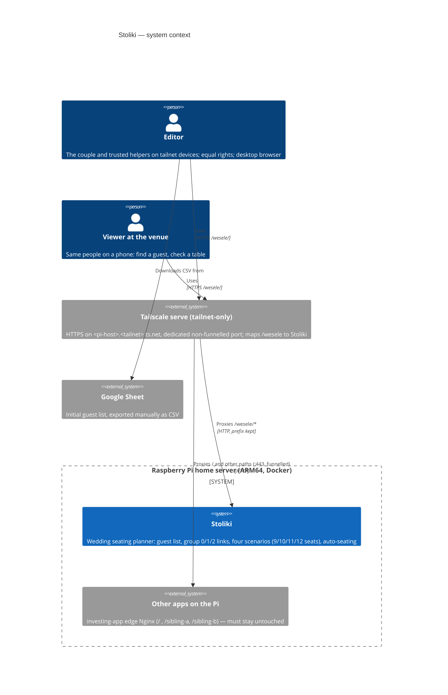
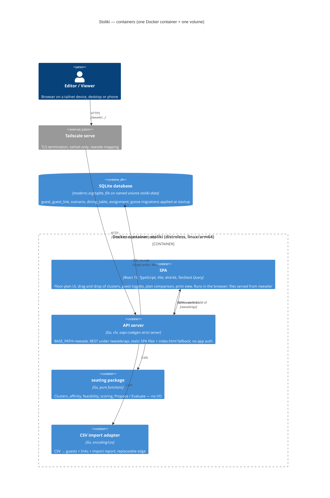
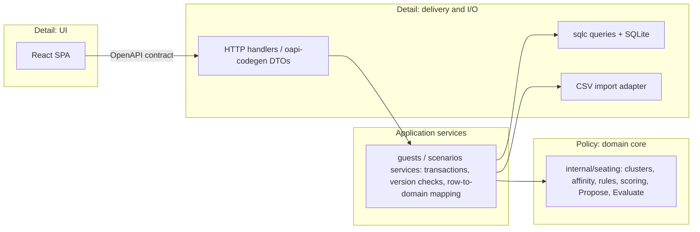

# 001 — C4: system context and containers

Task 001, Phase 2 (Skill 6). Policy vs detail boundaries for Stoliki. Prose and rules: [../02-system-context.md](../02-system-context.md).

## Level 1 — System context

*Legend:* `System` is what we build; `System_Ext` is existing or external and not changed by Stoliki. The CSV travels through the Editor's browser as an upload. There is **no** server-to-Google connection (cost-free, no OAuth). The Tailscale config is shared with other apps; only a `/wesele` serve mapping on Stoliki's own non-funnelled port is added. Tailnet membership is the only access control.

**Task 009 (designed 2026-10-03, not live until phase C1/C2):** a shared-PIN access gate inside the Go container protects the whole API on every network (tailnet, home LAN and, after the user confirms, the public internet through Tailscale Funnel). Context changes then: the Editor may be anywhere on the internet with the PIN, and an anonymous internet visitor can reach only the SPA shell, the PIN screen, `GET /health` and the throttled login. Design: [../05-access-gate.md](../05-access-gate.md).

## Level 2 — Containers

*Legend:* boxes inside the container boundary are logical parts of **one** process/image (the SPA executes in the browser but ships inside the same image). Arrows show the only allowed dependency directions.

## Policy vs detail

*Legend — principles applied:*
- **Dependency rule / functional core, imperative shell:** dependencies point inward to `internal/seating`, which imports nothing from HTTP, SQL or CSV and works on plain Go values. Services do the I/O around it.
- **Layered (handler → service → sqlc):** chosen over full hexagonal — YAGNI; no interfaces for single implementations.
- **Adapter** only at the import edge (CSV now; a Sheets API source could replace it).
- **DTO + mapper boundary:** sqlc rows never cross into handlers; OpenAPI DTOs never enter `seating`.
- **Rejected:** a separate Nginx container (one Go binary serves SPA + API), a separate DB container (SQLite), auth middleware (tailnet-only today; task 009 adds the PIN gate before any public exposure, see 05-access-gate.md), Strategy for algorithms (only one), Observer/live push (few editors).
