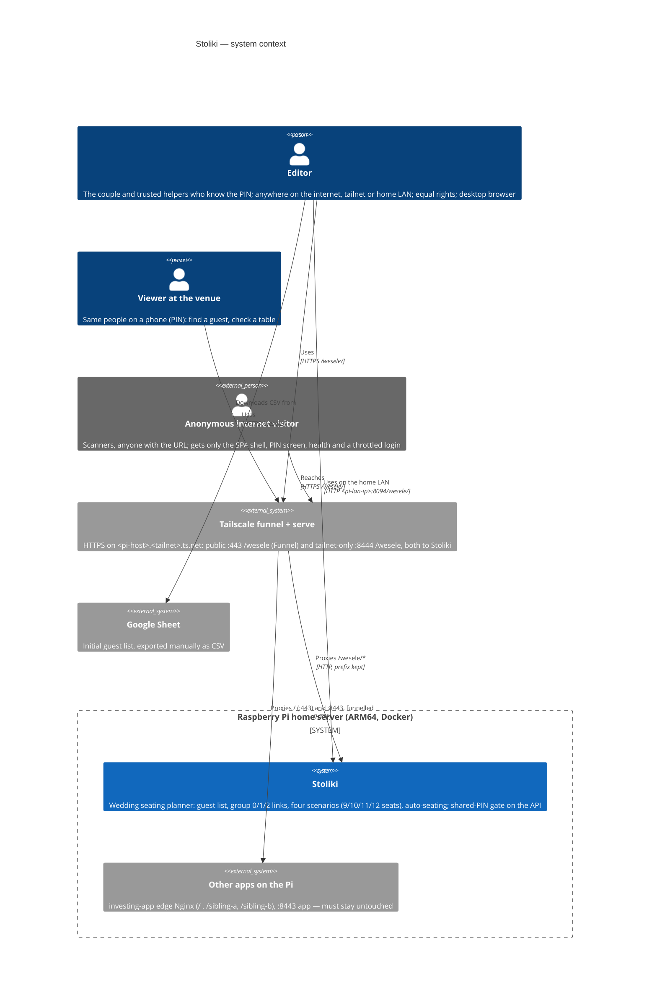
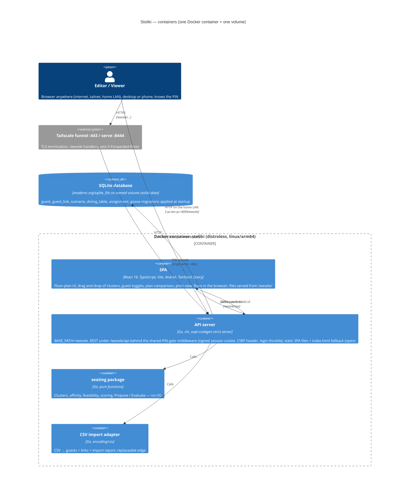
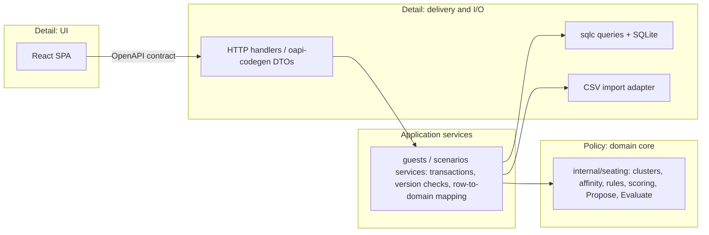

# 001 — C4: system context and containers

Task 001, Phase 2 (Skill 6). Policy vs detail boundaries for Stoliki. Prose and rules: [../02-system-context.md](../02-system-context.md).

## Level 1 — System context

*Legend:* `System` is what we build; `System_Ext` is existing or external and not changed by Stoliki. The CSV travels through the Editor's browser as an upload. There is **no** server-to-Google connection (cost-free, no OAuth). The Tailscale config is shared with other apps; Stoliki owns only two `/wesele` handlers: one on the funnelled `:443` listener (public, `https://<pi-host>.<tailnet>.ts.net/wesele/`) and one on its own tailnet-only `:8444` listener. **Access control is the shared-PIN gate inside the Go container** (live since 2026-10-03, task 009), identical on all three routes (Funnel, tailnet, home LAN): without the PIN cookie a visitor reaches only the SPA shell, the PIN screen, `GET /health` and the throttled login. Design: [../05-access-gate.md](../05-access-gate.md).

## Level 2 — Containers

*Legend:* boxes inside the container boundary are logical parts of **one** process/image (the SPA executes in the browser but ships inside the same image). Arrows show the only allowed dependency directions.

## Policy vs detail

*Legend — principles applied:*
- **Dependency rule / functional core, imperative shell:** dependencies point inward to `internal/seating`, which imports nothing from HTTP, SQL or CSV and works on plain Go values. Services do the I/O around it.
- **Layered (handler → service → sqlc):** chosen over full hexagonal — YAGNI; no interfaces for single implementations.
- **Access gate as one middleware (Decorator)** on the API sub-router, in the HTTP detail layer; the core and services know nothing about sessions.
- **Adapter** only at the import edge (CSV now; a Sheets API source could replace it).
- **DTO + mapper boundary:** sqlc rows never cross into handlers; OpenAPI DTOs never enter `seating`.
- **Rejected:** a separate Nginx container (one Go binary serves SPA + API), a separate DB container (SQLite), Strategy for algorithms (only one), Observer/live push (few editors).
