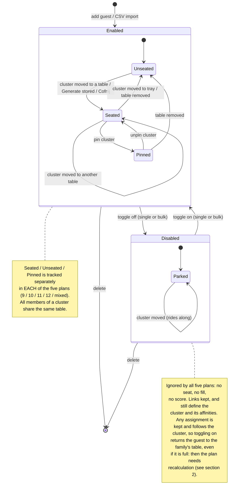
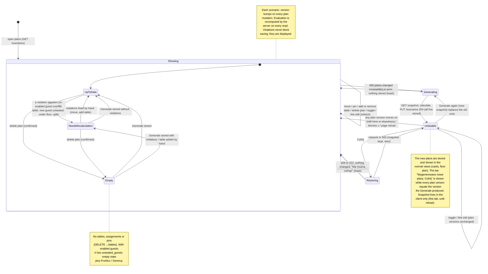
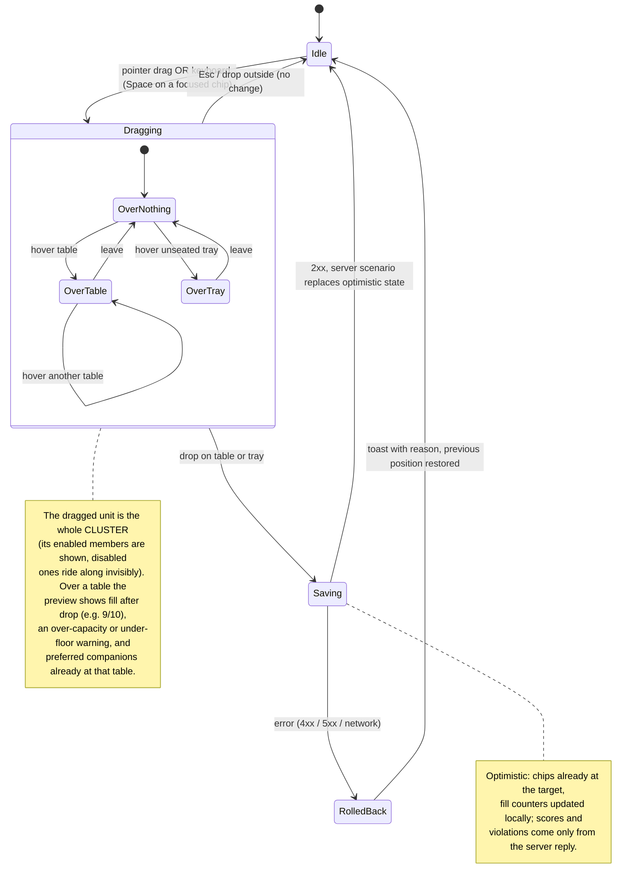
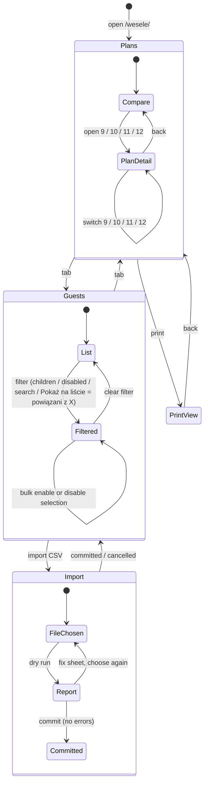
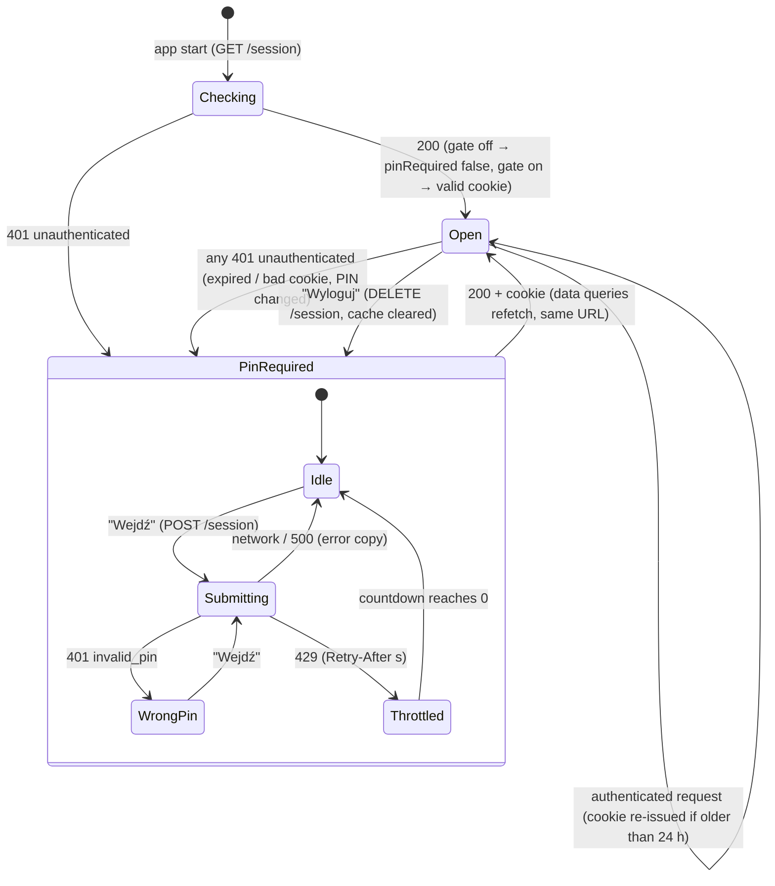
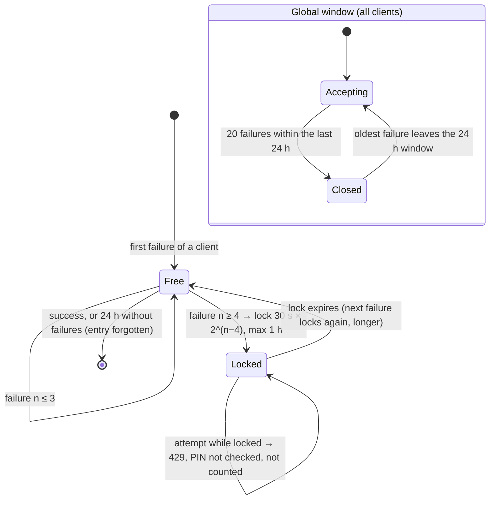
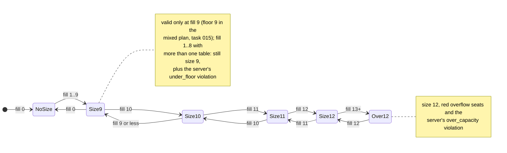

# 001 — State machines (domain lifecycles + UI interaction)

Task 001, Phase 2 (Skill 7); updated 2026-10-02 with the user's answers (enabled toggle, generate-all-three, no login); updated 2026-10-03 for four table sizes 9/10/11/12 (task 006) for Generate storing at once + Cofnij (task 007) and for the mixed plan's table sizes (task 013, §6). Terms: [../01-domain-glossary.md](../01-domain-glossary.md). Rules: [../03-seating-model.md](../03-seating-model.md).

Contents:
1. [Guest lifecycle](#1-guest-lifecycle) (domain)
2. [Plans: generate (stored at once), Cofnij](#2-plans-generate-stored-at-once-cofnij) (domain + UI)
3. [Cluster drag & drop](#3-cluster-drag--drop-ui) (UI)
4. [App shell and screens](#4-app-shell-and-screens) (UI)
5. [Access gate](#5-access-gate-session-client-view-and-login-throttle-server-view--task-009) (UI + server)
6. [Mixed plan: table size follows the fill](#6-mixed-plan-table-size-follows-the-fill-task-013) (domain, derived on the client)

## 1. Guest lifecycle

*Legend:* Guest is the aggregate root of the guest list. The seating sub-state is the guest's Assignment in one scenario. One `enabled` flag replaces an attending/declined status (one switch, no extra state). Store-only-input rule: toggling writes one column and re-derives everything else. No undo stack (Command/Memento rejected as patterns): every transition has an inverse; the only undo is the one-step Cofnij of a Generate (§2).

## 2. Plans: generate (stored at once), Cofnij

*Legend:* the five Scenarios (9, 10, 11, 12, mixed; task 013) are aggregate roots with an **Optimistic Offline Lock** (`version`). `UpToDate` / `NeedsRecalculation` / `Empty` (inside `Showing`, and equally inside `Undoable`) are tracked per plan and derived by the server (`summary.needsRecalculation` = any violation); `Empty` is a display state (`tableCount = 0`). There is never an automatic regeneration. Generate always produces and stores all five plans, **atomically** (`PUT /scenarios`: all five or none), with no preview and no confirmation (user decision 2026-10-03, task 007). `Undoable` is a client-side state: it holds a one-slot snapshot of the five plans as they were before the Generate; **Cofnij** re-sends it through the same atomic, version-checked call, so it fails cleanly (409, nothing changed) if any plan was edited after the Generate. **Delete plan** (UC-17) has no undo; a confirmation dialog stands in for it.

## 3. Cluster drag & drop (UI)

*Legend:* `@dnd-kit/core` with pointer and keyboard sensors and screen-reader announcements. Warnings use an icon plus text, never colour alone. A drop on a full table is allowed and shown as a violation: the plan is a draft, not a validator. A TanStack Query optimistic mutation with rollback implements `Saving/RolledBack`.

## 4. App shell and screens

*Legend:* the access gate (task 009) wraps this whole machine — see §5; with the gate off there is no login state.
- `Compare` shows the five plans side by side (2 per row on tablets, 3 + 2 on laptops, 5 across on wide screens; mixed last; task 013): table count, fill bars, satisfaction and violation count, plus the **Generate** button.
- `PlanDetail` is the floor plan of one plan, with the unseated tray, guest search and a details panel showing where a guest's preferred companions sit, with "via group 0 of X" provenance.
- `Guests` is the editable list. It has per-row enable switches, a child marker, the relationships panel with per-group link checklists, and data warnings ([003-frontend-design.md](003-frontend-design.md) §5).

On a phone, `Compare`, `PlanDetail` (read-mostly, search) and `PrintView` must be usable.

## 5. Access gate: session (client view) and login throttle (server view) — task 009

Rules: [../05-access-gate.md](../05-access-gate.md). Flows: [003-sequences.md](003-sequences.md) §6.

*Legend:* client states of `AccessGate` (`keys.session`). `Open` contains the whole app shell of §4. Leaving `Open` always drops cached guest data. `Throttled` disables the button; it does not reveal whether the last PIN was right (the server did not check it).

*Legend:* server-side, in memory, reset by a restart. A client is refused when **either** its own state is `Locked` **or** the global window is `Closed`; `Retry-After` is the longer of the two. A success clears only that client's entry, never the global window.

## 6. Mixed plan: table size follows the fill (task 013)

Rule: [../03-seating-model.md](../03-seating-model.md) § The mixed plan; client functions `tableSize` / `tablesNeeded` in [003-frontend-design.md](003-frontend-design.md) §13.

*Legend:* the size of one **mixed-plan** table (seats the venue must provide) as a function of its live fill. Moves can jump several states at once (a cluster of 3 takes 9 → 12); the size is always `min{s ∈ 9..12 : s ≥ fill}` (12 above 12), `NoSize` for an empty table. It follows every optimistic move at once, because `applyMove` recomputes `fill`. For a valid mixed table (9–12 guests, task 015) the size equals the fill. In a uniform plan the size is constant (`capacity`) for every non-empty table. A pure function of server data, never stored and not a State pattern; violations and scores still come from the server.
