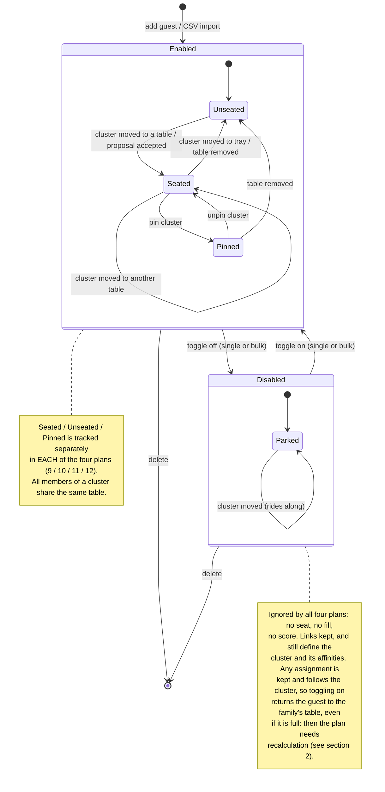
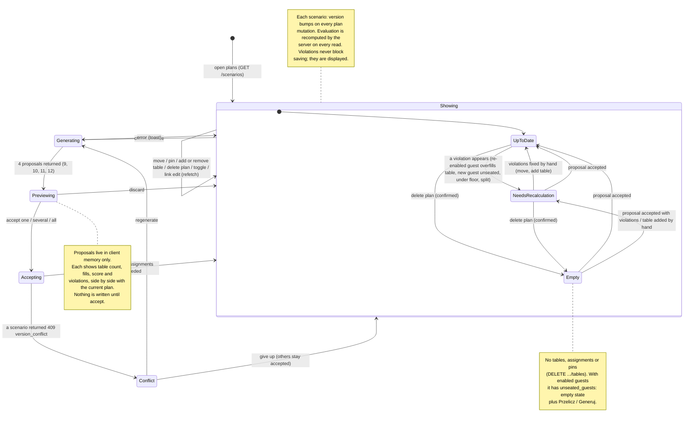
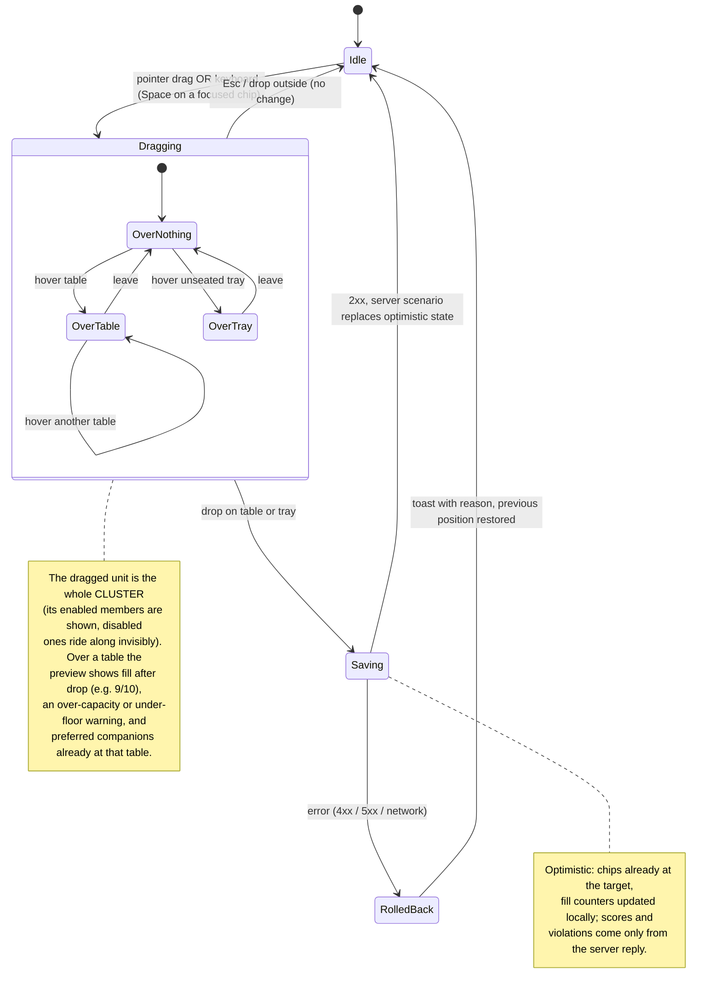
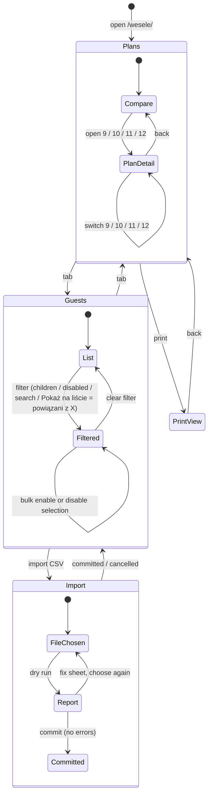

# 001 — State machines (domain lifecycles + UI interaction)

Task 001, Phase 2 (Skill 7); updated 2026-10-02 with the user's answers (enabled toggle, generate-all-three, no login); updated 2026-10-03 for four table sizes 9/10/11/12 (task 006). Terms: [../01-domain-glossary.md](../01-domain-glossary.md). Rules: [../03-seating-model.md](../03-seating-model.md).

Contents:
1. [Guest lifecycle](#1-guest-lifecycle) (domain)
2. [Plans: generate, preview, accept](#2-plans-generate-preview-accept) (domain + UI)
3. [Cluster drag & drop](#3-cluster-drag--drop-ui) (UI)
4. [App shell and screens](#4-app-shell-and-screens) (UI)

## 1. Guest lifecycle

*Legend:* Guest is the aggregate root of the guest list. The seating sub-state is the guest's Assignment in one scenario. One `enabled` flag replaces an attending/declined status (one switch, no extra state). Store-only-input rule: toggling writes one column and re-derives everything else. No undo stack (Command/Memento rejected): every transition has an inverse.

## 2. Plans: generate, preview, accept

*Legend:* the four Scenarios are aggregate roots with an **Optimistic Offline Lock** (`version`). `UpToDate` / `NeedsRecalculation` is tracked per plan and derived by the server (`summary.needsRecalculation` = any violation). In `NeedsRecalculation` the plan card and the floor plan show a "Przelicz / Generuj" call to action. There is never an automatic regeneration. Each proposal carries `basedOnVersion`, and each accept is an independent PUT, so "accept all" is four calls and a conflict affects only that scenario. Generate always produces all three plans (user requirement). `Previewing` replaces an undo stack for accepting. **Delete plan** (UC-17) has no undo either; a confirmation dialog stands in for it. `Empty` is a display state, not a stored one: the server still derives `needsRecalculation` (true when any enabled guest exists), the UI additionally recognises `tableCount = 0` to show the empty state and disable "Usuń plan". Discarding a preview ("Odrzuć", `Previewing → Showing`) is a different thing: it never touches a stored plan.

## 3. Cluster drag & drop (UI)

*Legend:* `@dnd-kit/core` with pointer and keyboard sensors and screen-reader announcements. Warnings use an icon plus text, never colour alone. A drop on a full table is allowed and shown as a violation: the plan is a draft, not a validator. A TanStack Query optimistic mutation with rollback implements `Saving/RolledBack`.

## 4. App shell and screens

*Legend:* there is no login state (tailnet-only access).
- `Compare` shows the four plans side by side (2×2 on medium screens, 4 across on wide ones): table count, fill bars, satisfaction and violation count, plus the **Generate** button.
- `PlanDetail` is the floor plan of one plan, with the unseated tray, guest search and a details panel showing where a guest's preferred companions sit, with "via group 0 of X" provenance.
- `Guests` is the editable list. It has per-row enable switches, a child marker, the relationships panel with per-group link checklists, and data warnings ([003-frontend-design.md](003-frontend-design.md) §5).

On a phone, `Compare`, `PlanDetail` (read-mostly, search) and `PrintView` must be usable.
