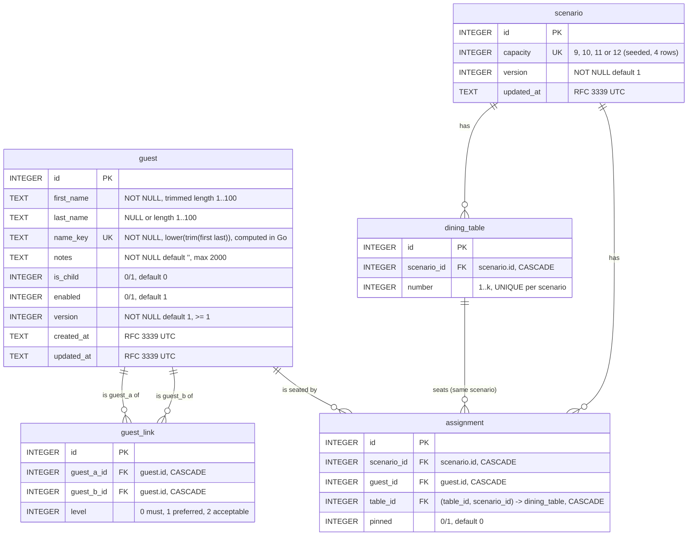

# 002 — ERD (physical SQLite schema)

Task 002, Phase 4 (Skill 10). Source of truth: [`backend-go/db/migrations/`](../../../backend-go/db/migrations/) (goose): `00001_init.sql`, then `00002_capacity_9_10_11_12.sql` (task 006: capacities 9/10/11/12, see the note under the constraints table). This diagram mirrors it. If they disagree, the migration wins and this file is a bug. Mapping to domain and DTOs: [../04-data-model.md](../04-data-model.md).

## Legend: constraints and the reasoning behind them

| Rule | Where enforced | Why |
|---|---|---|
| One link per unordered pair | `CHECK (guest_a_id < guest_b_id)` + `UNIQUE (guest_a_id, guest_b_id)` | Links are undirected. The store normalises the order, so "A lists B" and "B lists A" are the same row. |
| Link level ∈ {0,1,2}; capacity ∈ {9,10,11,12}; booleans 0/1 | `CHECK` | Bounded values live in the DB, not only in Go. |
| Unique display name | `guest.name_key UNIQUE` | Names are how links are typed and imported. SQLite's `lower()` does not fold Polish letters, so Go computes the key with `strings.ToLower(strings.TrimSpace(...))`. |
| A guest sits at most once per plan | `UNIQUE (assignment.scenario_id, guest_id)` | Hard rule. |
| An assignment's table belongs to the same plan | composite FK `(table_id, scenario_id) → dining_table (id, scenario_id)` | Makes cross-plan corruption impossible without trigger code. |
| Removing a table unseats its guests | `ON DELETE CASCADE` from `dining_table` to `assignment` | Unseated means "no assignment row", so there is no nullable `table_id`. Deleting a plan (UC-17) is "delete all tables of the scenario"; the same cascade removes its assignments and pins. |
| Deleting a guest removes their links and assignments | `ON DELETE CASCADE` | UC-06. |
| Exactly four plans | Seeded in the migration; `capacity UNIQUE` | Scenarios are never created or deleted by the app. |
| Table numbers 1..k without gaps | **Store logic** (renumber in the same transaction) | A DB rule for "no gaps" would need triggers. Not worth it (KISS). |
| Cluster integrity, capacity, floor | **Not in the DB** | These are plan *violations*, allowed to exist in a draft and reported by `internal/seating`. |

**Migration `00002_capacity_9_10_11_12.sql` (task 006).** Capacities changed from 8/10/12 to 9/10/11/12 with no data loss: plans 10 and 12 keep their rows untouched; the 8-seat plan row is converted in place to capacity 9 (same `id`, so its tables, assignments and pins stay; `version` + 1, so a proposal computed before the upgrade is rejected with 409); a new, empty plan 11 is inserted (new `id`; the API never exposes ids and always orders by `capacity`). Because SQLite cannot alter a `CHECK` and `DROP TABLE scenario` with `foreign_keys=ON` would cascade-delete every table and assignment, `scenario`, `dining_table` and `assignment` are rebuilt together in goose's transaction: create `*_new` → copy rows with their ids → drop the old ones child-first → rename (SQLite rewrites the FK references to the final names) → recreate the two `assignment` indexes. The Down migration mirrors it (deletes plan 11, turns 9 back into 8; a 9-guest table then shows as an `over_capacity` violation).

*Patterns and principles:*
- **Store only explicit input.** There are no tables for clusters, affinities, proposals or scores; they are derived.
- **Surrogate keys everywhere** (project rule), including the link table. API keys are natural where that is friendlier: the scenario is addressed by `capacity`, a table by `number`, a link by `"{a}-{b}"`.
- **Optimistic Offline Lock:** `version` columns on `guest` and `scenario` only. `guest.version` is bumped by every guest update, including toggles. `scenario.version` is bumped by every plan mutation (storing a Generate or its Cofnij — all four plans at once —, move, pin, unseat, add or remove a table, delete the plan). No schema change for task 007 (the undo snapshot lives in the client).
- **SQLite deviations from the generic rules:** timestamps are `TEXT` (RFC 3339 UTC) instead of `TIMESTAMPTZ`; there is no money in this domain.
