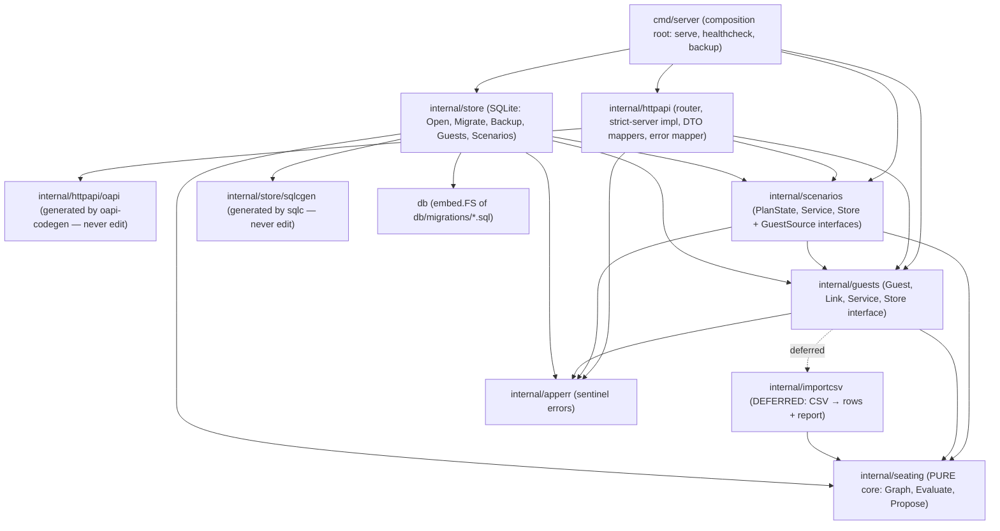
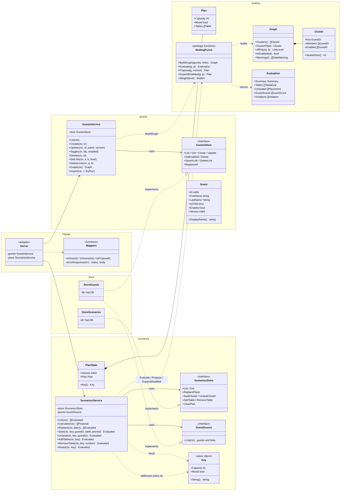
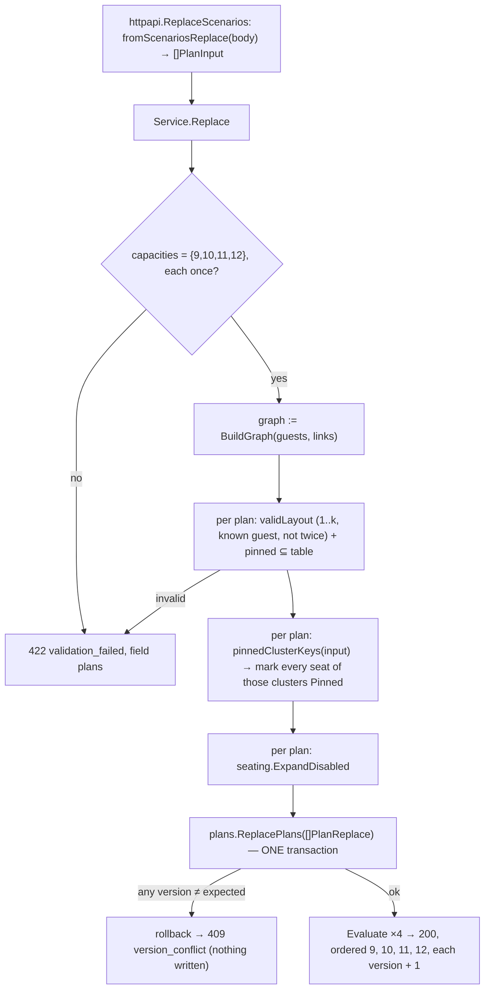
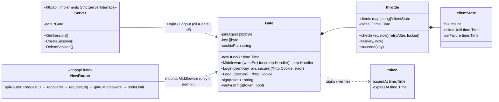
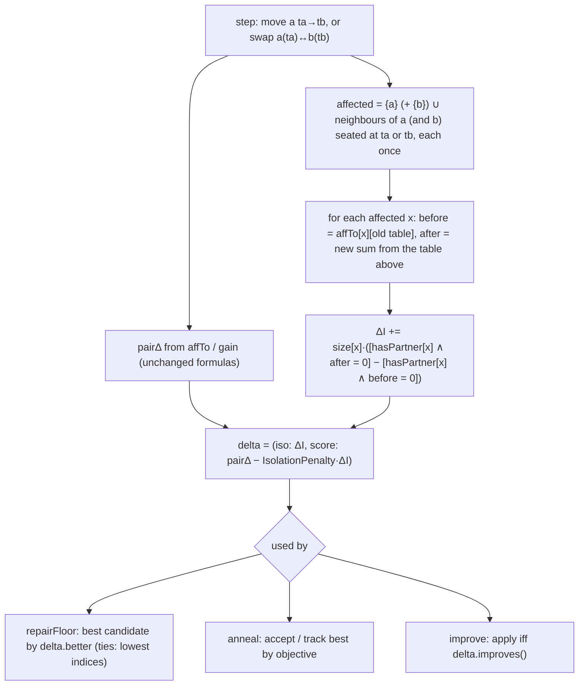
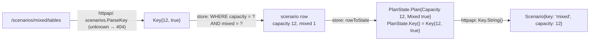

# 003 — Backend design (Go): packages, core interfaces, class diagram, audit

Task 003, Phase 5 (Skills 13–16); updated for task 007 (Generate stores at once, `PUT /scenarios`, §6), task 008 (anneal stage, §2.1), task 009 (access gate, §7), task 011 (wykluczanie izolacji, §8) and task 013 (the mixed plan, a fifth plan, §9). It builds on [../04-data-model.md](../04-data-model.md) (DTOs, mappers, stores), [../03-seating-model.md](../03-seating-model.md) (rules), [002-erd.md](002-erd.md) and the contract [`docs/openapi.yaml`](../../openapi.yaml). Backend-Go implements **exactly** these packages and signatures. If one turns out to be wrong, raise it rather than drifting.

## 1. Packages and dependency direction



*Legend:*
- Arrows mean "imports".
- **Dependency rule:** `seating` imports nothing from the project (only the stdlib). Services own their store interfaces, and `store` implements them (**Dependency Inversion**). Go requires this anyway: `store` imports the domain types, so the domain cannot import `store`.
- `httpapi` never touches `store` or `sqlcgen`, and `seating` never sees a DTO or a row.
- `importcsv` depends only on `seating` (for `LinkLevel`), so it can be replaced without touching the core (**Adapter**). It is deferred to post-MVP.

## 2. Core interfaces and signatures (Skill 13)

### 2.1 `internal/seating` — pure functional core

```go
package seating

type GuestID = int64
type LinkLevel int
const (Must LinkLevel = 0; Preferred LinkLevel = 1; Acceptable LinkLevel = 2)
const Floor = 8                       // minimum guests per table when k > 1 (was 6 until task 006)
func Weight(l LinkLevel) float64      // Preferred 1.0, Acceptable 0.5, else 0
const IsolationPenalty = 1            // satisfaction taken from each isolated guest (task 011, §8)

type Guest struct { ID GuestID; Enabled bool }
type Link  struct { A, B GuestID; Level LinkLevel }

type Cluster struct {
    Key     GuestID   // smallest member id
    Members []GuestID // all members, sorted
    Enabled []GuestID // enabled members, sorted
}
func (c Cluster) SeatedSize() int

type Graph struct { /* clusters, guest→cluster index, cluster-pair affinity, warnings (unexported fields) */ }
func BuildGraph(guests []Guest, links []Link) Graph   // union-find over level-0 links of ALL guests
func (g Graph) Clusters() []Cluster                    // ordered by Key
func (g Graph) ClusterOf(id GuestID) (Cluster, bool)
func (g Graph) Affinity(a, b GuestID) (LinkLevel, bool) // between two cluster keys; false = strangers
func (g Graph) IsEnabled(id GuestID) bool
func (g Graph) Warnings() []DataWarning                 // cluster_exceeds_9 / _12 / conflicting_link_levels

type Seat  struct { Guest GuestID; Pinned bool }
type Table struct { Number int; Seats []Seat }
type Plan  struct { Capacity int; Mixed bool; Tables []Table } // tables ordered 1..k; Mixed: the mixed plan (Capacity 12), task 013 §9

type Evaluation struct {
    Summary     Summary
    Tables      []TableEval
    Unseated    []Placement
    GuestScores []GuestScore
    Violations  []Violation
}
type Summary struct { TableCount, Seated, Unseated, ViolationCount, Isolated int; Score float64; NeedsRecalculation bool } // Isolated: task 011, not in the contract
type TableEval  struct { Number, Fill int; Score float64; Clusters []Placement }
type Placement  struct { ClusterKey GuestID; Guests []GuestID; Pinned bool } // enabled members only
type GuestScore struct { Guest GuestID; Table int /*0 = unseated*/; Satisfaction float64; PreferredTotal, PreferredAtTable, FallbackAtTable, StrangersAtTable int; Isolated bool /*task 011, not in the contract*/ }
type Violation  struct { Code ViolationCode; Table int /*0 = none*/; Guests []GuestID }
type DataWarning struct { Code WarningCode; Guests []GuestID }

func Evaluate(g Graph, p Plan) Evaluation         // disabled seats are ignored; NeedsRecalculation = len(Violations) > 0
func Propose(g Graph, current Plan) Plan          // deterministic; keeps pinned clusters; enabled guests only; current.Mixed → k0 / k0+1 rule (§9); result keeps Capacity and Mixed
func ExpandDisabled(g Graph, p Plan) Plan          // adds each placed cluster's unlisted disabled members to its table (used by Service.Replace)
```

Internal (unexported, but each has its own table-driven tests): `minTables`, `pack`, `repairFloor`, `packExact`, `anneal`, `improve` (move/swap, first-improvement, capped at a fixed number of passes, no wall-clock), `score`. **No time budget based on the clock**: fixed iteration / pass / node caps keep it deterministic and testable.

**Score optimisation stage (task 008).** In `Propose`, every place that today calls `improve(l, maxPasses)` on a feasible layout (after `pack`+`repairFloor` and after `packExact`) calls `optimise(l)` instead; nothing before it changes (k selection, `pack`, `repairFloor`, `packExact`, the best-effort fallback):

```go
// anneal.go (new file)
type rng struct{ s uint64 }              // self-contained PRNG (splitmix64 or xorshift64*); no math/rand, no clock
func (r *rng) next() uint64
func (r *rng) intn(n int) int             // uniform in [0, n)
func (r *rng) float() float64             // uniform in [0, 1)

const annealSeed = <constant>             // fixed; restart i uses a seed derived from annealSeed and i
const annealIters = 1_500_000             // per restart, upper bound
const annealItersPerItemSq = 700          // steps per (movable items)², until annealIters is reached (task 012)
const annealRestarts = 32                 // independent walks, run in parallel goroutines (task 012)
const annealTempHigh, annealTempLow = 6, 3 // geometric cooling (task 012: the end was 0.8)

// anneal: simulated annealing over unpinned placed items, from l (feasible).
// Steps: move one item to another table, or swap two items on different tables;
// a step is only tried if it keeps capacity and floor (Floor, 0 when k = 1).
// Δ from affTo / swapDelta (integer). Accept Δ ≥ 0; else accept if r.float() < exp(Δ/T),
// T cooling geometrically over the iteration budget. Leaves l at the BEST layout seen.
func anneal(l *layout, iters int, r *rng)

// optimise = for each restart (parallel goroutines, own clone + PRNG each): copy of the start layout
// → anneal → winner by objective, earliest index on ties; then improve(best, maxPasses).
// Skips anneal when fewer than 2 movable items, k = 1, or no movable item has an affinity.
// Steps per restart = min(annealIters, annealItersPerItemSq · m²), m = movable items.
// Postcondition: score(result) ≥ score(start); k, pins, fills within [floor, capacity] unchanged.
func optimise(l *layout)
```

Names and the exact schedule (T0, T_end, move/swap mix, restart count) are Backend-Go's choice, tuned with the benchmark; the contract is the postcondition plus determinism. `layout` needs a cheap copy (assign, fill, affTo) for best-seen snapshots and restarts. Determinism note: `math.Exp` results feed the accept decision, so "same input → same plan" is guaranteed for the same build/architecture (tests run on the Pi); tests assert run-twice equality and score thresholds rather than relying on cross-architecture bit identity. Target (task 012): `Calculate` (four capacities) ≲ 3–5 s on the Pi for ~107 guests; `scenarios.Service.Calculate` runs the four `Propose` calls in goroutines (read-only `Graph`; each writes its own slot, results in order 9, 10, 11, 12) and `optimise` runs the restarts of one `Propose` in goroutines too (each restart owns its clone and PRNG, the winner is picked after `wg.Wait()` in index order, so the result is independent of scheduling). Measured numbers: 03-seating-model § Auto-seating. Update the package doc in `graph.go` ("no clock, no randomness") to: no clock, no I/O, no package-level mutable state; the only randomness is a constant-seed PRNG inside `Propose`, so results are still a pure function of the input.

### 2.2 `internal/guests`

```go
type Guest struct { ID int64; FirstName string; LastName *string; Notes string; IsChild, Enabled bool; Version int64; CreatedAt, UpdatedAt time.Time }
func (g Guest) DisplayName() string
func NameKey(first string, last *string) string
type Link struct { A, B int64; Level seating.LinkLevel }      // NewLink(a, b, level) normalises A < B, rejects a == b
func NewLink(a, b int64, l seating.LinkLevel) (Link, error)
func (l Link) Key() string
func ParseLinkKey(s string) (a, b int64, err error)
type ImportLink struct { AIndex, BIndex int; Level seating.LinkLevel } // deferred
type NewGuest struct { FirstName string; LastName *string; Notes string; IsChild, Enabled bool }
type Patch struct { FirstName *string; LastName *string; ClearLastName bool; Notes *string; IsChild, Enabled *bool }
func ToSeating(gs []Guest, ls []Link) ([]seating.Guest, []seating.Link)

type Store interface {                       // implemented by *store.Guests
    List(ctx) ([]Guest, []Link, error)
    Get(ctx, id int64) (Guest, error)
    Create(ctx, g NewGuest) (Guest, error)
    Update(ctx, g Guest, expectedVersion int64) (Guest, error)
    SetEnabled(ctx, ids []int64, enabled bool) ([]Guest, error)
    Delete(ctx, id int64) error
    UpsertLink(ctx, l Link) (Link, error)
    DeleteLink(ctx, a, b int64) error
    ReplaceAll(ctx, gs []NewGuest, ls []ImportLink) error   // deferred (import)
}

type Service struct { store Store }
func NewService(s Store) *Service
func (s *Service) List(ctx) ([]Guest, []Link, error)
func (s *Service) Create(ctx, in NewGuest) (Guest, error)                 // trims, validates lengths → apperr.Validation
func (s *Service) Update(ctx, id int64, p Patch, version int64) (Guest, error)
func (s *Service) Toggle(ctx, ids []int64, enabled bool) ([]Guest, error)
func (s *Service) Delete(ctx, id int64) error
func (s *Service) SetLink(ctx, a, b int64, l seating.LinkLevel) (Link, error)
func (s *Service) DeleteLink(ctx, a, b int64) error
func (s *Service) Graph(ctx) (seating.Graph, error)                       // for GET /clusters
func (s *Service) Import(ctx, r io.Reader, dryRun bool) (importcsv.Report, error) // DEFERRED
```

### 2.3 `internal/scenarios`

```go
type PlanState struct { Version int64; Plan seating.Plan }   // reuses seating.Plan (DRY): Capacity, Mixed, Tables, Seats(+Pinned)
func (p PlanState) Key() Key
type Key struct { Capacity int; Mixed bool }                 // task 013: plan identity; String() "9".."12" / "mixed"
var Keys = [5]Key{{9,false},{10,false},{11,false},{12,false},{12,true}}   // canonical order (replaces Capacities)
func ParseKey(s string) (Key, bool)

type Store interface {                       // implemented by *store.Scenarios
    List(ctx) ([]PlanState, error)                                    // 5, ordered 9, 10, 11, 12, mixed
    Get(ctx, key Key) (PlanState, error)
    ReplacePlans(ctx, ps []PlanReplace) ([]PlanState, error)          // task 007: all given plans in ONE transaction; any stale → ErrVersionConflict, nothing written
    SeatCluster(ctx, key Key, members []int64, tableNumber int, pinned bool) (PlanState, error)
    UnseatCluster(ctx, key Key, members []int64) (PlanState, error)
    AddTable(ctx, key Key) (PlanState, error)
    RemoveTable(ctx, key Key, number int) (PlanState, error)
    ClearPlan(ctx, key Key) (PlanState, error)                   // delete plan: all tables (cascade: assignments, pins); version+1
}
type GuestSource interface { List(ctx) ([]guests.Guest, []guests.Link, error) } // *store.Guests satisfies it

type Evaluated   struct { State PlanState; Eval seating.Evaluation }
type Proposal    struct { BasedOnVersion int64; Plan seating.Plan; Eval seating.Evaluation }
type PlanInput   struct { Key Key; BasedOn int64; Tables []seating.Table }           // one ScenarioLayout; Seat.Pinned = id ∈ pinnedGuestIds
type PlanReplace struct { Key Key; ExpectedVersion int64; Plan seating.Plan }        // what the store writes

type Service struct { plans Store; guests GuestSource }
func NewService(p Store, g GuestSource) *Service
func (s *Service) List(ctx) ([]Evaluated, error)
func (s *Service) Calculate(ctx) ([]Proposal, error)                                  // Propose ×5 (9, 10, 11, 12, mixed) from ONE graph, parallel goroutines
func (s *Service) Replace(ctx, in []PlanInput) ([]Evaluated, error)              // task 007, PUT /scenarios (Generate store + Cofnij); replaces Accept
        // keys 9,10,11,12,mixed exactly once → per plan: validLayout (1..k, known guests, no duplicates)
        // + pinned ⊆ its table → pin spread to every seat of a pinned cluster (pinnedClusterKeys of the INPUT)
        // → ExpandDisabled → plans.ReplacePlans (one tx) → Evaluate each; ordered 9, 10, 11, 12, mixed
func (s *Service) Seat(ctx, key Key, guestID int64, table int, pinned bool) (Evaluated, error) // whole cluster (ClusterOf.Members)
func (s *Service) Unseat(ctx, key Key, guestID int64) (Evaluated, error)
func (s *Service) AddTable(ctx, key Key) (Evaluated, error)
func (s *Service) RemoveTable(ctx, key Key, number int) (Evaluated, error)
func (s *Service) Reset(ctx, key Key) (Evaluated, error)        // UC-17 "Usuń plan": s.edit(ClearPlan); no version check
```

### 2.4 `internal/store`, `internal/httpapi`, `internal/apperr`, `cmd/server`

```go
package store
func Open(path string) (*sql.DB, error)            // modernc driver, WAL, foreign_keys=ON, busy_timeout=5000, MaxOpenConns(1)
func Migrate(ctx context.Context, db *sql.DB) error // goose + db.Migrations (embed.FS)
func Backup(ctx context.Context, db *sql.DB, dest string) error // VACUUM INTO
type Guests struct { db *sql.DB }                   // implements guests.Store and scenarios.GuestSource
type Scenarios struct { db *sql.DB }                // implements scenarios.Store
func NewGuests(db *sql.DB) *Guests; func NewScenarios(db *sql.DB) *Scenarios
func withTx(ctx, db, fn func(q *sqlcgen.Queries) error) error   // one transaction per store method
func mapErr(err error) error                        // UNIQUE(name_key) → apperr.ErrDuplicateName; FK → apperr.ErrNotFound

package apperr
var ErrNotFound, ErrVersionConflict, ErrDuplicateName error
type Validation struct { Field, Message string }    // implements error

package httpapi
type Server struct { guests *guests.Service; plans *scenarios.Service } // implements oapi.StrictServerInterface
func NewServer(g *guests.Service, p *scenarios.Service) *Server
func NewRouter(basePath, webRoot string, api oapi.StrictServerInterface) http.Handler
        // basePath+"/api": RequestID, Recoverer, slog request log (method, path, status, duration — NO bodies), body limit, X-Robots-Tag
        // basePath+"/": static files from webRoot, index.html fallback; basePath → 301 basePath+"/"; Compress
func errorResponse(err error) (status int, body oapi.ErrorResponse)   // the ONE error mapper (04-data-model § errors)
// mapping.go: toGuest, toGuestList, toLink, toClusterOverview, toScenario, toProposal, toSeatingPlan, fromScenariosReplace

package main
func run(ctx context.Context, args []string, getenv func(string) string, stdout io.Writer) error
        // "serve" (default) | "healthcheck" (GET http://127.0.0.1:$PORT$BASE_PATH/api/health) | "backup <dest>"
type config struct { BasePath, Port, DBPath, WebRoot string } // from env, defaults per 02-system-context
```

## 3. Class diagram (Skill 15)



*Legend: patterns and principles*

| Element | Pattern / principle | Why here |
|---|---|---|
| `seating` package functions | **Functional core, imperative shell** | All rules are pure (data in, data out), so they get table-driven tests with no DB. Services form the shell. |
| `GuestsStore`, `ScenariosStore`, `GuestSource` (declared in the consumer packages) | **Repository** + **Dependency Inversion** + **Interface Segregation** | Go needs consumer-side interfaces to avoid the store↔domain import cycle. `GuestSource` has one method because `scenarios` needs nothing else. One concrete implementation each, with no mocks; tests use real SQLite. |
| `httpapi.Server` | **Adapter** (to the generated strict-server interface) | Transport only: decode, call one service method, map. |
| `Mappers` / `errorResponse` | **DTO + Mapper**, **DRY** | One mapper per type and one error mapper for every handler. |
| `PlanState{Version; Plan seating.Plan}` | **Composition**, **DRY** | Reuses the core's `Plan` instead of a parallel struct (fixed in the audit). |
| `version` checks in `Update` / `ReplacePlans` | **Optimistic Offline Lock** | Two flows can clobber: a guest edit form and replacing all five plans (storing a Generate over plans the user saw, or a Cofnij over the Generate's result). Manual plan edits (`Seat`, `Unseat`, `AddTable`, `RemoveTable`, `Reset`) are not version-checked: their result does not depend on a snapshot the client saw. They still bump the version, which is what makes a later Cofnij a 409. |
| `cmd/server.run` | **Composition root** | Explicit constructor wiring, no DI container, testable through `run(args, getenv)`. |
| Union-find inside `BuildGraph` | Algorithm, not a pattern | Connected components of group-0 links. |

## 4. Pattern evaluation (Skill 14)

| Candidate | Verdict | Reason |
|---|---|---|
| Strategy (seating algorithm) | rejected | One algorithm; capacity is a parameter. Add it only if a second algorithm is actually built. |
| Template Method | rejected | No algorithm family. |
| Strategy / injectable RNG interface for the anneal (task 008) | rejected | Annealing is one more stage of the single algorithm, not an alternative. The PRNG is a tiny concrete type with a constant seed; tests need determinism, not a swappable source. |
| Command / Memento (undo) | rejected as patterns | Task 007's one-step Cofnij needs no server code: the client re-sends its pre-Generate snapshot through the same `PUT /scenarios`. No undo stack, no snapshot table. |
| Observer / domain events | rejected | Nothing reacts asynchronously; plans are evaluated on read. |
| State (plan "needs recalculation") | rejected as a pattern | It is a derived boolean (`len(violations) > 0`), not a stored state machine. |
| Facade | rejected | Two services already form the API surface. |
| Builder | rejected for production code | Test fixtures may use small helper functions (`guest(id)`, `link(a,b,l)`), with no builder types. |
| Factory | rejected | Plain constructors (`NewService`). |
| Singleton | rejected | Explicit wiring in `main`. |
| Unit of Work | rejected | One transaction per store method; no cross-aggregate transaction except import (`ReplaceAll`, deferred). |
| Decorator | adopted only as chi middleware | Request ID, recoverer, logging, body limit: the idiomatic `func(http.Handler) http.Handler`. |
| Generic repository | rejected | Two aggregates with different operations. |
| Clock / ID-generator interfaces | rejected | Timestamps come from SQL defaults; ids from SQLite. |
| Atomic all-plans replace (`ReplacePlans`, task 007; five plans since task 013) | **adopted, one store method** | A half-applied Generate is worse than none. One store method = one transaction, so no Unit of Work object is needed. |
| Batch "delete all plans" endpoint (Unit of Work over 5 scenarios) | rejected | Five independent `DELETE /scenarios/{planKey}/tables` calls suffice: each is idempotent, a partial failure is fixed by retrying, and nothing requires the four plans to be cleared atomically (contrast: Generate, which must replace all four at once). |

## 5. Clean-architecture / SOLID / YAGNI audit (Skill 16)

| Check | Result |
|---|---|
| **SRP** | `seating` = rules. `guests` / `scenarios` services = validation, orchestration, transaction choice. `store` = SQL + row mapping. `httpapi` = transport + DTO mapping. `main` = wiring. One reason to change each. |
| **OCP / LSP** | No extension points by design (YAGNI); nothing to violate. |
| **ISP** | Consumer interfaces list only the methods used (`GuestSource` = 1 method). |
| **DIP** | Services own their abstractions and `store` depends on the domain, never the reverse. `seating` depends on nothing. |
| **DRY** | One `Plan` type (core), one `SeatingPlan` DTO shared by `Scenario` and `Proposal`, one error mapper, one place for the floor/weights (`seating` constants). |
| **Law of Demeter** | Handlers call one service method each; services do not reach through store internals. |
| **YAGNI** | No Strategy, no event bus, no caching, no Zustand, no auth, no config package, no batch create endpoint. Import is kept in the contract but implemented last. |
| **Found and fixed in this audit** | (1) `scenarios.PlanState` duplicated the core plan shape, so it now embeds `seating.Plan` (04-data-model §1 updated). (2) `importcsv` importing `guests` while `guests.Service.Import` imports `importcsv` would be an import cycle, so `importcsv` now returns its own row types and depends only on `seating`. (3) The wall-clock time budget in `Propose` made tests flaky by design, so it is replaced by a fixed pass cap (deterministic); task 008's anneal follows the same rule (fixed iteration budget, constant-seed PRNG). (4) `GET /clusters` and plan reads both need the graph: built by one function (`seating.BuildGraph`) via `guests.ToSeating`, not duplicated. |

## 6. Task 007 — Generate stores at once, Cofnij (`PUT /scenarios`)

Contract: `PUT /scenarios` (`replaceScenarios`, body `ScenariosReplace`, 200 `ScenarioListResponse`); `PUT /scenarios/{capacity}/assignments` (`acceptProposal`, `AcceptPlan`) is **removed**. `POST /scenarios/calculate` is unchanged (still pure). Rules: [../03-seating-model.md](../03-seating-model.md) § Storing a Generate / § Undoing a Generate. No migration.



*Legend:* validation (422) happens before the transaction; the version check happens inside it (atomic compare-and-set per scenario row, `UPDATE … WHERE version = ?`). Functional core / imperative shell is unchanged: `validLayout`, `pinnedClusterKeys` and `ExpandDisabled` are pure; only `ReplacePlans` touches the DB.

**Tests (real SQLite, no DB mocks):**
- store: `ReplacePlans` writes four plans and bumps four versions; one stale version among four → `ErrVersionConflict` and **all four plans byte-for-byte unchanged** (tables, assignments, pins, versions); empty `tables` → empty plan.
- service: missing/duplicate capacity → 422; unknown guest / guest twice / bad numbering / pinned guest not at its table → 422 naming the plan; pins from `pinnedGuestIds` reach every seat of the cluster incl. ride-along disabled members; disabled members ride along; round trip "GET → calculate → PUT (snapshot versions) → PUT(snapshot, returned versions)" restores the exact original tables, enabled assignments and pins.
- httpapi: 200 envelope with four scenarios; 409 and 422 envelopes; `PUT /scenarios/{capacity}/assignments` now 404/405 (route gone).

**Delete (dead after task 007):** `scenarios.Service.Accept`; `Store.ReplacePlan` (fold its SQL into `ReplacePlans`; reuse `DeleteScenarioTables` and the insert queries; remove any sqlc query used only by it); the strict handler `AcceptProposal`; mapper `fromAcceptPlan`; their tests. Keep `Calculate`, `validLayout`, `pinnedClusterKeys` (now applied to the input plan), `toProposal`, `ExpandDisabled`.

## 7. Task 009 — Access gate (shared PIN)

Rules, parameters and threat model: [../05-access-gate.md](../05-access-gate.md) (authoritative; this section is the class-level map). Contract: `/session` (`getSession`, `createSession`, `deleteSession`), `securitySchemes.sessionCookie`, error codes `unauthenticated`, `invalid_pin`, `too_many_attempts`, `csrf_header_missing`. No migration, no new table.

### 7.1 New package `internal/accessgate` (stdlib only: `crypto/hmac`, `crypto/sha256`, `crypto/subtle`, `crypto/rand`, `net/http`, `sync`, `time`)

```go
package accessgate

const CookieName = "stoliki_session"
const CSRFHeader = "X-Stoliki-Request"           // value "1"

var ErrUnauthenticated, ErrInvalidPIN, ErrCSRF error   // sentinels; httpapi.errorResponse maps them
type ThrottledError struct{ RetryAfter time.Duration }   // implements error

// LoadOrCreateSecret reads 32 bytes from path, or creates the file (crypto/rand, mode 0600) if missing.
func LoadOrCreateSecret(path string) ([]byte, error)

// New derives pinDigest = SHA-256(pin) and key = HMAC-SHA256(secret, "stoliki-session-v1" || pinDigest).
// The pin string is not kept. now is time.Now in production, a fixed clock in tests.
func New(pin string, secret []byte, cookiePath string, now func() time.Time) *Gate

type Gate struct {
    pinDigest  [32]byte
    key        []byte
    cookiePath string                 // BASE_PATH, e.g. "/wesele"
    throttle   *throttle
    now        func() time.Time
}

// Middleware: mounted on the API sub-router only (§ 05-access-gate §1 flowchart).
// Public: GET /health, POST /session, DELETE /session (paths relative to the API mount).
// Writes 401/403 through the same error envelope as every other API error (httpapi passes its writer in).
func (g *Gate) Middleware(writeErr func(http.ResponseWriter, *http.Request, error)) func(http.Handler) http.Handler

// Login: throttle check (locked → *ThrottledError, PIN NOT evaluated) → constant-time compare →
// ErrInvalidPIN (failure recorded) or a fresh session cookie (client's failures cleared).
func (g *Gate) Login(clientKey, pin string, secure bool) (*http.Cookie, error)
func (g *Gate) Logout(secure bool) *http.Cookie                        // Max-Age=0
func Session(ctx context.Context) (expiresAt time.Time, ok bool)      // set by Middleware for authenticated requests
func ClientKey(r *http.Request) string                                 // rightmost X-Forwarded-For entry, else RemoteAddr host
func IsSecure(r *http.Request) bool                                    // r.TLS != nil || X-Forwarded-Proto == "https"

// unexported
type token struct{ issuedAt, expiresAt time.Time }
func (g *Gate) sign(t token) string; func (g *Gate) verify(v string) (token, bool)
type throttle struct {                 // all under one sync.Mutex
    clients map[string]*clientState    // ≤ 4096 entries
    global  []time.Time                // failure times within the last 24 h (≤ 20)
}
type clientState struct{ failures int; lockedUntil, lastFailure time.Time }
func (t *throttle) check(key string, now time.Time) (retryAfter time.Duration, locked bool)
func (t *throttle) fail(key string, now time.Time)
func (t *throttle) succeed(key string)
```

Parameters as named constants in the package (one place): `freeFailures = 3`, `baseLock = 30*time.Second`, `maxLock = time.Hour`, `clientTTL = 24*time.Hour`, `maxClients = 4096`, `globalWindow = 24*time.Hour`, `globalMaxFailures = 20`, `sessionLifetime = 30*24*time.Hour`, `slideAfter = 24*time.Hour`.

### 7.2 Changes in existing packages

| Where | Change |
|---|---|
| `cmd/server` `config` | + `PIN string` from `STOLIKI_PIN` (empty = gate off). `serve`: if `PIN != ""` → `secret := accessgate.LoadOrCreateSecret(filepath.Join(filepath.Dir(cfg.DBPath), "session.key"))`, `gate := accessgate.New(cfg.PIN, secret, base, time.Now)`; else `gate = nil` and `slog.Warn("access gate off (STOLIKI_PIN not set)")`. The PIN is used only by `New`; never log `cfg`. `healthcheck` and `backup` ignore the PIN. |
| `httpapi.NewRouter` | `NewRouter(basePath, webRoot string, api oapi.StrictServerInterface, gate *accessgate.Gate)`; `apiRouter` adds `gate.Middleware(writeError)` after `requestLog` and before `bodyLimit` **only when `gate != nil`**. Static routes unchanged (open). |
| `httpapi.Server` | + field `gate *accessgate.Gate` (`NewServer(db, g, p, gate)`). New strict handlers: `GetSession` (gate nil → `{pinRequired:false, expiresAt:null}`; else `accessgate.Session(ctx)`), `CreateSession`, `DeleteSession`. The strict handlers need the `*http.Request` (client key, `IsSecure`): a small chi middleware in `apiRouter` stores it in the context (`withRequest`), or use oapi-codegen's `StrictMiddlewareFunc` — Backend-Go picks one, no other change. Cookies go out through the generated `SetCookie` response header field (`cookie.String()`), `Retry-After` through the 429 header field (whole seconds, rounded up, ≥ 1). |
| `httpapi.errorResponse` | maps `accessgate.ErrUnauthenticated` → 401 `unauthenticated`, `ErrInvalidPIN` → 401 `invalid_pin` (field `pin`), `*ThrottledError` → 429 `too_many_attempts`, `ErrCSRF` → 403 `csrf_header_missing`. Messages are the generic English strings from the contract examples; never echo input. |
| gated API responses | `Cache-Control: no-store` (set by the middleware when the gate is on). |



*Legend:* `accessgate` depends on nothing in the project (like `seating`), so `httpapi` and `main` import it, never the reverse; the error writer is passed in (**Dependency Inversion** without an interface — a function value is enough). The middleware is a **Decorator** (same idiom as the existing ones). `nil` gate = off, so the gate-off path is literally today's router (one `if`). No session store, no Strategy, no interface for the clock beyond a `func() time.Time` field (needed for deterministic throttle tests).

### 7.3 Tests (B1)

- `accessgate` unit (fixed clock): sign/verify round trip; tampered payload, tampered MAC, wrong key (other PIN), expired → invalid; sliding re-issue only after 24 h; throttle: 3 free failures, then 30 s / 1 min / 2 min … capped at 1 h; while locked `Login` returns `*ThrottledError` **for the correct PIN too** and does not record a failure; global: the 21st failure within 24 h from 21 different client keys → locked for everyone, a success elsewhere does not reset it; entries forgotten after 24 h; table full → fail closed; `LoadOrCreateSecret` creates a 0600 file once and re-reads the same bytes.
- `httpapi` router tests with a real SQLite temp DB and the gate on (PIN from a test constant such as `"test-pin-not-real"`, never a realistic value): **every** operation in the generated route list except the three public ones → 401 without the cookie (iterate the routes, do not hand-pick); with a valid cookie → normal status; mutating requests without `X-Stoliki-Request` → 403 (with cookie) and 401 (without); `POST /session` right → 200 + `Set-Cookie` with `HttpOnly`, `SameSite=Lax`, `Path=/wesele`, `Max-Age=2592000`, `Secure` only when `X-Forwarded-Proto: https`; wrong → 401 `invalid_pin`; throttled → 429 + `Retry-After`; `DELETE /session` → 204 + `Max-Age=0`; `GET /health` and static files (`/wesele/`, `/wesele/goscie`, an asset) → 200 without a cookie; gated responses have `Cache-Control: no-store`.
- Gate off (`gate == nil`): the existing test suite passes unchanged; `GET /session` → 200 `pinRequired:false`; no 401/403 anywhere.
- Log hygiene: capture `slog` output during a wrong and a right login and assert the PIN string and the attempted value do not appear; error bodies never contain them.
- `cmd/server`: `STOLIKI_PIN` empty → gate off + warning; set → `session.key` created next to `DB_PATH`.

## 8. Task 011 — Wykluczanie izolacji (isolated guests)

Rules and worked examples: [../03-seating-model.md](../03-seating-model.md) § Isolation (authoritative). In short: a seated enabled guest is **isolated** when their cluster has at least one partner cluster (group 1/2 affinity, ≥ 1 enabled member, seated or not) and none of those partners has an enabled guest at the table. Displayed satisfaction: −`IsolationPenalty` (= 1) per isolated guest. Optimiser: **lexicographic** — fewest isolated guests first, then the highest scenario score; hard rules, fewest tables and pins come before both. Not a violation. No migration; the contract changes only in descriptions (`GuestScore.satisfaction` may be negative and is negative **iff** the guest is isolated). Everything below lives in `internal/seating`; no other package changes, except that `httpapi` does **not** map the two new Go-only fields.

### 8.1 `graph.go` / `evaluate.go`

```go
const IsolationPenalty = 1 // next to Weight and Floor; untyped, used as int (layout) and float (Evaluate)

// hasPartners: cluster key -> true when some OTHER cluster with SeatedSize() > 0 has a
// group-1/2 affinity to it. One function, used by Evaluate and newItems (DRY), next to preferredTotals.
func (g Graph) hasPartners() map[GuestID]bool

type GuestScore struct { /* … as before … */ Isolated bool }   // Go only, not mapped to the DTO
type Summary    struct { /* … as before … */ Isolated int }    // seated enabled guests with Isolated; Go only
```

`Evaluate`, per table, per cluster key `k` at the table (after the existing `prefAt`/`fallAt`/`strangers` loop):

```go
isolated := hasPartner[k] && prefAt+fallAt == 0
if isolated { sat -= IsolationPenalty }
// each member's GuestScore gets Isolated = isolated; te.Score += sat as today;
// ev.Summary.Isolated += len(members) when isolated
```

Unseated guests: `Satisfaction 0`, `Isolated false` (unchanged code path). Violations and `NeedsRecalculation`: unchanged.

### 8.2 `propose.go`: items, layout, objective

```go
type items struct {
    // … as before …
    hasPartner []bool   // per item, from g.hasPartners() (counts partners that are NOT items too: oversized / unseated)
    nbr        [][]int  // per item: indices b with gain[a][b] > 0, ascending (adjacency list for the deltas)
}

// objective is what the optimiser compares: fewer isolated seats first, then a higher score.
// Value object; an explicit pair, never a weighted sum (no big-M, no overflow question).
type objective struct {
    iso   int // isolated enabled guests (seats) — lower is better
    score int // displayed scenario score, penalty included (= Evaluate Summary.Score)
}
func (o objective) better(p objective) bool  // o.iso < p.iso || (o.iso == p.iso && o.score > p.score)

// delta is the change of an objective caused by one step.
type delta struct{ iso, score int }
func (d delta) improves() bool                // d.iso < 0 || (d.iso == 0 && d.score > 0)
func (d delta) better(e delta) bool           // same lexicographic order between two candidate steps

func (l *layout) objective() objective        // from scratch, O(items)
func (l *layout) score() int                  // = l.objective().score (kept: tests and callers)
func (l *layout) moveDelta(a, tb int) delta   // a placed, tb != assign[a]
func (l *layout) swapDelta(a, b int) delta    // a, b placed at different tables (replaces the int version)
```

`affTo`, `gain`, `place`, `unplace`, `move` are unchanged. **Units:** `gain[a][b]` and `affTo` are already in scenario-score points (`gain = 2·w·size_a·size_b` is the full contribution of the pair, counted once per pair); only the accumulator inside `score()` holds twice that (each pair is seen from both ends). The penalty is therefore `IsolationPenalty · size[a]` points in every delta, and `2 · IsolationPenalty · size[a]` only if someone adds it into that internal "twice" accumulator — the recommended `objective()` avoids the trap:

```go
func (l *layout) objective() objective {
    twice, iso := 0, 0
    for a, t := range l.assign {
        if t < 0 { continue }
        twice += l.affTo[a][t]
        if l.it.hasPartner[a] && l.affTo[a][t] == 0 { iso += l.it.size[a] }
    }
    return objective{iso: iso, score: twice/2 - IsolationPenalty*iso}
}
```

**Key fact:** all gains are positive integers (weights 1 or ½, sizes ≥ 1 → `gain ≥ 1`), and `gain[a][a] = 0`, so for a placed item `a` at `t`: **`affTo[a][t] == 0` ⇔ no partner item at t**. With `hasPartner[a]` this is exactly Evaluate's `prefAt + fallAt == 0` for layouts built by Propose (oversized clusters are never placed, so a partner that is not an item is never at the table).

### 8.3 Delta rules (exact; `iso(c, v) = hasPartner[c] && v == 0`, `[x]` = 1 if true else 0)

Every step changes only `affTo[·][ta]` and `affTo[·][tb]`, and only for neighbours of the moved items; every other cluster keeps its isolation status. Write `ΔI` for the change of isolated seats; then always

```
delta.iso   = ΔI
delta.score = pairΔ − IsolationPenalty · ΔI
```

**Move `a`: `ta → tb`.** `pairΔ = affTo[a][tb] − affTo[a][ta]` (as today).

| Affected cluster | Isolated before | Isolated after |
|---|---|---|
| `a` itself | `iso(a, affTo[a][ta])` | `iso(a, affTo[a][tb])` |
| `c ∈ nbr[a]`, `assign[c] == ta` (left behind) | `false` (a is there) | `affTo[c][ta] == gain[c][a]` (a was its only partner there) |
| `c ∈ nbr[a]`, `assign[c] == tb` (joined) | `affTo[c][tb] == 0` | `false` (a arrives) |
| anything else | unchanged | unchanged |

`ΔI = Σ size[x] · ([after] − [before])` over the affected rows. Cost O(|nbr[a]|).

**Swap `a` (at `ta`) ↔ `b` (at `tb`), `ta ≠ tb`.** `pairΔ` = today's `swapDelta` formula `(affTo[a][tb] − g) − affTo[a][ta] + (affTo[b][ta] − g) − affTo[b][tb]`, `g = gain[a][b]`. New sums after the swap:

| Affected cluster | `affTo` before → after (at the cluster's table after the step) |
|---|---|
| `a` (now at `tb`) | `affTo[a][ta]` → `affTo[a][tb] − gain[a][b]` |
| `b` (now at `ta`) | `affTo[b][tb]` → `affTo[b][ta] − gain[b][a]` |
| `c ∉ {a,b}`, `assign[c] == ta`, `c ∈ nbr[a] ∪ nbr[b]` | `affTo[c][ta]` → `affTo[c][ta] − gain[c][a] + gain[c][b]` |
| `c ∉ {a,b}`, `assign[c] == tb`, `c ∈ nbr[a] ∪ nbr[b]` | `affTo[c][tb]` → `affTo[c][tb] − gain[c][b] + gain[c][a]` |

Each row contributes `size[x] · ([iso(x, after)] − [iso(x, before)])`. **Count each `c` once**: walk `nbr[a]`, then `nbr[b]` skipping every `c` with `gain[c][a] > 0` (already seen). Cost O(|nbr[a]| + |nbr[b]|). A `c` that is a partner of both `a` and `b` is handled by the formula (it loses one and gains the other).



*Legend:* pure functions over the incremental state; no pattern beyond a small value object (`objective`/`delta`). The two tables above are the specification; the property test in §8.7 is its oracle (`delta == objective(after) − objective(before)` component-wise).

### 8.4 Where the objective is used

- **`pack`: unchanged.** It builds a starting layout from a partial assignment, where isolation is not yet defined (partners may still be unplaced). Everything after it repairs/optimises with the full objective.
- **`repairFloor`** (`liftByMove`, `liftBySwap`): candidates are filtered by the hard rules as today; the chosen one is the best by `delta.better` (fewest new isolated seats, then least score loss), ties lowest indices. `liftByMove` uses `moveDelta` instead of the inline `affTo` difference.
- **`anneal`:** keeps `cur objective` and `best objective` (+ `bestAssign`). Per step with `d` = `moveDelta` / `swapDelta`:
  - accept if `d.iso < 0 || (d.iso == 0 && d.score >= 0)` (lexicographically not worse — includes today's "ties accepted");
  - otherwise accept with probability `exp(Δacc / T)`, where `Δacc = d.score − annealIsoWeight · d.iso` (`d.iso ≥ 0` here). New constant `annealIsoWeight = 8` (score points per isolated seat; a tuning knob for the *walk only* — it never decides which layout is returned). With T from 6 to 0.8 (task 012: 6 to 3) a step isolating one more guest is still taken now and then early on (≈ e^(−9/6) ≈ 0.2) and almost never at the end, so the walk can cross a barrier that improve alone cannot. Backend-Go may retune it with the fixtures (constants only).
  - after applying: `cur = cur + d`; if `cur.better(best)` → snapshot. `l.restore(bestAssign)` at the end as today.
- **`optimise`:** restart winner = the restart whose final `objective()` is `better` than the best so far (start layout included, earliest on ties). Postcondition: `objective(result)` is not worse than `objective(start)` lexicographically; k, pins and hard rules unchanged.
- **`improve`:** a move / swap is applied iff `delta.improves()` (replaces `affTo[a][t]-affTo[a][x] > 0` and `swapDelta(a, b) > 0`). Still first-improvement, still capped at `maxPasses`. Because it scans every move and every swap, **the returned layout has no single feasible move or swap that lowers the isolated count** — a testable guarantee (§8.7 P6).
- **k selection and the best-effort fallback:** unchanged (rule 3 before rule 5: isolation never adds a table).

### 8.5 `Propose`: extract the per-k solver (pure refactor, needed by the diagnostic)

```go
// feasibleAt tries one table count: pack with and without affinity (+ repairFloor), then packExact.
// Returns the optimised feasible layout, or nil plus the greedy tries (for the best-effort fallback).
func feasibleAt(it items, k int, pins map[int]int) (best *layout, tries []*layout)
```

`Propose` becomes the k loop around `feasibleAt` with the same fallback logic; behaviour identical except for the new objective inside `optimise`/`repairFloor`.

### 8.6 Diagnostic for Phase C: is isolation avoidable with k + 1 tables?

Not a product feature (the user decides whether an extra table is worth it; Propose never adds one). A **test-only** report, skipped unless an input file is given, so it never runs in CI and never touches the DB:

```go
// diagnose_test.go
// TestDiagnoseIsolation: t.Skip unless STOLIKI_DIAG_INPUT is set. Input JSON (ids only, no names):
//   {"guests":[{"id":1,"enabled":true},…], "links":[{"a":1,"b":2,"level":1},…]}
// For capacity 9, 10, 11, 12 (no pins), t.Logf one line each for k and for k+1 (only when (k+1)·Floor ≤ N).
// Format (numbers invented):
//   cap=12 k=9  isolated=4 (clusters: key 17 size 4) score=287
//   cap=12 k=10 isolated=0 score=281
//   or "k+1 infeasible". k = len(Propose(...).Tables); k+1 via feasibleAt(newItems(g, cap), k+1, nil),
//   numbers via Evaluate. Prints guest ids and counts only, never names.
```

Phase C recipe (logged in with the session cookie as in AGENTS.md; the temp file holds ids and flags only and is deleted afterwards):

```bash
D=$(mktemp -d)
curl -s -b "$COOKIE_JAR" http://127.0.0.1:8094/wesele/api/guests \
 | jq '{guests: [.data[] | {id, enabled}],
        links:  [.data[] as $g | $g.links[] | select($g.id < .guestId) | {a: $g.id, b: .guestId, level}]}' > "$D/in.json"
(cd backend-go && STOLIKI_DIAG_INPUT="$D/in.json" go test -run TestDiagnoseIsolation -v ./internal/seating)
rm -rf "$D"
```

Report to the user per capacity: isolated guests at k (and which cluster, by name only in the chat with the user if needed), and whether k + 1 removes them at what score. Implementing a "k + 1 if it removes isolation" option is **out of scope** (user decision first).

### 8.7 Tests (B1) — real code paths, no mocks

**Evaluate** (`evaluate_test.go`, small hand-built graphs):

| # | Case | Expected |
|---|---|---|
| E1 | cluster {1,2} —1— {3}; 1,2 at table 1 with strangers, 3 at table 2 | guests 1, 2: `Satisfaction −1`, `Isolated`; table 1 score includes −2; `Summary.Isolated` counts 1, 2 (and 3 if it is isolated too) |
| E2 | same, 3 at table 1 | 1, 2: +1 each, not isolated |
| E3 | only a group-2 partner at the table | +0.5, not isolated |
| E4 | guest with no group-1/2 link at all, strangers only | 0, not isolated |
| E5 | only partner cluster fully disabled | 0, not isolated |
| E6 | partner enabled but unseated | isolated (−1) |
| E7 | isolated-looking guest who is unseated | 0, not isolated, no new violation |
| E8 | partner cluster with one enabled member at the table, others elsewhere (split) | not isolated |
| E9 | any isolated plan | `Violations` and `NeedsRecalculation` unchanged versus the same plan before task 011 |

**Deltas** (`propose_test.go` / `anneal_test.go`): hand-built layouts, each asserting `moveDelta`/`swapDelta` == `objective(after) − objective(before)` and the expected `ΔI`:
D1 isolated `a` moves to its partner's table (ΔI = −size a); D2 partner leaving: `c`'s only partner `a` leaves `ta` (+size c); D3 partner arriving at an isolated `c` (−size c); D4 `c` has two partners at `ta`, one leaves (0); D5 swap where `c` at `ta` is a partner of `b` only (−size c) and `d` at `tb` is a partner of `b` only (+size d); D6 swap of mutual partners `a`—`b` at different tables; D7 `c` at `ta` partner of both `a` and `b` in a swap (counted once, stays non-isolated); D8 moving an item with no partners and no neighbours (ΔI = 0); D9 an item whose only partner is oversized (not an item): isolated at every table, ΔI = 0 when it moves.

**Property** (extends `TestProposeScoreMatchesEvaluate`): for 40+ generated instances, after pack/repair and after ≥ 2 000 random steps each (moves and swaps, hard rules ignored — deltas must be right everywhere), every predicted delta equals the recomputed `objective()` difference; and `Evaluate(toPlan)` gives `Summary.Score == objective().score` and `Summary.Isolated == objective().iso`.

**Propose** (synthetic fixtures from 03-seating-model § Isolation):
- P1 *Michał case* (example A, capacity 12): k = 2, `Summary.Isolated == 0`, `Summary.Score == 40` (the old objective would return 48 with M isolated).
- P2 *Unavoidable* (example B: M[4] —1— X[10], strangers [2], [4], [4]): k = 2, 14 isolated guests, no violation, `NeedsRecalculation == false`.
- P3 *k beats isolation* (example C): k = 2, `Summary.Isolated == 8`; `feasibleAt(…, 3, nil)` gives 0 isolated (the diagnostic's primitive).
- P4 *Pins beat isolation*: example A with M pinned to table 1 and P pinned to table 2 → pins kept, M isolated.
- P5 *Determinism*: run twice, identical plans (all fixtures above + the ~100-guest fixture).
- P6 *Local optimality*: on generated inputs, the returned layout has no single feasible move/swap with `delta.iso < 0`.
- Existing tests: `fixtureOldScore12` / `fixtureBestScore12` (253 / 306) are re-derived under the new score (penalty included) and the best-known value becomes an `objective` (isolated, score) from 12 long runs; other expected scores (e.g. 116, 200, `8·couples`) change only where those fixtures contain isolated guests — say so per test in the commit message.
- Benchmark `BenchmarkProposeFixture` re-measured on the Pi; target then ≤ ~1 s per Propose, Generate ≤ ~2–3 s (it was ≈ 60 ms / 240 ms; task 012 raised the budget, see §8.3 and 03-seating-model). Record the numbers in 03-seating-model § Auto-seating (replace the "Measured before task 011" paragraph).

### 8.8 Pattern evaluation and audit (task 011)

| Candidate | Verdict | Reason |
|---|---|---|
| Soft penalty weight in one scalar objective | rejected | The user asked to *exclude* isolation when possible. Example A needs > 2 per guest; other data needs more; no fixed weight guarantees it. |
| Big-M scalarisation (`score − M·iso`) | rejected | Equivalent but needs a proven bound for M and hides intent; the explicit pair is as cheap and cannot overflow. |
| `objective` / `delta` value objects with a lexicographic `better` | **adopted** | Makes the priority (rule 5 before rule 6) explicit at every comparison site. |
| Strategy for objectives | rejected | One objective (YAGNI). |
| New violation code `isolated_guests` | rejected | It would set `needsRecalculation`, and "Przelicz" cannot fix an isolation that is unavoidable at the fewest tables. |
| Contract field `GuestScore.isolated` / `summary.isolatedCount` | rejected | Derivable: `satisfaction < 0` ⇔ isolated (stated in the schema description). Go-only fields serve tests and the diagnostic. |
| Product option "add a table to remove isolation" | deferred | Trade-off belongs to the user; Phase C brings the numbers (§8.6). |

Audit: SRP kept (`seating` only); DRY — one `hasPartners()` for Evaluate and items, one `objective()` from scratch, deltas specified once (§8.3) and checked by the property test; no new package, no new dependency; determinism and the fixed budgets unchanged.

## 9. Task 013 — The mixed plan (a fifth plan)

Rules: [../03-seating-model.md](../03-seating-model.md) § The mixed plan. Contract: `PlanKey` (`"9"`, `"10"`, `"11"`, `"12"`, `"mixed"`), `Scenario.key`, `Proposal.key`, `ScenarioLayout.key` (replaces `ScenarioLayout.capacity`), path parameter `{planKey}` (replaces `{capacity}`; the URLs of the four uniform plans are byte-identical), "exactly five" everywhere. Schema: [002-erd.md](002-erd.md) + `backend-go/db/migrations/00003_mixed_plan.sql` (Architect-owned, already written and verified). `sqlcgen` was regenerated against it (adds `Scenario.Mixed`); the **queries** are Backend-Go's to change (below). **Between Phase A and B1 `main` does not pass `go test` and must not be deployed:** with the migration applied `GetScenario WHERE capacity = 12` matches two rows and `List` returns five.

### 9.1 Identity: `(capacity, mixed)` in the DB, `scenarios.Key` in Go, `PlanKey` in the API



*Legend:* one identity, three representations, one mapping function per boundary (**DTO + Mapper**, DRY). `capacity` keeps its meaning (max guests per table) in every layer, so `Evaluate`, violation messages and the client's fill status need no change. `Key` is a **value object** (comparable struct, usable as a map key for `generatedVersions`-style lookups in tests). Rejected: capacity `0` as the mixed key (magic number in URLs and the DB), a string `plan_key` column (duplicates `capacity` or forces parsing it back; ordering needs a CASE), a separate `kind` enum column (two values = a boolean).

### 9.2 `internal/seating`

```go
type Plan struct { Capacity int; Mixed bool; Tables []Table }   // Mixed only changes Propose; Evaluate ignores it

// Propose: if current.Mixed → proposeMixed; else unchanged. The result always carries current.Capacity and current.Mixed.
func Propose(g Graph, current Plan) Plan

// propose.go — pure refactor of today's k loop so both paths share it (no behaviour change for uniform plans):
// solve returns the optimised feasible layout at the smallest feasible k (nil if none) and the
// best-effort plan (fewest violations) used when it is nil.
func solve(g Graph, it items, pins map[int]int) (l *layout, bestEffort Plan)

// proposeMixed (capacity = current.Capacity = 12):
//   l0, be := solve(g, it, pins); if l0 == nil → return be (Mixed = true)
//   o0 := l0.objective()
//   if o0.iso == 0 || (l0.k+1)*Floor > it.total → return l0
//   l1, _ := feasibleAt(it, l0.k+1, pins)                 // same pins map; a pin to table k0+1 is kept here
//   if l1 != nil && l1.objective().iso < o0.iso → return l1   // strictly fewer isolated; score not compared
//   return l0
func proposeMixed(g Graph, current Plan) Plan
```

- `pinTargets` already maps pins to 0-based tables; `pack` releases a pin to a table ≥ k, so the same `pins` map serves k0 and k0 + 1.
- No new constants, no new PRNG use: `feasibleAt` → `optimise` is called as today (its seeds are constants), so the mixed plan is deterministic and, when k0 is chosen with the same pins, **identical to plan 12** (flagged in 03-seating-model; not a bug).
- `ExpandDisabled`, `Evaluate`, `BuildGraph`: no change. `Evaluate` must keep returning `Plan.Mixed` untouched where it echoes the plan (it does not today; nothing to do).

### 9.3 `internal/scenarios`, `internal/apperr`

- `Key`, `Keys`, `ParseKey`, `Key.String()`, `PlanState.Key()` as in [../04-data-model.md](../04-data-model.md) §1. `Capacities` and `checkCapacities` are replaced by `Keys` and `checkKeys` ("Exactly 5 plans are required (9, 10, 11, 12, mixed).", "Unknown plan …", "Plan … appears more than once.").
- `Calculate`: iterates `Keys` in parallel goroutines (one slot each, order kept); `Propose(graph, current.Plan)` already carries `Mixed`. `Proposal` gets nothing new (its `Plan` carries Capacity + Mixed; httpapi derives `key`).
- `Replace`: `validLayout(g, key, tables)` builds `seating.Plan{Capacity: key.Capacity, Mixed: key.Mixed}`; error messages name the plan by `key.String()` ("Plan mixed: …", "Plan 10: …"); `PlanReplace` sorted by `Keys` order.
- Per-plan methods take `Key` instead of `capacity int`; behaviour unchanged.
- `apperr.StaleVersion{Capacity int; …}` → `StaleVersion{Plan string; Current int64}` (apperr cannot import scenarios), message "Plan mixed was changed by someone else (current version 9)."

### 9.4 `internal/store`, queries (Backend-Go owns `db/queries/*.sql`)

| Query | Change |
|---|---|
| `ListScenarios` | `ORDER BY mixed, capacity` (→ 9, 10, 11, 12, mixed) |
| `GetScenario` | `WHERE capacity = ? AND mixed = ?` (the only lookup by identity; all other queries use `scenario_id`) |
| `bootstrap.sql ListCapacities` | replace by a query returning `(capacity, mixed)` ordered like `ListScenarios`, or drop it if only tests use it |
| everything else | unchanged (keyed by `scenario_id`) |

`rowToState` sets `Plan.Mixed = row.Mixed != 0`. `ReplacePlans`, `tx(ctx, key, fn)` and the per-plan methods look up by `Key`. Migration test: new `TestMigration00003KeepsEveryRow` (below); `TestMigration00002KeepsEveryRow` must stop at v2 for its assertions (`provider.UpTo(ctx, 2)`) or assert the five-plan end state.

### 9.5 `internal/httpapi`

- Regenerate `oapi.gen.go` (`go generate ./...`). New: `type PlanKey string` with consts `Seats9 … Seats12, Mixed` and `PlanKey.Valid()`; handlers receive `request.PlanKey`; `Scenario.Key`, `Proposal.Key`, `ScenarioLayout.Key` (no `Capacity` in `ScenarioLayout`).
- `parseKey(oapi.PlanKey) (scenarios.Key, error)` — one helper; unknown → `apperr.ErrNotFound` (404 `not_found`, the same answer an unknown capacity gave; chi does not validate the enum). In `fromScenariosReplace` an unknown key → 422 `validation_failed` (body problem, like a bad capacity was).
- `toScenario` / `toProposal`: `Key: oapi.PlanKey(state.Key().String())`, `Capacity: oapi.Capacity(plan.Capacity)` (12 for mixed).
- No new field for table sizes or "potrzebne stoły" (client-derived, see the `Capacity` schema description).

### 9.6 Time budget

Generate = five `Propose` calls in parallel; the mixed one does one or two solves (§ The mixed plan, "Time budget"). Expected on the Pi: **≈ 4.0 s** on the live list (mixed: one solve, its k0 layout has 0 isolated), **≈ 4.8 s** worst case; target ≲ 5 s. The two solves stay sequential. Re-measure in B1: `BenchmarkProposeTight` (unchanged) + a timing of `Service.Calculate` on `STOLIKI_TUNE_INPUT` (five plans), and record the numbers in 03-seating-model § Auto-seating.

### 9.7 Tests (B1) — real SQLite, no mocks

**seating** (`propose_test.go` / new `mixed_test.go`):

| # | Case | Expected |
|---|---|---|
| M1 | Example C (M[3] —1— P[5], strangers 6, 2, 5, 3; N = 24), `Plan{Capacity: 12, Mixed: true}` | 3 tables, fills 8/8/8, `Summary.Isolated == 0`; same input non-mixed (plan 12): 2 tables, 8 isolated |
| M2 | Example A (Michał; k0 = 2 has 0 isolated) | 2 tables, identical to `Propose(Plan{Capacity: 12})` (tables and seats; equality is the assertion) |
| M3 | Example B (structural isolation M[4] —1— X[10] + strangers) with N large enough that (k0+1)·8 ≤ N | k0 (k0 + 1 does not strictly lower the isolated count) |
| M4 | (k0 + 1)·8 > N while k0 has isolated guests (e.g. N = 23 with an unavoidable isolation) | k0, no panic |
| M5 | k0 + 1 lowers isolation but has a **lower score** | k0 + 1 chosen (isolation primary) |
| M6 | k0 + 1 equal isolated count, higher score | k0 (score never buys a table) |
| M7 | Pins: a cluster pinned to table 3 in a mixed plan, k0 = 2 and k0 + 1 = 3 helps → pin kept at table 3; k0 + 1 does not help → plan has 2 tables and the pin is released | as stated |
| M8 | Infeasible input (cluster sizes cannot meet the floor at capacity 12) | same best-effort plan as plan 12, `Mixed` true |
| M9 | Determinism: M1–M7 run twice → identical plans | — |
| M10 | Result carries `Capacity 12, Mixed true`; every table fill in [8, 12] (k > 1) | — |

**scenarios** (`service_test.go`): `List` returns five in order 9, 10, 11, 12, mixed (empty mixed plan has `unseated_guests`); `Calculate` returns five proposals in that order, the mixed one with `Plan.Mixed`; `Replace` requires exactly the five keys (4 plans → 422, duplicate mixed → 422, unknown → 422), stores five, bumps five versions, error messages name "mixed"; one stale mixed version → `ErrVersionConflict`, nothing written in any plan; per-plan `Seat`/`Unseat`/`AddTable`/`RemoveTable`/`Reset` on `Key{12, true}` touch only the mixed plan (plan 12 unchanged, and vice versa); overfilling a mixed table to 13 → `over_capacity`.

**store**: `TestMigration00003KeepsEveryRow` (pattern of the 00002 test: `UpTo(2)`, fill guests/links/tables/assignments/pins in all four plans with non-default versions, `Migrate`, assert every row and id unchanged, versions unchanged, a fifth row `(12, 1)` version 1 with no tables, `PRAGMA foreign_key_check` empty, inserting `(11, 1)`, a second `(12, 1)` or `(12, 0)` fails); `List` five ordered; `Get(Key{12,true})` ≠ `Get(Key{12,false})`; `ReplacePlans` over five; `ClearPlan(mixed)` leaves plan 12 untouched.

**httpapi**: `GET /scenarios` five items with `key` and `capacity` (mixed: 12); `POST /scenarios/calculate` five; `PUT /scenarios` with five → 200, with four or with a `capacity` field (old body) → 400/422; `DELETE /scenarios/mixed/tables` 200; `/scenarios/13/tables` and `/scenarios/foo/tables` → 404 `not_found`; `PUT /scenarios/mixed/assignments/{id}` and `POST /scenarios/mixed/tables` work; the URLs `/scenarios/9…12/…` unchanged.

**cmd/server**: `TestBackupSubcommand` expects five scenarios.

### 9.8 Pattern evaluation and audit (task 013)

| Candidate | Verdict | Reason |
|---|---|---|
| Strategy (uniform vs mixed seating) | rejected | One algorithm plus one decision after it (k0 vs k0 + 1); a flag on `Plan` and a ~15-line function. A Strategy interface would add a type hierarchy for two branches (YAGNI). |
| `Plan.Mixed bool` vs a `Kind` enum | **`Mixed bool` adopted** | Two kinds only; a bool mirrors the DB column 1:1. |
| `scenarios.Key` value object | **adopted** | Replaces `capacity int` as identity everywhere; comparable, parse/format in one place. |
| Server-side table size / "potrzebne stoły" field | rejected | Pure function of `fill` (+ key); no consumer on the server; the client derives it (no contract field to keep in sync). |
| Parallelising the mixed plan's two solves | rejected | CPU already saturated by restarts; the second solve depends on the first. |
| Reusing plan 12's proposal for the mixed k0 | deferred | Only if B1 measures Generate > 5 s (identical input ⇒ identical result when pins match). |

Audit: SRP kept (seating decides k; scenarios orchestrates; store maps rows; httpapi maps keys). DRY: one key mapping per boundary; size rule written once (contract + 03-seating-model) and implemented once (client). No new package, no new dependency. Determinism and budgets unchanged.
