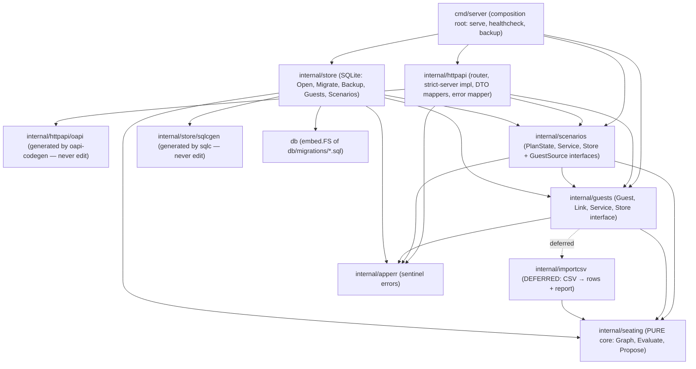
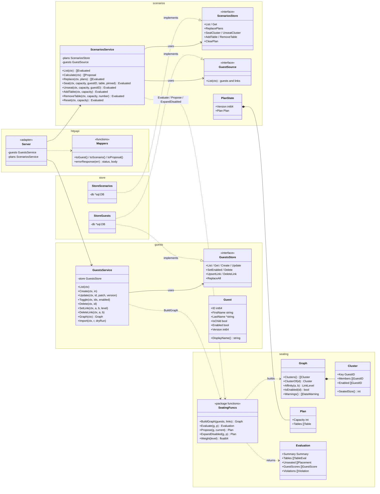
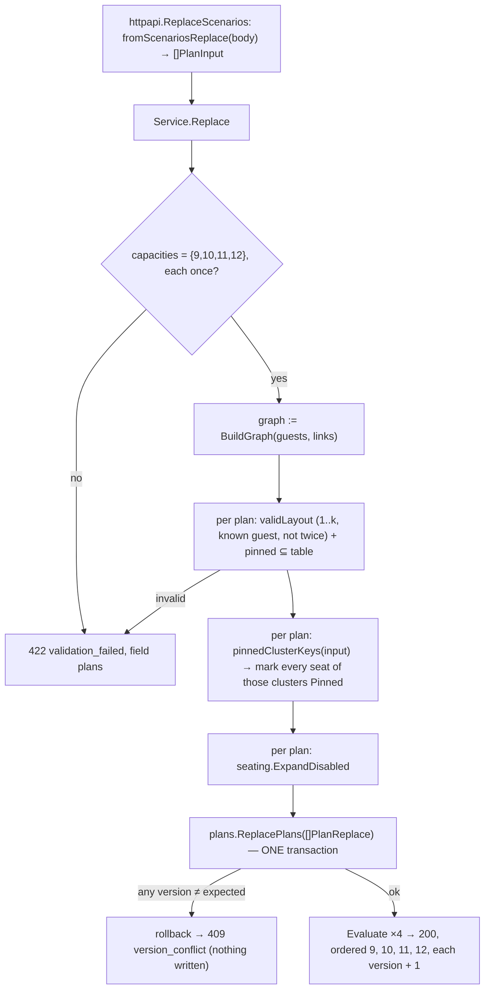

# 003 — Backend design (Go): packages, core interfaces, class diagram, audit

Task 003, Phase 5 (Skills 13–16); updated for task 007 (Generate stores at once, `PUT /scenarios`, §6) and task 008 (anneal stage, §2.1). It builds on [../04-data-model.md](../04-data-model.md) (DTOs, mappers, stores), [../03-seating-model.md](../03-seating-model.md) (rules), [002-erd.md](002-erd.md) and the contract [`docs/openapi.yaml`](../../openapi.yaml). Backend-Go implements **exactly** these packages and signatures. If one turns out to be wrong, raise it rather than drifting.

## 1. Packages and dependency direction



*Legend:*
- Arrows mean "imports".
- **Dependency rule:** `seating` imports nothing from the project (only the stdlib). Services own their store interfaces, and `store` implements them (**Dependency Inversion**). Go requires this anyway: `store` imports the domain types, so the domain cannot import `store`.
- `httpapi` never touches `store` or `sqlcgen`, and `seating` never sees a DTO or a row.
- `importcsv` depends only on `seating` (for `LinkLevel`), so it can be replaced without touching the core (**Adapter**). It is deferred to post-MVP.

## 2. Core interfaces and signatures (Skill 13)

### 2.1 `internal/seating` — pure functional core

```go
package seating

type GuestID = int64
type LinkLevel int
const (Must LinkLevel = 0; Preferred LinkLevel = 1; Acceptable LinkLevel = 2)
const Floor = 8                       // minimum guests per table when k > 1 (was 6 until task 006)
func Weight(l LinkLevel) float64      // Preferred 1.0, Acceptable 0.5, else 0

type Guest struct { ID GuestID; Enabled bool }
type Link  struct { A, B GuestID; Level LinkLevel }

type Cluster struct {
    Key     GuestID   // smallest member id
    Members []GuestID // all members, sorted
    Enabled []GuestID // enabled members, sorted
}
func (c Cluster) SeatedSize() int

type Graph struct { /* clusters, guest→cluster index, cluster-pair affinity, warnings (unexported fields) */ }
func BuildGraph(guests []Guest, links []Link) Graph   // union-find over level-0 links of ALL guests
func (g Graph) Clusters() []Cluster                    // ordered by Key
func (g Graph) ClusterOf(id GuestID) (Cluster, bool)
func (g Graph) Affinity(a, b GuestID) (LinkLevel, bool) // between two cluster keys; false = strangers
func (g Graph) IsEnabled(id GuestID) bool
func (g Graph) Warnings() []DataWarning                 // cluster_exceeds_9 / _12 / conflicting_link_levels

type Seat  struct { Guest GuestID; Pinned bool }
type Table struct { Number int; Seats []Seat }
type Plan  struct { Capacity int; Tables []Table }      // tables ordered 1..k

type Evaluation struct {
    Summary     Summary
    Tables      []TableEval
    Unseated    []Placement
    GuestScores []GuestScore
    Violations  []Violation
}
type Summary struct { TableCount, Seated, Unseated, ViolationCount int; Score float64; NeedsRecalculation bool }
type TableEval  struct { Number, Fill int; Score float64; Clusters []Placement }
type Placement  struct { ClusterKey GuestID; Guests []GuestID; Pinned bool } // enabled members only
type GuestScore struct { Guest GuestID; Table int /*0 = unseated*/; Satisfaction float64; PreferredTotal, PreferredAtTable, FallbackAtTable, StrangersAtTable int }
type Violation  struct { Code ViolationCode; Table int /*0 = none*/; Guests []GuestID }
type DataWarning struct { Code WarningCode; Guests []GuestID }

func Evaluate(g Graph, p Plan) Evaluation         // disabled seats are ignored; NeedsRecalculation = len(Violations) > 0
func Propose(g Graph, current Plan) Plan          // deterministic; keeps pinned clusters; enabled guests only
func ExpandDisabled(g Graph, p Plan) Plan          // adds each placed cluster's unlisted disabled members to its table (used by Service.Replace)
```

Internal (unexported, but each has its own table-driven tests): `minTables`, `pack`, `repairFloor`, `packExact`, `anneal`, `improve` (move/swap, first-improvement, capped at a fixed number of passes, no wall-clock), `score`. **No time budget based on the clock**: fixed iteration / pass / node caps keep it deterministic and testable.

**Score optimisation stage (task 008).** In `Propose`, every place that today calls `improve(l, maxPasses)` on a feasible layout (after `pack`+`repairFloor` and after `packExact`) calls `optimise(l)` instead; nothing before it changes (k selection, `pack`, `repairFloor`, `packExact`, the best-effort fallback):

```go
// anneal.go (new file)
type rng struct{ s uint64 }              // self-contained PRNG (splitmix64 or xorshift64*); no math/rand, no clock
func (r *rng) next() uint64
func (r *rng) intn(n int) int             // uniform in [0, n)
func (r *rng) float() float64             // uniform in [0, 1)

const annealSeed = <constant>             // fixed; restart i uses a seed derived from annealSeed and i
const annealIters = <constant>            // per restart; ≥ 400k at ~100 guests (may be a pure function of item count)
const annealRestarts = <constant>         // ≥ 1

// anneal: simulated annealing over unpinned placed items, from l (feasible).
// Steps: move one item to another table, or swap two items on different tables;
// a step is only tried if it keeps capacity and floor (Floor, 0 when k = 1).
// Δ from affTo / swapDelta (integer). Accept Δ ≥ 0; else accept if r.float() < exp(Δ/T),
// T cooling geometrically over the iteration budget. Leaves l at the BEST layout seen.
func anneal(l *layout, iters int, r *rng)

// optimise = for each restart: copy of the start layout → anneal → keep the best;
// then improve(best, maxPasses). Skips anneal when fewer than 2 movable items or k = 1.
// Postcondition: score(result) ≥ score(start); k, pins, fills within [floor, capacity] unchanged.
func optimise(l *layout)
```

Names and the exact schedule (T0, T_end, move/swap mix, restart count) are Backend-Go's choice, tuned with the benchmark; the contract is the postcondition plus determinism. `layout` needs a cheap copy (assign, fill, affTo) for best-seen snapshots and restarts. Determinism note: `math.Exp` results feed the accept decision, so "same input → same plan" is guaranteed for the same build/architecture (tests run on the Pi); tests assert run-twice equality and score thresholds rather than relying on cross-architecture bit identity. Target: one `Propose` ≤ ~1 s on the Pi, `Calculate` (four capacities) ≤ ~2–3 s; if sequential runs miss it, `scenarios.Service.Calculate` runs the four `Propose` calls in goroutines (read-only `Graph`; results kept in order 9, 10, 11, 12) — `seating` stays single-threaded. Update the package doc in `graph.go` ("no clock, no randomness") to: no clock, no I/O, no package-level mutable state; the only randomness is a constant-seed PRNG inside `Propose`, so results are still a pure function of the input.

### 2.2 `internal/guests`

```go
type Guest struct { ID int64; FirstName string; LastName *string; Notes string; IsChild, Enabled bool; Version int64; CreatedAt, UpdatedAt time.Time }
func (g Guest) DisplayName() string
func NameKey(first string, last *string) string
type Link struct { A, B int64; Level seating.LinkLevel }      // NewLink(a, b, level) normalises A < B, rejects a == b
func NewLink(a, b int64, l seating.LinkLevel) (Link, error)
func (l Link) Key() string
func ParseLinkKey(s string) (a, b int64, err error)
type ImportLink struct { AIndex, BIndex int; Level seating.LinkLevel } // deferred
type NewGuest struct { FirstName string; LastName *string; Notes string; IsChild, Enabled bool }
type Patch struct { FirstName *string; LastName *string; ClearLastName bool; Notes *string; IsChild, Enabled *bool }
func ToSeating(gs []Guest, ls []Link) ([]seating.Guest, []seating.Link)

type Store interface {                       // implemented by *store.Guests
    List(ctx) ([]Guest, []Link, error)
    Get(ctx, id int64) (Guest, error)
    Create(ctx, g NewGuest) (Guest, error)
    Update(ctx, g Guest, expectedVersion int64) (Guest, error)
    SetEnabled(ctx, ids []int64, enabled bool) ([]Guest, error)
    Delete(ctx, id int64) error
    UpsertLink(ctx, l Link) (Link, error)
    DeleteLink(ctx, a, b int64) error
    ReplaceAll(ctx, gs []NewGuest, ls []ImportLink) error   // deferred (import)
}

type Service struct { store Store }
func NewService(s Store) *Service
func (s *Service) List(ctx) ([]Guest, []Link, error)
func (s *Service) Create(ctx, in NewGuest) (Guest, error)                 // trims, validates lengths → apperr.Validation
func (s *Service) Update(ctx, id int64, p Patch, version int64) (Guest, error)
func (s *Service) Toggle(ctx, ids []int64, enabled bool) ([]Guest, error)
func (s *Service) Delete(ctx, id int64) error
func (s *Service) SetLink(ctx, a, b int64, l seating.LinkLevel) (Link, error)
func (s *Service) DeleteLink(ctx, a, b int64) error
func (s *Service) Graph(ctx) (seating.Graph, error)                       // for GET /clusters
func (s *Service) Import(ctx, r io.Reader, dryRun bool) (importcsv.Report, error) // DEFERRED
```

### 2.3 `internal/scenarios`

```go
type PlanState struct { Version int64; Plan seating.Plan }   // reuses seating.Plan (DRY): Capacity, Tables, Seats(+Pinned)

type Store interface {                       // implemented by *store.Scenarios
    List(ctx) ([]PlanState, error)                                    // 4, ordered by capacity (9, 10, 11, 12)
    Get(ctx, capacity int) (PlanState, error)
    ReplacePlans(ctx, ps []PlanReplace) ([]PlanState, error)          // task 007: all given plans in ONE transaction; any stale → ErrVersionConflict, nothing written
    SeatCluster(ctx, capacity int, members []int64, tableNumber int, pinned bool) (PlanState, error)
    UnseatCluster(ctx, capacity int, members []int64) (PlanState, error)
    AddTable(ctx, capacity int) (PlanState, error)
    RemoveTable(ctx, capacity, number int) (PlanState, error)
    ClearPlan(ctx, capacity int) (PlanState, error)                   // delete plan: all tables (cascade: assignments, pins); version+1
}
type GuestSource interface { List(ctx) ([]guests.Guest, []guests.Link, error) } // *store.Guests satisfies it

type Evaluated   struct { State PlanState; Eval seating.Evaluation }
type Proposal    struct { BasedOnVersion int64; Plan seating.Plan; Eval seating.Evaluation }
type PlanInput   struct { Capacity int; BasedOn int64; Tables []seating.Table }      // one ScenarioLayout; Seat.Pinned = id ∈ pinnedGuestIds
type PlanReplace struct { Capacity int; ExpectedVersion int64; Plan seating.Plan }   // what the store writes

type Service struct { plans Store; guests GuestSource }
func NewService(p Store, g GuestSource) *Service
func (s *Service) List(ctx) ([]Evaluated, error)
func (s *Service) Calculate(ctx) ([]Proposal, error)                                  // Propose ×4 (9, 10, 11, 12) from ONE graph
func (s *Service) Replace(ctx, in []PlanInput) ([]Evaluated, error)              // task 007, PUT /scenarios (Generate store + Cofnij); replaces Accept
        // capacities 9,10,11,12 exactly once → per plan: validLayout (1..k, known guests, no duplicates)
        // + pinned ⊆ its table → pin spread to every seat of a pinned cluster (pinnedClusterKeys of the INPUT)
        // → ExpandDisabled → plans.ReplacePlans (one tx) → Evaluate each; ordered 9..12
func (s *Service) Seat(ctx, capacity int, guestID int64, table int, pinned bool) (Evaluated, error) // whole cluster (ClusterOf.Members)
func (s *Service) Unseat(ctx, capacity int, guestID int64) (Evaluated, error)
func (s *Service) AddTable(ctx, capacity int) (Evaluated, error)
func (s *Service) RemoveTable(ctx, capacity, number int) (Evaluated, error)
func (s *Service) Reset(ctx, capacity int) (Evaluated, error)        // UC-17 "Usuń plan": s.edit(ClearPlan); no version check
```

### 2.4 `internal/store`, `internal/httpapi`, `internal/apperr`, `cmd/server`

```go
package store
func Open(path string) (*sql.DB, error)            // modernc driver, WAL, foreign_keys=ON, busy_timeout=5000, MaxOpenConns(1)
func Migrate(ctx context.Context, db *sql.DB) error // goose + db.Migrations (embed.FS)
func Backup(ctx context.Context, db *sql.DB, dest string) error // VACUUM INTO
type Guests struct { db *sql.DB }                   // implements guests.Store and scenarios.GuestSource
type Scenarios struct { db *sql.DB }                // implements scenarios.Store
func NewGuests(db *sql.DB) *Guests; func NewScenarios(db *sql.DB) *Scenarios
func withTx(ctx, db, fn func(q *sqlcgen.Queries) error) error   // one transaction per store method
func mapErr(err error) error                        // UNIQUE(name_key) → apperr.ErrDuplicateName; FK → apperr.ErrNotFound

package apperr
var ErrNotFound, ErrVersionConflict, ErrDuplicateName error
type Validation struct { Field, Message string }    // implements error

package httpapi
type Server struct { guests *guests.Service; plans *scenarios.Service } // implements oapi.StrictServerInterface
func NewServer(g *guests.Service, p *scenarios.Service) *Server
func NewRouter(basePath, webRoot string, api oapi.StrictServerInterface) http.Handler
        // basePath+"/api": RequestID, Recoverer, slog request log (method, path, status, duration — NO bodies), body limit, X-Robots-Tag
        // basePath+"/": static files from webRoot, index.html fallback; basePath → 301 basePath+"/"; Compress
func errorResponse(err error) (status int, body oapi.ErrorResponse)   // the ONE error mapper (04-data-model § errors)
// mapping.go: toGuest, toGuestList, toLink, toClusterOverview, toScenario, toProposal, toSeatingPlan, fromScenariosReplace

package main
func run(ctx context.Context, args []string, getenv func(string) string, stdout io.Writer) error
        // "serve" (default) | "healthcheck" (GET http://127.0.0.1:$PORT$BASE_PATH/api/health) | "backup <dest>"
type config struct { BasePath, Port, DBPath, WebRoot string } // from env, defaults per 02-system-context
```

## 3. Class diagram (Skill 15)



*Legend: patterns and principles*

| Element | Pattern / principle | Why here |
|---|---|---|
| `seating` package functions | **Functional core, imperative shell** | All rules are pure (data in, data out), so they get table-driven tests with no DB. Services form the shell. |
| `GuestsStore`, `ScenariosStore`, `GuestSource` (declared in the consumer packages) | **Repository** + **Dependency Inversion** + **Interface Segregation** | Go needs consumer-side interfaces to avoid the store↔domain import cycle. `GuestSource` has one method because `scenarios` needs nothing else. One concrete implementation each, with no mocks; tests use real SQLite. |
| `httpapi.Server` | **Adapter** (to the generated strict-server interface) | Transport only: decode, call one service method, map. |
| `Mappers` / `errorResponse` | **DTO + Mapper**, **DRY** | One mapper per type and one error mapper for every handler. |
| `PlanState{Version; Plan seating.Plan}` | **Composition**, **DRY** | Reuses the core's `Plan` instead of a parallel struct (fixed in the audit). |
| `version` checks in `Update` / `ReplacePlans` | **Optimistic Offline Lock** | Two flows can clobber: a guest edit form and replacing all four plans (storing a Generate over plans the user saw, or a Cofnij over the Generate's result). Manual plan edits (`Seat`, `Unseat`, `AddTable`, `RemoveTable`, `Reset`) are not version-checked: their result does not depend on a snapshot the client saw. They still bump the version, which is what makes a later Cofnij a 409. |
| `cmd/server.run` | **Composition root** | Explicit constructor wiring, no DI container, testable through `run(args, getenv)`. |
| Union-find inside `BuildGraph` | Algorithm, not a pattern | Connected components of group-0 links. |

## 4. Pattern evaluation (Skill 14)

| Candidate | Verdict | Reason |
|---|---|---|
| Strategy (seating algorithm) | rejected | One algorithm; capacity is a parameter. Add it only if a second algorithm is actually built. |
| Template Method | rejected | No algorithm family. |
| Strategy / injectable RNG interface for the anneal (task 008) | rejected | Annealing is one more stage of the single algorithm, not an alternative. The PRNG is a tiny concrete type with a constant seed; tests need determinism, not a swappable source. |
| Command / Memento (undo) | rejected as patterns | Task 007's one-step Cofnij needs no server code: the client re-sends its pre-Generate snapshot through the same `PUT /scenarios`. No undo stack, no snapshot table. |
| Observer / domain events | rejected | Nothing reacts asynchronously; plans are evaluated on read. |
| State (plan "needs recalculation") | rejected as a pattern | It is a derived boolean (`len(violations) > 0`), not a stored state machine. |
| Facade | rejected | Two services already form the API surface. |
| Builder | rejected for production code | Test fixtures may use small helper functions (`guest(id)`, `link(a,b,l)`), with no builder types. |
| Factory | rejected | Plain constructors (`NewService`). |
| Singleton | rejected | Explicit wiring in `main`. |
| Unit of Work | rejected | One transaction per store method; no cross-aggregate transaction except import (`ReplaceAll`, deferred). |
| Decorator | adopted only as chi middleware | Request ID, recoverer, logging, body limit: the idiomatic `func(http.Handler) http.Handler`. |
| Generic repository | rejected | Two aggregates with different operations. |
| Clock / ID-generator interfaces | rejected | Timestamps come from SQL defaults; ids from SQLite. |
| Atomic four-plan replace (`ReplacePlans`, task 007) | **adopted, one store method** | A half-applied Generate is worse than none. One store method = one transaction, so no Unit of Work object is needed. |
| Batch "delete all plans" endpoint (Unit of Work over 4 scenarios) | rejected | Four independent `DELETE /scenarios/{capacity}/tables` calls suffice: each is idempotent, a partial failure is fixed by retrying, and nothing requires the four plans to be cleared atomically (contrast: Generate, which must replace all four at once). |

## 5. Clean-architecture / SOLID / YAGNI audit (Skill 16)

| Check | Result |
|---|---|
| **SRP** | `seating` = rules. `guests` / `scenarios` services = validation, orchestration, transaction choice. `store` = SQL + row mapping. `httpapi` = transport + DTO mapping. `main` = wiring. One reason to change each. |
| **OCP / LSP** | No extension points by design (YAGNI); nothing to violate. |
| **ISP** | Consumer interfaces list only the methods used (`GuestSource` = 1 method). |
| **DIP** | Services own their abstractions and `store` depends on the domain, never the reverse. `seating` depends on nothing. |
| **DRY** | One `Plan` type (core), one `SeatingPlan` DTO shared by `Scenario` and `Proposal`, one error mapper, one place for the floor/weights (`seating` constants). |
| **Law of Demeter** | Handlers call one service method each; services do not reach through store internals. |
| **YAGNI** | No Strategy, no event bus, no caching, no Zustand, no auth, no config package, no batch create endpoint. Import is kept in the contract but implemented last. |
| **Found and fixed in this audit** | (1) `scenarios.PlanState` duplicated the core plan shape, so it now embeds `seating.Plan` (04-data-model §1 updated). (2) `importcsv` importing `guests` while `guests.Service.Import` imports `importcsv` would be an import cycle, so `importcsv` now returns its own row types and depends only on `seating`. (3) The wall-clock time budget in `Propose` made tests flaky by design, so it is replaced by a fixed pass cap (deterministic); task 008's anneal follows the same rule (fixed iteration budget, constant-seed PRNG). (4) `GET /clusters` and plan reads both need the graph: built by one function (`seating.BuildGraph`) via `guests.ToSeating`, not duplicated. |

## 6. Task 007 — Generate stores at once, Cofnij (`PUT /scenarios`)

Contract: `PUT /scenarios` (`replaceScenarios`, body `ScenariosReplace`, 200 `ScenarioListResponse`); `PUT /scenarios/{capacity}/assignments` (`acceptProposal`, `AcceptPlan`) is **removed**. `POST /scenarios/calculate` is unchanged (still pure). Rules: [../03-seating-model.md](../03-seating-model.md) § Storing a Generate / § Undoing a Generate. No migration.



*Legend:* validation (422) happens before the transaction; the version check happens inside it (atomic compare-and-set per scenario row, `UPDATE … WHERE version = ?`). Functional core / imperative shell is unchanged: `validLayout`, `pinnedClusterKeys` and `ExpandDisabled` are pure; only `ReplacePlans` touches the DB.

**Tests (real SQLite, no DB mocks):**
- store: `ReplacePlans` writes four plans and bumps four versions; one stale version among four → `ErrVersionConflict` and **all four plans byte-for-byte unchanged** (tables, assignments, pins, versions); empty `tables` → empty plan.
- service: missing/duplicate capacity → 422; unknown guest / guest twice / bad numbering / pinned guest not at its table → 422 naming the plan; pins from `pinnedGuestIds` reach every seat of the cluster incl. ride-along disabled members; disabled members ride along; round trip "GET → calculate → PUT (snapshot versions) → PUT(snapshot, returned versions)" restores the exact original tables, enabled assignments and pins.
- httpapi: 200 envelope with four scenarios; 409 and 422 envelopes; `PUT /scenarios/{capacity}/assignments` now 404/405 (route gone).

**Delete (dead after task 007):** `scenarios.Service.Accept`; `Store.ReplacePlan` (fold its SQL into `ReplacePlans`; reuse `DeleteScenarioTables` and the insert queries; remove any sqlc query used only by it); the strict handler `AcceptProposal`; mapper `fromAcceptPlan`; their tests. Keep `Calculate`, `validLayout`, `pinnedClusterKeys` (now applied to the input plan), `toProposal`, `ExpandDisabled`.
