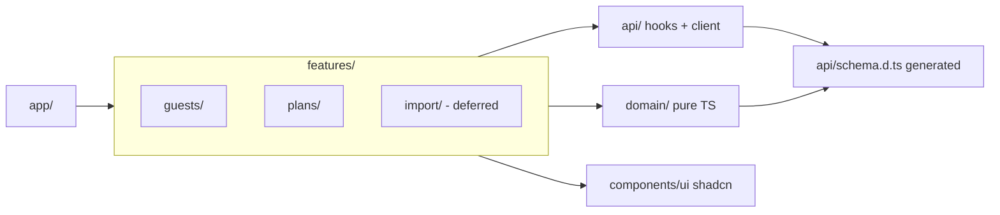
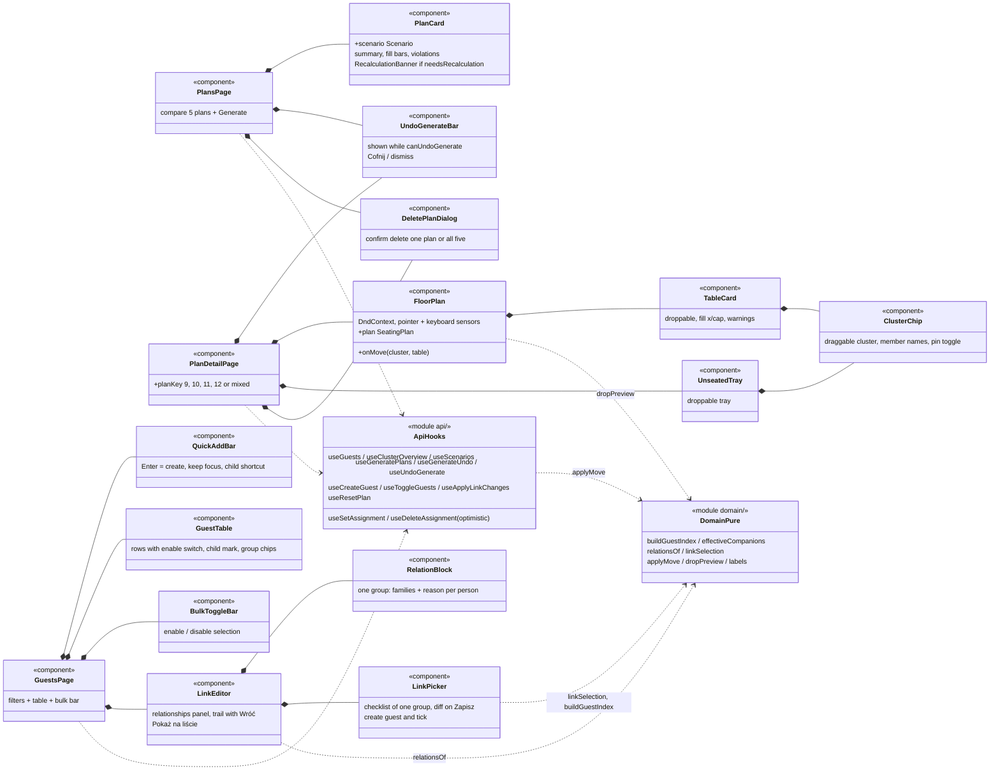
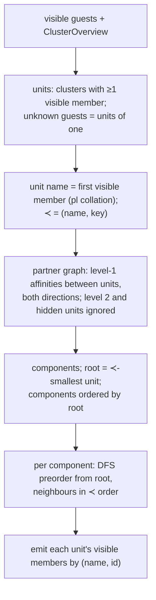
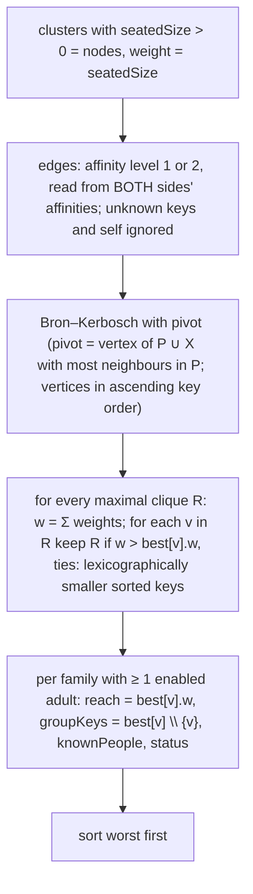

# 003 — Frontend design (React SPA): modules, components, state ownership, audit

Task 003, Phase 5 (Skills 13–16); updated for task 005 (delete a plan, §7), task 006 (four table sizes, §8), task 007 (Generate stores at once + Cofnij, §9), task 009 (PIN screen / access gate, §10), task 013 (five plans incl. the mixed plan, §13) and to match the shipped relationships panel / link checklists (§5). Contract: [`docs/openapi.yaml`](../../openapi.yaml). Interaction states: [001-state-machine.md](001-state-machine.md). Flows: [003-sequences.md](003-sequences.md). The UI language is Polish. Frontend-web loads the `frontend-design` skill before building screens.

## 1. Modules and dependency rule

```
frontend-web/src/
├── app/                 App.tsx (router, basename /wesele), Layout (tabs: Plany | Goście), queryClient.ts
├── api/                 schema.d.ts (GENERATED by openapi-typescript from docs/openapi.yaml)
│                        client.ts (openapi-fetch, baseUrl API_BASE='/wesele/api'), errors.ts (ApiError from envelope)
│                        keys.ts (query keys), guests.ts, clusters.ts, scenarios.ts (TanStack hooks), import.ts (DEFERRED)
├── domain/              PURE TS, no React: guestIndex.ts, companions.ts, linkColumns.ts, relations.ts, linkSelection.ts,
│                        guestFilters.ts, optimistic.ts, dropPreview.ts, planView.ts, labels.ts (Polish copy for codes)
├── features/
│   ├── guests/          GuestsPage, QuickAddBar, GuestTable, GuestRow, GuestFilters, BulkToggleBar,
│   │                    GuestEditDialog, DeleteGuestDialog, LinkEditor (relationships panel), RelationBlock,
│   │                    LinkPicker (per-group checklist), ClusterWarnings
│   ├── plans/           PlansPage (compare), PlanCard, GenerateButton, UndoGenerateBar (task 007), RecalculationBanner,
│   │                    PlanDetailPage, FloorPlan, TableCard, ClusterChip, UnseatedTray, GuestDetailsPanel,
│   │                    PlanSearch, PrintView, DeleteTableDialog, DeletePlanDialog (task 005)
│   └── import/          ImportPage (DEFERRED)
└── components/ui/       shadcn/ui primitives (copy-paste), nothing app-specific
```



*Legend:*
- `domain/` imports only **types** from the generated schema. It has no React, no fetch and no state, so it gets plain Vitest unit tests.
- Features never call `fetch`; they use the `api/` hooks.
- Features do not import each other. Shared bits move to `domain/` or `components/ui/`.

## 2. Core module interfaces (Skill 13)

```ts
// api/client.ts
export const API_BASE = '/wesele/api';
export const client = createClient<paths>({ baseUrl: API_BASE });
export class ApiError extends Error { status: number; errors: ErrorItem[] }  // thrown by every hook on non-2xx

// api/keys.ts
export const keys = { guests: ['guests'], clusters: ['clusters'], scenarios: ['scenarios'], generateUndo: ['generateUndo'] } as const;

// api/guests.ts
useGuests(): UseQueryResult<Guest[]>
useCreateGuest(), useUpdateGuest(), useToggleGuests(), useDeleteGuest()      // onSuccess: invalidate guests, clusters, scenarios
useApplyLinkChanges()     // ONE mutation for a checklist Save or a single removal: {guestId, changes: LinkChange[]};
                          // sends one PUT/DELETE /guest-links/{a-b} per change, in order, and returns the failures;
                          // onSettled: invalidate guests, clusters, scenarios
// api/clusters.ts
useClusterOverview(): UseQueryResult<ClusterOverview>
// api/scenarios.ts
useScenarios(): UseQueryResult<Scenario[]>                                    // 5, ordered 9/10/11/12/mixed (task 013, §13)
useGeneratePlans()        // task 007, §9: fetch fresh scenarios (= undo snapshot) → POST /scenarios/calculate → PUT /scenarios
                          // (basedOnVersion = snapshot versions); onSuccess: setQueryData(keys.scenarios, response) +
                          // setQueryData(keys.generateUndo, {previous: snapshot, generatedVersions}); 409: refetch scenarios
useGenerateUndo(): GenerateUndo | undefined   // reads keys.generateUndo (skipToken, staleTime/gcTime Infinity, like the old preview)
useUndoGenerate()         // PUT /scenarios with the snapshot (basedOnVersion = generatedVersions); onSuccess: setQueryData(keys.scenarios)
                          // + clear keys.generateUndo; on 409/422: clear keys.generateUndo + refetch scenarios
useSetAssignment(), useDeleteAssignment()                                     // OPTIMISTIC (domain/optimistic.ts), rollback on error,
                                                                              // onSuccess: replace scenario with the server's evaluated copy
useAddTable(), useDeleteTable()
useResetPlan()            // task 005: DELETE /scenarios/{planKey}/tables; onSuccess: replace that scenario (matched by key)

// domain/guestIndex.ts
buildGuestIndex(guests: Guest[]): GuestIndex                    // byId, search(query) — case- and diacritics-insensitive ("Michal" finds "Michał")
// domain/companions.ts
effectiveCompanions(guestId, guests, overview): Companion[]     // {guestId, level, via?: guestId}: group 0 = the server's cluster
clusterOf(guestId, overview): Cluster
sortByCluster(guests, overview | undefined): Guest[]             // default guest-list order: group 0, then group 1 (§11)
// domain/linkColumns.ts
linkColumns(guestId, guests, overview): Record<LinkLevel, ColumnEntry[]>  // own links first, then derived ({via, reason: 'cluster'|'link'})
warningsForGuest(guestId, overview): DataWarning[]
// domain/relations.ts
relationsOf(guestId, guests, overview): Relations               // per level: people grouped by family (group-0 cluster), counts, total
summariseRelations(guests, overview): Map<id, RelationSummary>  // guest-list row: group-0 partners, counts and names per level
relatedTo(guestId, guests, overview): RelatedGuest[]            // the "Powiązani z: X" filter (?powiazani=<id>)
// domain/linkSelection.ts
pickerRows(guest, guests, overview): PickerRow[]                 // every other guest, Polish order, currentLevel, viaCluster, via
selectedAt(guest, level); diffSelection(guest, level, selected): LinkDiff {add, move, remove}; diffIsEmpty(diff)
linkChangesOf(level, diff): LinkChange[]                         // removals first, then moves and adds (same upsert)
joiningViaCluster(guestId, selected, overview)                   // group 1/2 preview: who comes along with the ticked
clusterAfter(guest, guests, selected); clusterSizeWarning(seatedSize)   // group 0 preview: cluster after Save, > 9 / > 12
// domain/optimistic.ts
applyMove(plan: SeatingPlan, cluster: ClusterPlacement, toTable: number | null): SeatingPlan   // moves the placement, recomputes fills only
// domain/dropPreview.ts
dropPreview(plan, cluster, toTable, capacity, overview): { fillAfter, overCapacity, underFloorSource, preferredHere: number }
// domain/planView.ts (task 007)
toTableLayouts(plan: SeatingPlan): TableLayout[]          // number, guestIds (all clusters), pinnedGuestIds (pinned clusters) — for proposals AND snapshots
toScenariosReplace(plans: {key, basedOnVersion, plan}[]): ScenariosReplace     // task 013: key instead of capacity
canUndoGenerate(undo: GenerateUndo | undefined, scenarios: Scenario[] | undefined): boolean   // every scenario.version === undo.generatedVersions[scenario.key]
// domain/plans.ts (task 013, replaces domain/capacity.ts): PLAN_KEYS, parsePlanKey, isRetiredPlanKey, planName, planTitle
// domain/tableSizes.ts (task 013): tableSize(fill, scenario), tablesNeeded(scenario), tablesNeededLabel(needed)
// domain/labels.ts
violationLabel(v: Violation): string; warningLabel(w: DataWarning): string; errorLabel(e: ErrorItem): string   // Polish copy
```

The `domain/` functions only **display** hints (fill after a drop, who is "via" whom). Scores, violations and `needsRecalculation` always come from the server; the client never re-implements scoring.

## 3. Component / hook class diagram (Skill 15)



*Legend*

| Element | Pattern / principle | Why |
|---|---|---|
| `api/` hooks | **Gateway** (one typed access point) + **DRY** | Types are generated from the contract; invalidation rules are written once per mutation. |
| `domain/` | **Functional core** | Display logic is pure and unit-tested without React. |
| Pages → presentational children | **Container / presentational split** | Pages own the hooks; children get props, so they are easy to test and to print. |
| Optimistic moves | **Optimistic UI with rollback** (TanStack `onMutate` / `onError`) | The drag must feel instant (state machine §3). |
| Undo snapshot in the query cache (`keys.generateUndo`, task 007) | **YAGNI** over a client store; a one-slot **Memento** in spirit | Transient, per tab, never fetched. No Zustand, no undo stack. |
| `@dnd-kit` sensors | **Accessibility** | Keyboard drag is a requirement. |

## 4. State ownership

| State | Owner | Notes |
|---|---|---|
| Guests, clusters, scenarios | TanStack Query (`keys.*`) | Refetch on window focus. Mutations invalidate or replace. |
| Undo snapshot of the last Generate (`{previous: Scenario[], generatedVersions}`) | TanStack Query cache `keys.generateUndo` | Task 007. Set by a successful Generate (replacing any older one), cleared by Cofnij (success, 409 or 422) and by "×". Lost on reload (by design). Visibility is derived: `canUndoGenerate`. |
| Guest filters, selection for bulk toggle, search text | `GuestsPage` local state (filters mirrored to the URL query string so a reload keeps them) | Includes the **"Powiązani z: X"** filter, URL-mirrored as `?powiazani=<guestId>` (`domain/guestFilters.ts`), set by "Pokaż na liście" in the relationships panel. |
| Relationships panel: which person is shown, the "Wróć" trail, which group's checklist is open | `LinkEditor` local state | Closing the panel forgets it. |
| Checklist selection, search text, "Tylko zaznaczeni" | `LinkPicker` local state | Nothing is sent before "Zapisz"; "Anuluj" / Esc discards. |
| Delete-plan confirmation open, acknowledgement checkbox | `PlansPage` / `PlanDetailPage` local state | Task 005, §7. |
| Active drag | dnd-kit (`DndContext`) | — |
| Selected guest in a plan (details panel) | `PlanDetailPage` local state + URL param `?guest=` | Deep link: "where does Ania sit". |
| Remembered tab / last plan opened | _not implemented_ (YAGNI; would be `localStorage` in try/catch) | Convenience only. |

## 5. Manual-entry UX (MVP data entry, first-class)

- **QuickAddBar:** a single input at the top of the guest list. "Imię Nazwisko" + Enter creates the guest (`POST /guests`) and the input stays focused. A **sticky "Dziecko" checkbox** next to the input marks every following add as a child until it is unticked; while it is on, the whole bar is tinted and shows a "Dodajesz dzieci" pill, and the confirmation reads "Dodano dziecko: …" (otherwise "Dodano: …", with the session count). A duplicate name shows the server's `duplicate_name` inline and keeps the text so it can be fixed. Typing speed is the limit; there is no batch endpoint (A-20).
- **LinkEditor = relationships panel** ("Powiązania: X"), opened from a guest row. It shows "Łącznie powiązanych: N" and three `RelationBlock`s: **Grupa 0 – siedzą razem**, **Grupa 1 – chcą siedzieć razem**, **Grupa 2 – ewentualnie**. In each block people are grouped by family (their group-0 cluster) and every person carries the reason: **"wpisany bezpośrednio"** (a link of this guest), **"przez grupę 0: X"** (in X's cluster), or **"przez powiązanie: X"** (a cluster-mate X's own link brings them). Direct links have a remove button (one `useApplyLinkChanges` call with `level: null`). Every name is clickable and opens that person in the same panel; a **"Wróć: <name>"** trail walks back. **"Pokaż na liście"** closes the panel and narrows the guest list to this person and their relations (`?powiazani=<id>`). Data warnings of the guest's cluster show inline (`ClusterWarnings`).
- **LinkPicker = per-group checklist** ("Edytuj" / "Wybierz gości…" on a block, a nested dialog). It lists **every other guest** (Polish collation) with a checkbox, a search box (case- and diacritics-insensitive) and a **"Tylko zaznaczeni"** toggle. It starts with the guest's direct links at that level ticked. A note under a name says what Save will do ("Powiązanie przejdzie z grupy 1 do grupy 0", since a pair has ONE link) or why the row is fixed (group 0: already in the cluster through someone else's link, "przez grupę 0: X. Zmień to przy: X"). A live preview shows who comes along (group 1/2: `joiningViaCluster`) or the cluster after saving and its size warning > 9 / > 12 (group 0: `clusterAfter`). **"Zapisz"** applies the difference (`diffSelection` → `linkChangesOf`): **removals first, then moves and adds**, all through one `useApplyLinkChanges` mutation (one request per changed pair); failures are listed and the rest stays saved. If the search matches nobody, **"Dodaj «X» jako nowego gościa"** only creates the guest (`POST /guests`) and ticks them; the link is sent with "Zapisz".
- **Rule: group 0 is the cluster.** For every guest, everywhere in the UI (relationships panel, guest-row summary, "Powiązani z" filter, picker), group 0 is derived from the server's **cluster membership** (`GET /clusters`, `clusterOf`), never from the guest's own stored group-0 links. Example: Emilka linked Justynka, Maks and os. tow. at level 0; Justynka has no link of her own, yet her group 0 is those three (Emilka "wpisany bezpośrednio" from Emilka's side, the others "przez grupę 0: Emilka"). Reading only `guest.links` here was a bug (Justynka showed 1 instead of 3). The guest's own links are used only to label *how* someone is reached and to decide what the checklist can untick.
- **No link author.** The API stores one symmetric link per pair with no author, so the UI cannot show "who entered it"; "wpisany bezpośrednio" means "a link of the shown guest", from whichever side it was typed. Showing the author would need a contract change (possible future, not planned).
- **BulkToggleBar:** filter "Dzieci" → select all → "Wyłącz zaznaczonych" (`PATCH /guests`). Per-row switches use the same endpoint with one id.
- Data warnings (cluster > 9 / > 12, conflicting levels) are shown inline next to the guests involved.

## 6. Pattern evaluation and audit (Skills 14, 16)

| Candidate | Verdict | Why |
|---|---|---|
| Zustand / global client store | rejected | Every piece of state has an owner in §4. |
| Redux / context-based store | rejected | Same reason. |
| Canvas library (Konva) | rejected | DOM/SVG keeps dnd-kit accessible (ADR-001). |
| Command/undo stack | rejected | Only a one-step Cofnij of the last Generate (task 007): one snapshot, re-sent through `PUT /scenarios`. |
| Client-side scoring | rejected | The server is the single source of truth (DRY). Only display hints are computed client-side. |
| Form library for QuickAddBar | rejected | One input. React Hook Form + Zod only in `GuestEditDialog`. |
| MSW (Mock Service Worker) for hook/component tests | **adopted, test-only** | Free (MIT). Tests the real fetch layer against contract-shaped responses (`schema.d.ts` types). |

**Audit.**
- SRP: pages fetch, children render, `domain/` computes, `api/` talks HTTP.
- DRY: one API client, generated types, one place for Polish labels.
- YAGNI: no global store, no undo stack (one-step Cofnij of Generate only), no canvas, no batch-create endpoint, import screen deferred.
- Found and fixed:
  1. The drop-preview "satisfaction hint" in state machine §3 could have turned into client-side scoring. It is limited to counting preferred companions already at the target table (`dropPreview.preferredHere`).
  2. The proposal preview initially needed a client store. The query cache is enough. (The preview itself was removed in task 007; the undo snapshot uses the same query-cache approach.)

## 7. Delete a plan (task 005, UC-17)

Contract: `DELETE /scenarios/{capacity}/tables` → 200 `ScenarioResponse` with the empty plan (no body, no version). Rules: [../03-seating-model.md](../03-seating-model.md) § Manual edits.

- **Where.** A destructive-styled **"Usuń plan"** button (trash icon + text) on each `PlanCard` (PlansPage, at the bottom next to "Otwórz plan") and in the `PlanDetailPage` header next to "Dodaj stół". A **"Usuń wszystkie plany"** button in the "Aktualne plany" section header of `PlansPage`. Each is **disabled when there is nothing to delete** (`summary.tableCount === 0`; for "all": all four).
- **Confirmation (`DeletePlanDialog`, an `AlertDialog` like `DeleteTableDialog`).** One plan: title "Usunąć plan na {capacity} miejsc?"; body states what is cleared, from the cached scenario: "{tableCount} stołów i {seatedCount} osób przy stołach. Wszyscy trafią do pola „Bez stołu”. Pinezki znikną. Tego nie da się cofnąć." Buttons "Anuluj" (default focus) / "Usuń plan" (destructive). All plans: title "Usunąć wszystkie cztery plany?", a line per plan with its counts, the same irreversibility text, and a **stronger confirmation**: the "Usuń wszystkie plany" button stays disabled until the checkbox "Rozumiem, że tego nie da się cofnąć" is ticked.
- **Calls.** One plan = one `useResetPlan().mutate({capacity})`. All plans = four calls (9, 10, 11, 12) via `Promise.allSettled`; plans that failed are named in one error toast ("Nie udało się usunąć planu: 10"), the others stay deleted (each call is independent and idempotent, so retrying is safe).
- **After success.** The hook replaces the scenario in `keys.scenarios` with the server copy (its version moves on, so a pending Cofnij of a Generate disappears: `canUndoGenerate` is false). Toast "Usunięto plan na {capacity} miejsc." / "Usunięto wszystkie plany.". On `PlanDetailPage` the user stays on the page.
- **What the empty plan shows.** Nothing new: the existing empty state "Brak stołów w tym planie." (`FillBars`), every cluster in `UnseatedTray`, and — when there are enabled guests — the server's `unseated_guests` violation, so `needsRecalculation` is true and `RecalculationBanner` offers "Przelicz / Generuj".
- Pattern check: no undo for a delete (the Cofnij of task 007 covers only Generate); a confirmation dialog stands in. No new client state beyond the dialog's open flag and checkbox (YAGNI).

## 8. Four table sizes (task 006)

> Task 013 extends this to five plans (§13): `CAPACITIES` becomes `PLAN_KEYS` and the card grid gains a fifth column. Everything else here still holds.

Plans exist for **9, 10, 11 and 12** seats (was 8, 10, 12). Contract: `Capacity` enum `[9, 10, 11, 12]`; `GET /scenarios` and `POST /scenarios/calculate` return exactly four items, ordered 9, 10, 11, 12; the data warning for "too big for the smallest plan" is now `cluster_exceeds_9` (cluster > 9 enabled guests).

- **One list of sizes.** `domain/capacity.ts` `CAPACITIES = [9, 10, 11, 12]` is the only place that lists them; every page, switcher, "delete all" and the Generate/Cofnij body builder iterates it (DRY). The `Capacity` type comes from `schema.d.ts`.
- **Four cards, readable.** `PlansPage` (current plans) lays the cards out as 1 column on phones, **2 × 2 on medium screens**, **4 across on wide screens** (Tailwind `grid-cols-1 md:grid-cols-2 xl:grid-cols-4`). The cards keep the same content; nothing new is added to them. The plan switcher in `PlanDetailPage` lists the four sizes; the print view is per capacity (`/druk/:capacity`). Old bookmarks `/plany/8` and `/druk/8` redirect to 9.
- **Odd seat counts.** `TableSeats` / the round-table drawing, the drop preview and the move menu must place **9 and 11** seats evenly around the table (angle = 360° / capacity, no assumption of an even count or of pairs facing each other).
- **Polish copy.** "Cztery plany naraz: stoły 9-, 10-, 11- i 12-osobowe"; "Zapisano plany: 9, 10, 11, 12 miejsc."; "Usunąć wszystkie cztery plany?" (four DELETE calls); warning label `cluster_exceeds_9`: "Ta paczka (grupa 0) jest za duża na stół 9-osobowy"; the client preview `clusterSizeWarning` uses > 9 / > 12.
- **Floor 8** (was 6): `domain/dropPreview.ts` `MIN_TABLE_FILL = 8` is the single client constant (drop preview, table status, labels "minimum 8", `FillBars` floor line); the `PlanLegend` copy "minimum 6" becomes "minimum 8". Scores and violations still come from the server.
- Pattern check: nothing new. No per-size component, no configuration endpoint for sizes (YAGNI: the sizes are fixed by the contract enum).

## 9. Generate stores at once, Cofnij (task 007)

User decision 2026-10-03 ("Zapisuj od razu"): after **Generuj plany** the tables and assignments are visible immediately in the normal plan views. No preview, no "Akceptuj", **no confirmation dialog** before overwriting (Cofnij covers mistakes; fewer clicks). Contract: `POST /scenarios/calculate` (unchanged) + `PUT /scenarios` (new, atomic, all four plans); `PUT /scenarios/{capacity}/assignments` is gone. Rules: [../03-seating-model.md](../03-seating-model.md) § Storing a Generate / § Undoing a Generate. Flow: [003-sequences.md](003-sequences.md) §1. States: [001-state-machine.md](001-state-machine.md) §2.

**`useGeneratePlans()`** (one mutation, `mutationKey: GENERATE_MUTATION_KEY` so every Generuj button disables while it runs):
1. `snapshot = await queryClient.fetchQuery({ queryKey: keys.scenarios, staleTime: 0, ... })` — fresh `Scenario[]`.
2. `proposals = POST /scenarios/calculate`.
3. `PUT /scenarios` with `toScenariosReplace(proposals.map(p => ({capacity: p.capacity, basedOnVersion: snapshot[p.capacity].version, plan: p.plan})))` — the **snapshot's** versions, so what is overwritten is exactly the snapshot.
4. onSuccess: `setQueryData(keys.scenarios, response.data)`; `setQueryData(keys.generateUndo, { previous: snapshot, generatedVersions: {9: v, 10: v, 11: v, 12: v} from the response })`; invalidate nothing else.
5. 409: invalidate `keys.scenarios`, toast "Plany zmieniły się w międzyczasie — kliknij „Generuj plany” jeszcze raz." Other errors: `errorMessage(error)` toast. Nothing is stored on any error (the PUT is atomic).

**`GenerateButton`.** Same component on both entry points (`PlansPage` header, `RecalculationBanner` on `PlanCard` and `PlanDetailPage`); label "Generuj plany" / "Przelicz / Generuj", running label "Liczę i zapisuję plany…". **No navigation after success**: the `onGenerated` prop is removed and `PlanDetailPage` no longer navigates to `/`; the page you are on re-renders from the updated cache (overview: four cards with new fills; detail: the floor plan with tables and guests). Success toast: "Zapisano nowe plany: 9, 10, 11, 12 miejsc." (no action in the toast — Cofnij lives in the bar).

**`UndoGenerateBar`** (new, presentational + `useGenerateUndo`/`useUndoGenerate`), rendered at the top of **both** `PlansPage` and `PlanDetailPage`, only while `canUndoGenerate(undo, scenarios)` is true:
- Text: "Wygenerowano nowe plany. Poprzednie można przywrócić." Buttons: **"Cofnij"** (outline, `Undo2Icon`) and an icon button "×" (aria-label "Zamknij", clears `keys.generateUndo`). `role="status"`.
- "Cofnij" → `useUndoGenerate().mutate()` → `PUT /scenarios` with `toScenariosReplace(previous.map(s => ({capacity: s.capacity, basedOnVersion: generatedVersions[s.capacity], plan: s.plan})))`. While pending: "Przywracam…", button disabled.
  - 200: `setQueryData(keys.scenarios, response.data)`, clear `keys.generateUndo`, toast "Przywrócono poprzednie plany."
  - 409 or 422: clear `keys.generateUndo`, invalidate `keys.scenarios`, toast.error "Nie można cofnąć — plany zmieniono po wygenerowaniu." Nothing changed on the server.
  - Other errors (network, 500): keep the snapshot (retry possible), toast `errorMessage(error)`.
- The bar disappears by itself as soon as any plan version differs from `generatedVersions` (a move, pin, table change or delete in this tab, or a refetch showing another device's change), because `canUndoGenerate` is derived from the cache — no hook needs to clear it.

**Polish copy (new):** "Liczę i zapisuję plany…", "Zapisano nowe plany: 9, 10, 11, 12 miejsc.", "Wygenerowano nowe plany. Poprzednie można przywrócić.", "Cofnij", "Przywracam…", "Przywrócono poprzednie plany.", "Nie można cofnąć — plany zmieniono po wygenerowaniu.", "Plany zmieniły się w międzyczasie — kliknij „Generuj plany” jeszcze raz."

**Delete (dead after task 007):** `features/plans/ProposalPreview.tsx`, `features/plans/ProposalCard.tsx`; in `api/scenarios.ts`: `useCalculateProposals`, `CALCULATE_MUTATION_KEY` (→ `GENERATE_MUTATION_KEY`), `useProposals`, `useDiscardProposals`, `useDropProposal`, `useAcceptProposal`, the proposal-dropping part of `useResetPlan`; `keys.proposals` in `api/keys.ts`; in `domain/planView.ts`: `toAcceptTables` (→ `toTableLayouts` with `pinnedGuestIds`), `isProposalStale`, `withoutProposal`; `AcceptPlan` in `domain/types.ts` (add `ScenariosReplace`, `ScenarioLayout`; keep `Proposal`, now an internal step); `PlanFigures`' `current` prop ("obecnie …") if `ProposalCard` was its only user; `fourProposals` in `features/plans/fixtures.ts` if no test still needs it; the `onGenerated` prop of `GenerateButton` / `RecalculationBanner` and the `navigate('/')` in `PlanDetailPage`; preview-related tests and copy ("Akceptuj", "Akceptuj wszystkie", "Odrzuć", "Generuj ponownie", "obecnie"). Regenerate `api/schema.d.ts` from the new bundle.

**Tests:** `domain/planView.test.ts` (`toTableLayouts` incl. pins and empty tables, `toScenariosReplace`, `canUndoGenerate`); MSW hook tests for `useGeneratePlans` (three calls in order, snapshot versions in the PUT, cache + undo set, 409 path) and `useUndoGenerate` (200 / 409 / 500); `PlansPage.test.tsx` and `PlanDetailPage.test.tsx`: Generate shows the new plans in place with no preview, Cofnij restores, the bar hides after a move.

Pattern check: no new library, no client store, no confirmation dialog. The snapshot is the minimal Memento (one slot, client memory); Command objects / undo stack stay rejected (YAGNI).

## 10. PIN screen and the access gate (task 009)

Server rules, cookie and throttle: [../05-access-gate.md](../05-access-gate.md). Contract: `GET/POST/DELETE /session`, `Session {pinRequired, expiresAt}`, error codes `unauthenticated` (401 on any protected call), `invalid_pin` (401 on login), `too_many_attempts` (429 + `Retry-After`), `csrf_header_missing` (403). Flow: [003-sequences.md](003-sequences.md) §6. States: [001-state-machine.md](001-state-machine.md) §5. The PIN never appears in code, tests or fixtures (tests use a fake value like `"0000-test"`) and is never stored client-side (no `localStorage`, no query cache entry, no URL).

**Module changes**

```ts
// api/client.ts — every request carries the CSRF header (harmless when the gate is off)
export const client = createClient<paths>({ baseUrl: …, fetch: …, headers: { 'X-Stoliki-Request': '1' } });

// api/keys.ts
keys.session = ['session']

// api/session.ts (new)
type SessionState = { status: 'open'; pinRequired: boolean; expiresAt: string | null } | { status: 'pinRequired' };
useSession(): UseQueryResult<SessionState>  // GET /session; 200 → {status:'open', ...data}; 401 → {status:'pinRequired'}
                                            // (a 401 here is a normal answer, not an error); retry: false, staleTime: Infinity,
                                            // refetchOnWindowFocus: false (other queries' 401s keep it honest)
useLogin()     // POST /session {pin}; onSuccess: setQueryData(keys.session, {status:'open', ...data}) then
               // invalidateQueries({ predicate: q => q.queryKey[0] !== 'session' }) — the current route refetches
useLogout()    // DELETE /session; onSettled (success or error): queryClient.clear(); setQueryData(keys.session, {status:'pinRequired'})
lockApp(qc: QueryClient): void   // removeQueries({ predicate: q => q.queryKey[0] !== 'session' }); setQueryData(keys.session, {status:'pinRequired'})

// app/queryClient.ts — ONE place maps any 401 to the PIN screen
createQueryClient(): new QueryClient({
  queryCache:    new QueryCache({    onError: (e) => isUnauthenticated(e) && lockApp(client) }),
  mutationCache: new MutationCache({ onError: (e) => isUnauthenticated(e) && lockApp(client) }),
  defaultOptions: { queries: { retry: (n, e) => !isUnauthenticated(e) && n < 1, … } },   // never retry a 401
})
// isUnauthenticated(e) = e instanceof ApiError && e.status === 401 && e.errors[0]?.code === 'unauthenticated'
// (the login's own 401 has code invalid_pin, so a wrong PIN never "locks" the app twice)

// domain/labels.ts — errorLabel: invalid_pin → "Zły PIN", too_many_attempts → "Za dużo prób — spróbuj za chwilę",
//                    unauthenticated → "Podaj PIN", csrf_header_missing → generic error copy
```

**Components**

- **`app/AccessGate.tsx`** (new): a **pathless root route** wrapping *every* route (the `Layout` routes **and** `druk/:capacity`, which sits outside `Layout`): `<Route element={<AccessGate />}> … </Route>`. Renders: session loading → the existing "Wczytuję…"; `status: 'pinRequired'` → `<PinScreen />` (full screen, no tabs); `status: 'open'` → `<Outlet />`. Because it is a route element inside the router, the URL (route, `?guest=`, filters) is untouched while the PIN screen shows; after login the same route renders again. Children (pages) mount only when open, so no data query fires before the session is known.
- **`features/session/PinScreen.tsx`** (new, presentational + `useLogin`): centred card, large type (it must be very readable on a phone).
  - Heading **"Podaj PIN"**, subline "Stoliki — plan stołów weselnych".
  - One `<input type="password" inputMode="numeric" autoComplete="current-password" autoFocus>` with a visible label "PIN", large font and letter-spacing; no `maxLength`/`pattern` (the PIN may become longer or alphanumeric — then switch `inputMode` to `text`, a one-line change). Show/hide toggle (eye icon, aria-label "Pokaż PIN").
  - Button **"Wejdź"** (full width, `type="submit"`), Enter submits; disabled while empty or pending ("Sprawdzam…").
  - 401 `invalid_pin` → inline error **"Zły PIN"** (`role="alert"`), field cleared, focus back in the field.
  - 429 → **"Za dużo prób — spróbuj za chwilę"**, plus "Spróbuj ponownie za {N} s / min" counting down from `Retry-After`; the button stays disabled until it reaches 0.
  - Network / 500 → `errorMessage(error)` copy. No hint about PIN length or remaining attempts.
- **`Layout`**: when `useSession().data` is `{status:'open', pinRequired: true}`, the header shows a **"Wyloguj"** button (ghost, `LogOutIcon`); hidden when the gate is off. Click → `useLogout().mutate()` → PIN screen. No confirmation dialog (logging back in is one PIN away). `PrintView` shows no logout button (print layout).

**State ownership (adds to §4):** session state = TanStack Query `keys.session` (server state like the rest). The PIN input value = `PinScreen` local state, cleared after every submit. Countdown = `PinScreen` local state. Nothing else.

**Behaviour notes**
- A 401 in the middle of an edit (cookie expired after 30 days of not using the app) drops the user on the PIN screen; an open dialog's unsaved input is lost, the URL is kept. Accepted: sessions slide, so this only happens after a month of inactivity or after "change the PIN" / logout elsewhere.
- Optimistic moves rolled back by a 401 are fine: `lockApp` removes the scenario cache anyway and it is refetched after login.
- Gate off: `GET /session` → `pinRequired: false`; the app behaves exactly as before (no PIN screen, no "Wyloguj"), one extra request at start.

**Tests (B2):** MSW: `useSession` maps 200/401; a page query answering 401 `unauthenticated` → PIN screen appears, other caches are emptied, URL unchanged; correct PIN (MSW returns 200) → the same route renders and refetches; wrong PIN → "Zły PIN", field cleared; 429 with `Retry-After: 30` → message + disabled button + countdown (fake timers); "Wyloguj" visible only when `pinRequired: true`, click → DELETE sent, PIN screen, cache cleared; `client` sends `X-Stoliki-Request: 1` (assert in an MSW handler); a 401 is never retried; `druk/10` is gated too.

Pattern check: the global `QueryCache`/`MutationCache` `onError` is TanStack's built-in interception point, so no custom event bus, no auth context/reducer, no Zustand. `AccessGate` is a plain route element (no HOC per page).

## 11. Guest list order: group 0, then group 1 (task 010)

User requirement (2026-10-03): the plain guest list is grouped **first by group 0, second by group 1**. Pure display logic in `domain/companions.ts` (`sortByCluster`, same signature, still pure); no API, contract or DB change.

**Scope.** `GuestsPage` applies the order only to the **default list**: empty search and no "Powiązani z" filter (unchanged call site). Search hits keep their ranking; "Powiązani z: X" keeps relation order. The other filters (Włączeni/Wyłączeni, Dzieci, group filter) are applied **first** by `filterGuests`; the order is then computed over the guests that remain **visible** (the function's `guests` argument). Nothing is ever computed from guests that are not in the argument.

**Definitions** (all over the visible guests only)

- *Unit* = a group-0 cluster from `GET /clusters` that has at least one visible member. A visible guest the overview does not know (stale overview right after an add) is a unit of one, with key = its guest id and no affinities. Unit key: `cluster.key` (= smallest member id, so it never collides with a lone guest's id).
- *Unit name* = the Polish-collated (`Intl.Collator('pl')`) first `displayName` among the unit's **visible** members. Hidden members are ignored (see problem 1).
- *Unit order* `≺`: by unit name (Polish collation), ties by unit key ascending. Total and deterministic.
- *Partner graph* = undirected graph on units: `U — V` iff `U.affinities` contains `{clusterKey: V.key, level: 1}` **or** `V.affinities` contains `{clusterKey: U.key, level: 1}` (read both sides; the server lists it symmetrically, the client does not depend on that). **Level 2 is ignored.** Affinities whose `clusterKey` is not a unit (no visible member, or unknown key) are ignored, and the graph is **not** closed transitively through them: if A—X—C and X is hidden, A and C are unconnected.

**Ordering rule**

1. Split the partner graph into connected components. A unit with no level-1 partner is a component of one.
2. Each component's *root* is its `≺`-smallest unit. Components are ordered by their root (`≺`). With no level-1 affinities this is exactly today's order.
3. Inside a component, units follow a **depth-first preorder from the root, neighbours taken in `≺` order**: place the unit; then, for each of its neighbours in `≺` order that is not placed yet, recurse. In words: continue with the alphabetically first not-yet-placed partner of the unit just placed; when it has none left, go back to the most recent placed unit that still has one. (Depth-first, not breadth-first: a chain A–C–E reads A, C, E and partners stay adjacent as often as a linear list allows.) An iterative stack is fine; recursion depth is at most the number of units (≈ 100), also fine.
4. Inside a unit, members are ordered by `displayName` (Polish collation), ties by guest id (unchanged).
5. Output: a **new** array (input not mutated); `overview === undefined` → return the input array as is (unchanged).

Guarantees: (a) every unit's visible members are contiguous (group 0, primary); (b) every level-1 component is contiguous (group 1, secondary); (c) the result depends only on the *sets* of visible guests, clusters and affinities, not on the order of any input array. Not guaranteed: that every pair of partners is adjacent — impossible in a list (a star's centre has only two neighbours in the list).



Legend: no GoF pattern — a pure function with a small graph walk (KISS). Rejected: a Strategy for "sort modes" or a user-facing sort control (the task asks for one fixed order; YAGNI); using level 2 as a third key (not requested; it would merge most of the list into a few large blocks); weighting/optimising adjacency (e.g. a Hamiltonian-path search) — DFS is predictable and good enough.

**Visual cue:** none in this task. Each row already shows its group-1 partners (`summariseRelations`), which explains why neighbours are together; a divider between components would need `GuestList` to know block boundaries (signature change) for little gain. Revisit only if the user asks.

**Worked examples / test cases (`domain/companions.test.ts`, `describe('sortByCluster')`).** Fixture: clusters of one named Ala (key 1), Bartek (2), Celina (3), Darek (4), Ewa (5), Franek (6) unless stated; "A–C" = a level-1 affinity between those clusters (listed on both sides unless stated).

| # | Case | Input | Expected |
|---|---|---|---|
| 1 | No affinities: unchanged | none | Ala, Bartek, Celina, Darek, Ewa, Franek; the four existing tests stay green as they are |
| 2 | Chain | A–C, C–E | Ala, Celina, Ewa, Bartek, Darek, Franek |
| 3 | Star | D–A, D–C, D–F | Ala, Darek, Celina, Franek, Bartek, Ewa |
| 4 | Cycle | A–B, B–C, C–A | Ala, Bartek, Celina, Darek, Ewa, Franek (no repeats, no infinite loop) |
| 5 | Depth-first, not breadth-first | A–B, A–C, B–D | Ala, Bartek, Darek, Celina, Ewa, Franek (BFS would give Ala, Bartek, Celina, Darek) |
| 6 | Level 2 not used | A–E at level 2 only | same as #1 |
| 7 | Hidden neighbour does not drag or bridge | A–X, X–C at level 1, X = cluster "Xawery" (key 7) whose only member is not in `guests` | same as #1 (Xawery absent) |
| 8 | Group 0 still primary | cluster {Zosia 8, Adam 9} (key 8) plus E–Z (Ewa ↔ that cluster) | Adam, Zosia, Ewa, Ala, Bartek, Celina, Darek, Franek ("Adam" ≺ "Ala") — whole cluster contiguous, members by name, partner follows the cluster |
| 9 | Hidden member does not name the unit (regression, problem 1) | cluster {Aaron 10 (filtered out), Wiktor 11} (key 10) | Wiktor sorts as "Wiktor" (after Franek), not first |
| 10 | One-sided affinity | A–E listed only in Ala's `affinities` | Ala, Ewa, Bartek, … (graph is undirected) |
| 11 | Unknown `clusterKey` | Ala has affinity `{clusterKey: 999, level: 1}` | same as #1 |
| 12 | Guest unknown to the overview | an extra visible guest "Celina" (id 20) not in any cluster | a unit of one; tie with Celina (key 3) broken by key: 3 then 20 |
| 13 | Determinism | case #3 with `guests`, `overview.clusters` and each `affinities` array shuffled / reversed | identical output |
| 14 | Input not mutated, new array; `undefined` overview returns the input | — | as today |

**Problems with the interpretation (flagged for the orchestrator/user):**

1. **Latent bug today.** Current `sortByCluster` names a cluster from *all* its members, using `''` for members missing from `guests`. With any filter that hides a member (e.g. "Wyłączeni" off, "Dzieci"), that cluster gets the name `''` and jumps to the top of the list. The rule above (unit name from visible members only) fixes it; test #9 covers it.
2. **One big block.** If group-1 links chain much of the guest list together (A wants B, B wants C, …), the whole chain is one component and reads in DFS order, not alphabetically. That is what "second by group 1" means; finding a person by name stays the job of the search box (which keeps its own ranking).
3. **Hidden bridge splits a block.** Per the task, an affinity through a hidden cluster does not connect its partners (test #7), so changing a filter can reorder blocks. Accepted: the list shows what is visible.
4. **Affinity is cluster-level** (03-seating-model § "Who counts"): a level-1 link of *any* member, disabled ones included, makes the whole clusters partners. So a family can be placed next to another family because of one disabled member's link. Consistent with the seating model; no change.

## 12. Wykluczanie izolacji: the "bez znajomych przy stole" cue (task 011)

Rule: [../03-seating-model.md](../03-seating-model.md) § Isolation. The server now excludes isolation whenever the hard rules allow it; what is left (unavoidable, or made by a hand move) must be **visible**. Not a violation: no banner, no "Przelicz".

**No contract change — derive it.** `GuestScore.satisfaction` is negative **if and only if** the guest is isolated (the schema description states this; without the penalty satisfaction is ≥ 0, and a guest with any partner at the table has ≥ 0.5). Counting fields cannot do it: `preferredTotal` covers group 1 only, so a guest whose partners are group 2 only is undetectable from `preferredTotal`/`preferredAtTable`/`fallbackAtTable`. The test is independent of the penalty's value (any value > 0).

```ts
// domain/isolation.ts (pure, unit-tested)
export const isIsolated = (score: GuestScore): boolean => score.satisfaction < 0
export const isolatedCount = (scores: readonly GuestScore[]): number => scores.filter(isIsolated).length
export const ISOLATED_LABEL = 'Bez znajomych przy stole'   // in domain/labels.ts with the other copy
```

**Where it shows** (cheapest meaningful cue: icon + text, never colour alone, same style family as the existing marks):

| Place | Component | What |
|---|---|---|
| Each guest in a table / tray chip | `GuestScoreMark` | When `isIsolated(score)`: a brick badge with `UserXIcon` (lucide), `title` and `sr-only` "Bez znajomych przy stole". Drawn **before** the hearts. The early return `preferredTotal === 0 && fallbackAtTable === 0 → null` must not hide it (a group-2-only guest is exactly that case). The existing brick "0/n" hearts stay as they are. |
| Guest details panel | `GuestDetailsPanel` → `Satisfaction` | First line, brick, when isolated: "Bez znajomych przy stole — nikt z grup 1 i 2 tu nie siedzi." |
| Plan card (overview) and plan detail header | `PlanFigures` | New optional prop `isolated?: number`; when > 0, a small brick line under the three figures: "Bez znajomych przy stole: N os." (`peopleLabel`). Not a fourth big figure, not in the violation count. Callers pass `isolatedCount(plan.guestScores)`. |
| Print view | — | No change (YAGNI). |

**Negative scores.** `scoreLabel` already formats negatives (`toLocaleString('pl-PL')`); table and plan scores can now be below zero or drop after the change (the displayed score includes −1 per isolated guest). Fix the comment "301 or 318,5" → table/plan scores are whole numbers, only a guest's own satisfaction can end in ,5 (not shown). While a save is in flight `scores` is `undefined` (existing rule), so the badge disappears with the other marks; no client-side guessing.

**Tests (B2):** `isIsolated` / `isolatedCount` (−1, 0, 0.5, −0.5 edge, empty list); `GuestScoreMark` renders the badge for `{satisfaction: −1, preferredTotal: 0, fallbackAtTable: 0}` (group-2-only guest) and for `{satisfaction: −1, preferredTotal: 3, preferredAtTable: 0}` (badge + brick hearts), not for `satisfaction: 0` or `2.5`; accessible name contains "Bez znajomych przy stole"; `PlanFigures` shows "Bez znajomych przy stole: 4 os." for `isolated: 4` and nothing for 0/undefined; `GuestDetailsPanel` line; a negative plan score renders as "-3". Fixtures in `features/plans/fixtures.ts`: give guests 4 and 5 (partners elsewhere, nobody at the table) `satisfaction: -1`.

Pattern check: two pure helpers and props; no new hook, no context, no state. Rejected: a contract field `isolated` (derivable; would need a backend DTO change and `schema.d.ts` regeneration for nothing); a violation-style banner (nothing to "fix" by recalculating).

## 13. Five plans: the mixed plan "Mieszany" (task 013)

Rules: [../03-seating-model.md](../03-seating-model.md) § The mixed plan. Contract changes (regenerate `api/schema.d.ts` from the bundle): new `PlanKey = '9' | '10' | '11' | '12' | 'mixed'`; `Scenario.key` and `Proposal.key` (new, required); `Scenario.capacity` stays (12 for the mixed plan); `ScenarioLayout` has `key` **instead of** `capacity`; per-plan paths are `/scenarios/{planKey}/…` (a string; the uniform plans' URLs are unchanged); `GET /scenarios`, `POST /scenarios/calculate`, `PUT /scenarios` carry **exactly five** plans. **No size field**: table sizes and "potrzebne stoły" are derived here from `PlanTable.fill`.

### 13.1 Domain (pure TS, unit-tested)

```ts
// domain/plans.ts — replaces domain/capacity.ts (the ONLY list of plans, DRY)
export type { PlanKey } from '@/domain/types'                      // Schemas['PlanKey']
export const PLAN_KEYS: readonly PlanKey[] = ['9', '10', '11', '12', 'mixed']
export const isMixed = (s: Pick<Scenario, 'key'>) => s.key === 'mixed'
export function parsePlanKey(raw: string | undefined): PlanKey | null   // route param → key, else null
export function isRetiredPlanKey(raw: string | undefined): boolean      // '8' (task 006 bookmarks) → '9', unchanged behaviour
export function planName(key: PlanKey): string    // "9 miejsc" … "12 miejsc" | "Mieszany"
export function planTitle(key: PlanKey): string   // "plan na 10 miejsc" | "plan mieszany"   (dialogs, toasts, aria)

// domain/tableSizes.ts
export const TABLE_SIZES = [9, 10, 11, 12] as const
export type TableSize = (typeof TABLE_SIZES)[number]
/** Seats the venue must provide at this table. null = empty table (not needed). */
export function tableSize(fill: number, scenario: Pick<Scenario, 'key' | 'capacity'>): TableSize | null
//   fill === 0 → null; uniform → scenario.capacity; mixed → smallest of TABLE_SIZES ≥ fill, 12 when fill > 12
export type TablesNeeded = { size: TableSize; count: number }[]          // largest size first, count > 0 only
export function tablesNeeded(scenario: Pick<Scenario, 'key' | 'capacity' | 'plan'>): TablesNeeded
export function tablesNeededLabel(needed: TablesNeeded): string
//   "5 × 12, 3 × 11, 1 × 9" ; [] → "brak" ; uses "×" (U+00D7) with spaces
export const seatsTotal = (needed: TablesNeeded) => needed.reduce((n, x) => n + x.size * x.count, 0)
```

The size of a mixed-plan table as its fill changes is the state machine in [001-state-machine.md](001-state-machine.md) §6 (a pure function of the live fill; it follows optimistic moves at once).

### 13.2 Where it shows

| Place | Component | Change |
|---|---|---|
| Plan cards grid | `PlansPage` | Five cards in `PLAN_KEYS` order, mixed last: `grid-cols-1 sm:grid-cols-2 lg:grid-cols-3 2xl:grid-cols-5` (phones 1, tablets 2, laptops 3 + 2, wide screens 5 across). Header copy: "Pięć planów naraz: stoły 9-, 10-, 11-, 12-osobowe i mieszany". |
| Card header | `PlanCard` | Uniform: unchanged (`TableGlyph seats={capacity}`, "{c} miejsc", "Stoły {c}-osobowe"). Mixed: two overlapping glyphs `TableGlyph seats={12}` + smaller `seats={9}`, title **"Mieszany"**, subline "Stoły 9–12-osobowe". `aria-label` from `planTitle`. Links `/plany/{key}`. |
| Card body (all five) | `PlanCard` → new `TablesNeededLine` | Under `PlanFigures`: **"Potrzebne stoły: 5 × 12, 3 × 11, 1 × 9 (102 miejsca)"** with a tiny `TableGlyph seats={size}` before each group (icon + text). Uniform cards show "Potrzebne stoły: 9 × 12 (108 miejsc)". Hidden when the plan has no non-empty table. This is the comparison figure ("as visual as possible"): sizes and total seats side by side across the five cards. |
| Mixed card, extra table | `PlanCard` (mixed only) | When `mixed.tableCount === plan12.tableCount + 1` **and** `isolatedCount(mixed) < isolatedCount(plan12)`: a calm note "1 stół więcej niż plan 12 — mniej osób bez znajomych ({a} zamiast {b})". Derived from the two cached scenarios; nothing when the condition is false (also after hand edits). **To be removed/replaced when the pending mixed-plan objective lands (§15, 03-seating-model § The mixed plan).** |
| Fill bars | `FillBars` | No change; for mixed it scales to `capacity` (12). |
| Switcher | `PlanSwitcher` | Five entries from `PLAN_KEYS`: "9 miejsc" … "12 miejsc", **"Mieszany"**, each with its table count. On phones it may scroll horizontally inside its own box (`overflow-x-auto`), never the page. |
| Detail header | `PlanDetailPage` | Title from `planName`; `TablesNeededLine` next to `PlanFigures`. Routes `plany/:planKey`, `druk/:planKey`; the route guard (`CapacityRoute` → **`PlanRoute`**) uses `parsePlanKey`; `/plany/8` and `/druk/8` still redirect to 9; anything else → `/`. URL of the mixed plan: `/wesele/plany/mixed`. |
| Table card | `TableCard` / `TableSeats` | Mixed: `TableSeats capacity={tableSize(fill) ?? 9}` (seats drawn = derived size; > 12 shows red overflow exactly like today), a size badge **"stół 11-os."** next to the number, counter **"11 os."** (not "11/11", which would always read full). `fillStatus(fill, scenario.capacity, tableCount)` unchanged (12 / floor 8). Uniform: unchanged ("9/10"). Empty table: "pusty — niepotrzebny" in muted text, glyph with 9 grey seats. |
| Drop preview | `TableCard` `DropHintBanner` | Mixed: "Po przeniesieniu: 11 os. → stół 11-os." / "Po przeniesieniu: 13 os., za dużo osób" (the size from `tableSize(preview.fillAfter, scenario)`). Uniform unchanged. `dropHintLabel(preview, capacity, size?)`. |
| Print view | `PrintView` / `PrintTableCard` / `domain/printPlan.ts` | Heading "Plan stołów, {c} miejsc przy stole" (uniform) / **"Plan stołów — mieszany (stoły 9–12-osobowe)"**; under it, for every plan, "Potrzebne stoły: …" (it is what the venue needs). Mixed table cards: "Stół 3 · 11-osobowy", seats drawn = size. |
| Delete one / all | `DeletePlanDialog`, `PlansPage` | Titles via `planTitle`: "Usunąć plan mieszany?"; "Usunąć wszystkie pięć planów?" with one line per plan (five lines). "Usuń wszystkie plany" = **five** `useResetPlan().mutate({key})` via `Promise.allSettled`; failures named by `planName` ("Nie udało się usunąć planu: Mieszany"). Toasts "Usunięto plan mieszany." / "Usunięto wszystkie plany." |
| Generate / Cofnij | `useGeneratePlans`, `useUndoGenerate`, `domain/planView.ts` | Everything keyed by `key`: `toScenariosReplace(proposals.map(p => ({key: p.key, basedOnVersion: snapshot[p.key].version, plan: p.plan})))`, `versionsOf(): Record<PlanKey, number>` over `PLAN_KEYS`, `GenerateUndo.generatedVersions: Record<PlanKey, number>`, `canUndoGenerate` requires `scenarios.length === PLAN_KEYS.length`. Success toast **"Zapisano nowe plany: 9, 10, 11, 12 miejsc i mieszany."** (`GENERATE_SAVED_MESSAGE(keys)`). Running label unchanged ("Liczę i zapisuję plany…"; ~4–5 s now). |
| Optimistic edits, add/remove table, pins | `api/scenarios.ts` hooks | Argument `{ key: PlanKey }` instead of `{ capacity }`; cache lookups/replacements by `scenario.key`; paths `'/scenarios/{planKey}/…'`. |
| Isolation cue | §12 | Unchanged; the mixed card's isolated count is what the "1 stół więcej" note compares. |

### 13.3 Copy (Polish, new or changed)

"Mieszany", "Stoły 9–12-osobowe", "Pięć planów naraz: stoły 9-, 10-, 11-, 12-osobowe i mieszany", "Potrzebne stoły: {lista} ({n} miejsc)", "stół {s}-os.", "{n} os.", "pusty — niepotrzebny", "1 stół więcej niż plan 12 — mniej osób bez znajomych ({a} zamiast {b})", "Plan stołów — mieszany (stoły 9–12-osobowe)", "Stół {n} · {s}-osobowy", "Usunąć plan mieszany?", "Usunąć wszystkie pięć planów?", "Usunięto plan mieszany.", "Zapisano nowe plany: 9, 10, 11, 12 miejsc i mieszany.", "Nie udało się usunąć planu: Mieszany". Polish plural via `pluralPl` for "miejsce/miejsca/miejsc".

### 13.4 Tests (B2)

- `domain/tableSizes.test.ts`: `tableSize` for mixed fills 0 → null, 1, 8, 9 → 9, 10 → 10, 11 → 11, 12 → 12, 13 → 12; uniform `capacity` 10 with fill 7 → 10 and fill 0 → null; `tablesNeeded` (mixed fills [12, 8, 11, 12, 0] → [{12,2},{11,1},{9,1}]; uniform 3 tables + 1 empty → [{10,3}]); `tablesNeededLabel` ("2 × 12, 1 × 11, 1 × 9", "brak"); `seatsTotal`.
- `domain/plans.test.ts`: `PLAN_KEYS` order; `parsePlanKey` ('9', 'mixed' → key; '8', '13', 'Mixed', undefined → null); `isRetiredPlanKey('8')`; `planName` / `planTitle`.
- `domain/planView.test.ts`: `toScenariosReplace` emits `key` (no `capacity`); `versionsOf` over five, throws when one is missing; `canUndoGenerate` false with four scenarios, true with five matching.
- MSW hook tests: `useGeneratePlans` sends five layouts with snapshot versions keyed by `key`; `useResetPlan({key: 'mixed'})` hits `DELETE /scenarios/mixed/tables` and replaces only that scenario; optimistic move in the mixed plan updates the derived size (fill 10 → 11 changes the badge to "stół 11-os.").
- Pages: `PlansPage` renders five cards with "Mieszany" last and a "Potrzebne stoły" line on each; delete-all dialog lists five plans and sends five DELETEs; partial failure names "Mieszany"; the "1 stół więcej niż plan 12" note appears only when both conditions hold. `PlanDetailPage` at `/plany/mixed`: switcher has five entries, table badges show sizes, empty table text. `PrintView` at `/druk/mixed`: heading and "Potrzebne stoły". Route guard: `/plany/8` → `/plany/9`, `/plany/13` → `/`.
- Fixtures (`features/plans/fixtures.ts`): add a mixed scenario (`key: 'mixed', capacity: 12`, fills 12, 8, 11) and `key` on the existing four.

### 13.5 Pattern check

No new library, no client store, no new hook. Two pure modules (`plans.ts`, `tableSizes.ts`) and props. Rejected: a server field for sizes (derivable, DRY); a per-plan-kind component tree (`MixedPlanCard`) — one `PlanCard` with a small `isMixed` branch in the header (KISS); a "table inventory" input (the user chose "Algorytm sam dobiera rozmiary").

## 14. Children are not scored (task 014)

Rule: [../03-seating-model.md](../03-seating-model.md) § Children. **No contract shape change**: the server sends every enabled guest's `GuestScore`, and a child's is all zeros (`satisfaction 0`, `preferredTotal/AtTable 0`, `fallbackAtTable 0`, `strangersAtTable 0`); adults' numbers count adults only; `PlanTable.score` and `PlanSummary.score` are adults-only. Only descriptions changed in `docs/openapi.yaml`; regenerate `schema.d.ts` (comments only).

**What follows without code:** `isIsolated` (`satisfaction < 0`) is never true for a child, so `isolatedCount` — the "Bez znajomych przy stole: N os." lines on `PlanCard` / `PlanDetailPage` and the mixed plan's `EXTRA_TABLE_NOTE` — already counts adults only. `GuestScoreMark` already returns `null` for a child's zeros (`preferredTotal 0 && fallbackAtTable 0 && !isolated`). Scores come from the server.

**What changes (small, explicit):**

| Place | Change |
|---|---|
| `GuestDetailsPanel` → `Satisfaction` | When `details.guest.isChild`: render one muted line instead of the block: **"Dziecko — nie wlicza się do zadowolenia (zajmuje miejsce przy stole)."** (today it would say "Ten gość nie ma preferowanych osób" and "Obcych przy stole: 0", which is misleading). Companion list unchanged. |
| `GuestDetailsPanel` (adults) | "Obcych przy stole: N" → **"Obcych dorosłych przy stole: N"** (the number now counts adults). |
| `PlanFigures` "Zadowolenie" figure | `title` (tooltip) **"Suma zadowolenia dorosłych — dzieci się nie liczą"**, so the drop in scores after the deploy is explained where the number is. No new figure. |
| `GuestScoreMark` | No code change; a test pins that a child's zero score renders nothing. |
| Copy | the three strings above go to `domain/labels.ts` (`CHILD_NOT_SCORED`, `STRANGERS_ADULTS_LABEL`, `SCORE_ADULTS_HINT`). |

The child's seat, name, chip, drag-and-drop and print entry are unchanged (a child still takes a seat). No new control, no filter, no client-side scoring.

**Tests (B2):** fixtures in `features/plans/fixtures.ts` get a child (a `Guest` with `isChild: true` seated with a family, `GuestScore` all zeros); `GuestScoreMark` renders nothing for it; `GuestDetailsPanel` shows the child line and not "Ten gość nie ma preferowanych osób" / "Obcych"; an adult shows "Obcych dorosłych przy stole: N"; `isolatedCount` ignores the child (satisfaction 0); `PlanFigures` score figure has the tooltip text. Typecheck, lint, test, build green.

Pattern check: one conditional and three strings; no hook, no context, no contract field (the client already has `isChild` from `GET /guests`). Rejected: hiding the child in the plan (it takes a seat), a client-side recomputation of scores (the server is the single source).

## 15. Avoid strangers: "Pary obcych" cues and the missing-links report (task 015)

Rules: [../03-seating-model.md](../03-seating-model.md) § Stranger pairs and § Missing-links report. **No contract shape change**: everything is derived from `SeatingPlan.guestScores` (`strangersAtTable`, adults only, 0 for children) and from `GET /guests` + `GET /clusters`. Only descriptions changed in `docs/openapi.yaml` (`GuestScore.strangersAtTable`, `PlanSummary`); regenerate `schema.d.ts` (comments only).

> **Mixed plan (pending, not in this task's B2):** the user decided the mixed plan will maximise satisfaction with any table count; the exact rule is TBD (03-seating-model § The mixed plan, "Pending change"). The mixed card note "1 stół więcej niż plan 12 — mniej osób bez znajomych" (§13.2, `EXTRA_TABLE_NOTE`) becomes wrong then and will be removed or replaced in that task; **leave it as is in task 015**. No "z 1 stołem więcej: o N par obcych mniej" note is built (dropped).

### 15.1 Domain (pure TS, unit-tested)

```ts
// domain/strangers.ts
/** Stranger pairs in a plan: each pair is seen from both adults, so half the sum (exact: the server's counts are symmetric). */
export const strangerPairs = (scores: readonly GuestScore[]): number =>
  scores.reduce((n, s) => n + s.strangersAtTable, 0) / 2
/** Same, for one table. */
export const tableStrangerPairs = (scores: readonly GuestScore[], tableNumber: number): number =>
  strangerPairs(scores.filter((s) => s.tableNumber === tableNumber))
// labels.ts
export const STRANGER_PAIRS_LABEL = 'Pary obcych'
export const strangerPairsLabel = (n: number) => `${pluralPl(n, 'para', 'pary', 'par')} obcych` // "1 para obcych", "3 pary obcych", "5 par obcych"
export const STRANGER_PAIRS_HINT = 'Pary dorosłych przy jednym stole, którzy się nie znają (ani grupa 0, ani 1, ani 2)'
```

### 15.2 Where the counts show

| Place | Component | What |
|---|---|---|
| Plan card | `PlanFigures` | New optional prop `strangerPairs?: number`; when defined: a small muted line **"Pary obcych: N"** (also for 0: it is the new comparison figure across the five cards), `title` = `STRANGER_PAIRS_HINT`, under the isolated line. Callers: `PlanCard` passes `strangerPairs(plan.guestScores)`. |
| Plan detail header | `PlanDetailPage` `<dl>` | A `dt`/`dd` pair "Pary obcych" / N after the isolated pair, `…` while `saving` (like the score). |
| Table card | `TableCard` | New prop `strangerPairs: number \| null` (null while a save is in flight, like `score`); when > 0, after "Zadowolenie N": **"· 3 pary obcych"** in muted text with `title` = hint. `FloorPlan` passes `settled ? tableStrangerPairs(plan.guestScores, table.number) : null`. |
| Guest details | `GuestDetailsPanel` | Unchanged ("Obcych dorosłych przy stole: N", task 014). |
| Print | — | No change (YAGNI). |

Not a violation and no colour alarm: muted text + number (the user completes links over time; the report below says how).

### 15.3 The missing-links report ("Braki powiązań")

**Placement:** a collapsible section on the **guests page** (`/goscie`), directly under the data warnings (`ClusterWarnings`). No new route: the guest page already has both queries and the relations dialog (`LinkEditor`, `onOpenLinks`), and after a link is saved the queries are invalidated, so the report recomputes by itself. Collapsed by default (local `useState`, `aria-expanded` button); its header is always visible with the summary counts. Computed over the **whole enabled list**, independent of the page's search and filters.

```ts
// domain/acquaintance.ts (pure)
export type ReachStatus = 'none' | 'partial' | 'ok'   // reach < 8 | 8..11 | ≥ 12
export type FamilyReach = {
  clusterKey: number
  memberIds: number[]          // enabled members, Polish-collated by displayName
  seats: number                // seatedSize
  knownPeople: number          // seats − 1 + Σ seats of clusters with an affinity (level 1 or 2)
  reach: number                // seats of the max-weight acquainted group containing the family
  groupKeys: number[]          // that group's other cluster keys (not the family itself), by name
  status: ReachStatus
}
/** One entry per cluster with ≥ 1 enabled ADULT (from guests' isChild/enabled). Sorted worst first:
 *  reach ↑, knownPeople ↑, family name (pl collation), key. */
export function familyReach(guests: readonly Guest[], overview: ClusterOverview): FamilyReach[]
```

**Algorithm** (exact; ≈ 50 nodes, sparse):



*Legend:* a maximum-weight clique containing v is contained in some maximal clique, so keeping the heaviest maximal clique per vertex is exact. No library (≈ 40 lines). Children-only clusters are nodes (they have seats and links) but never rows; they join a group only through their own links (conservative, glossary A-23). A cluster unknown to the overview (stale cache right after an add) is ignored until the overview refreshes.

**UI** (`features/guests/MissingLinksSection.tsx`, props: `reaches: FamilyReach[]`, `nameOf`, `onOpenLinks(guestId)`):

- Header button (icon `UsersRound` or similar + text, never colour alone): **"Braki powiązań: {a} {rodzina|rodziny|rodzin} bez stołu w gronie znajomych, {b} tylko na mniejszy stół"**; `a` = status `none`, `b` = `partial`. When both are 0: **"Każda rodzina ma grupę znajomych na pełny stół."** (muted, no expand).
- Expanded, first a help paragraph: **"Żeby nikt nie siedział z obcymi, każda rodzina potrzebuje grupy co najmniej 8 osób, w której wszyscy się znają (grupa 0, 1 lub 2). Dopisz powiązania z grup 1/2 z rodzinami, które znają też ich znajomi."**
- Then one row per family with status `none` or `partial` (worst first): family names (first 3 `displayName`s + "+N"), as a **button** opening the relations dialog of the family's first member by name (`onOpenLinks`); **"Zna: {knownPeople} os."**; **"Największa grupa znajomych: {reach} os."**; a badge — `none`: brick **"Za mało znajomych na stół (min. 8)"**, `partial`: amber **"Stół bez obcych najwyżej na {reach} os."**; a muted line **"Razem z: {names of groupKeys' first members}"** (or **"Nikt — dopisz pierwsze powiązania z grup 1/2"** when the group is the family alone).
- Last line: **"Pozostałe rodziny ({c}): wystarczy znajomych na pełny stół."**
- Phones: rows stack (name line, then figures, then badge); no horizontal scroll.

### 15.4 Tests (B2)

- `domain/strangers.test.ts`: `strangerPairs` (empty → 0; a symmetric fixture: table of A[2 adults] + B[1 adult] strangers → each A adult 1, B 2 → 2 pairs; children's zeros add nothing); `tableStrangerPairs` filters by table; `strangerPairsLabel(1/3/5/22)` → "1 para obcych", "3 pary obcych", "5 par obcych", "22 pary obcych".
- `domain/acquaintance.test.ts`: triangle of clusters 3 + 3 + 3 → reach 9 for each, `partial`; a path A–B–C (A, C strangers) → reach of B = max(A+B, B+C), not A+B+C; two disjoint groups; a family with no links → reach = own seats, `knownPeople = seats − 1`, `none`, groupKeys []; one-sided affinity counts; unknown key ignored; children-only cluster is a node but not a row; a family whose only enabled members are children is not a row; ties broken deterministically (shuffled inputs → identical output); a 50-node random sparse graph completes (sanity: < 50 ms) and every reported group is a clique (checked pairwise) and is at least as heavy as any clique found by brute force on a ≤ 12-node random graph.
- `PlanFigures` shows "Pary obcych: 0" and "Pary obcych: 7"; nothing when the prop is undefined. `TableCard` shows "· 3 pary obcych" for 3, nothing for 0 or null. `PlanDetailPage` header shows the pair, "…" while saving.
- `MissingLinksSection` / `GuestsPage`: header counts and Polish plurals; collapsed by default, expands; rows worst first; a row's name button opens the relations dialog for the right guest; all-ok text; section ignores the page filters (search for one name, the header counts stay).
- Fixtures: `features/plans/fixtures.ts` scores made symmetric for `strangersAtTable` (the sum per table must be even); `features/guests/fixtures.ts` gets clusters with affinities for the report.
- Typecheck, lint, test, build green.

### 15.5 Pattern check

Two pure modules and two small components; no hook, no context, no store, no library, no route, no contract field. Rejected: a server endpoint for the report (pure function of data the page holds), a suggestions engine ("dopisz X–Y", YAGNI: the help text and the "Razem z" names suffice), a contract field for stranger pairs (exact client derivation), approximating the clique greedily (exact is cheap at this size and never misleads).
