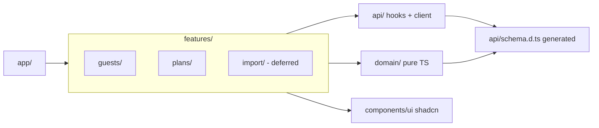

# 003 — Frontend design (React SPA): modules, components, state ownership, audit

Task 003, Phase 5 (Skills 13–16); updated for task 005 (delete a plan, §7), task 006 (four table sizes, §8), task 007 (Generate stores at once + Cofnij, §9), task 009 (PIN screen / access gate, §10) and to match the shipped relationships panel / link checklists (§5). Contract: [`docs/openapi.yaml`](../../openapi.yaml). Interaction states: [001-state-machine.md](001-state-machine.md). Flows: [003-sequences.md](003-sequences.md). The UI language is Polish. Frontend-web loads the `frontend-design` skill before building screens.

## 1. Modules and dependency rule

```
frontend-web/src/
├── app/                 App.tsx (router, basename /wesele), Layout (tabs: Plany | Goście), queryClient.ts
├── api/                 schema.d.ts (GENERATED by openapi-typescript from docs/openapi.yaml)
│                        client.ts (openapi-fetch, baseUrl API_BASE='/wesele/api'), errors.ts (ApiError from envelope)
│                        keys.ts (query keys), guests.ts, clusters.ts, scenarios.ts (TanStack hooks), import.ts (DEFERRED)
├── domain/              PURE TS, no React: guestIndex.ts, companions.ts, linkColumns.ts, relations.ts, linkSelection.ts,
│                        guestFilters.ts, optimistic.ts, dropPreview.ts, planView.ts, labels.ts (Polish copy for codes)
├── features/
│   ├── guests/          GuestsPage, QuickAddBar, GuestTable, GuestRow, GuestFilters, BulkToggleBar,
│   │                    GuestEditDialog, DeleteGuestDialog, LinkEditor (relationships panel), RelationBlock,
│   │                    LinkPicker (per-group checklist), ClusterWarnings
│   ├── plans/           PlansPage (compare), PlanCard, GenerateButton, UndoGenerateBar (task 007), RecalculationBanner,
│   │                    PlanDetailPage, FloorPlan, TableCard, ClusterChip, UnseatedTray, GuestDetailsPanel,
│   │                    PlanSearch, PrintView, DeleteTableDialog, DeletePlanDialog (task 005)
│   └── import/          ImportPage (DEFERRED)
└── components/ui/       shadcn/ui primitives (copy-paste), nothing app-specific
```



*Legend:*
- `domain/` imports only **types** from the generated schema. It has no React, no fetch and no state, so it gets plain Vitest unit tests.
- Features never call `fetch`; they use the `api/` hooks.
- Features do not import each other. Shared bits move to `domain/` or `components/ui/`.

## 2. Core module interfaces (Skill 13)

```ts
// api/client.ts
export const API_BASE = '/wesele/api';
export const client = createClient<paths>({ baseUrl: API_BASE });
export class ApiError extends Error { status: number; errors: ErrorItem[] }  // thrown by every hook on non-2xx

// api/keys.ts
export const keys = { guests: ['guests'], clusters: ['clusters'], scenarios: ['scenarios'], generateUndo: ['generateUndo'] } as const;

// api/guests.ts
useGuests(): UseQueryResult<Guest[]>
useCreateGuest(), useUpdateGuest(), useToggleGuests(), useDeleteGuest()      // onSuccess: invalidate guests, clusters, scenarios
useApplyLinkChanges()     // ONE mutation for a checklist Save or a single removal: {guestId, changes: LinkChange[]};
                          // sends one PUT/DELETE /guest-links/{a-b} per change, in order, and returns the failures;
                          // onSettled: invalidate guests, clusters, scenarios
// api/clusters.ts
useClusterOverview(): UseQueryResult<ClusterOverview>
// api/scenarios.ts
useScenarios(): UseQueryResult<Scenario[]>                                    // 4, ordered 9/10/11/12
useGeneratePlans()        // task 007, §9: fetch fresh scenarios (= undo snapshot) → POST /scenarios/calculate → PUT /scenarios
                          // (basedOnVersion = snapshot versions); onSuccess: setQueryData(keys.scenarios, response) +
                          // setQueryData(keys.generateUndo, {previous: snapshot, generatedVersions}); 409: refetch scenarios
useGenerateUndo(): GenerateUndo | undefined   // reads keys.generateUndo (skipToken, staleTime/gcTime Infinity, like the old preview)
useUndoGenerate()         // PUT /scenarios with the snapshot (basedOnVersion = generatedVersions); onSuccess: setQueryData(keys.scenarios)
                          // + clear keys.generateUndo; on 409/422: clear keys.generateUndo + refetch scenarios
useSetAssignment(), useDeleteAssignment()                                     // OPTIMISTIC (domain/optimistic.ts), rollback on error,
                                                                              // onSuccess: replace scenario with the server's evaluated copy
useAddTable(), useDeleteTable()
useResetPlan()            // task 005: DELETE /scenarios/{capacity}/tables; onSuccess: replace that scenario

// domain/guestIndex.ts
buildGuestIndex(guests: Guest[]): GuestIndex                    // byId, search(query) — case- and diacritics-insensitive ("Michal" finds "Michał")
// domain/companions.ts
effectiveCompanions(guestId, guests, overview): Companion[]     // {guestId, level, via?: guestId}: group 0 = the server's cluster
clusterOf(guestId, overview): Cluster
// domain/linkColumns.ts
linkColumns(guestId, guests, overview): Record<LinkLevel, ColumnEntry[]>  // own links first, then derived ({via, reason: 'cluster'|'link'})
warningsForGuest(guestId, overview): DataWarning[]
// domain/relations.ts
relationsOf(guestId, guests, overview): Relations               // per level: people grouped by family (group-0 cluster), counts, total
summariseRelations(guests, overview): Map<id, RelationSummary>  // guest-list row: group-0 partners, counts and names per level
relatedTo(guestId, guests, overview): RelatedGuest[]            // the "Powiązani z: X" filter (?powiazani=<id>)
// domain/linkSelection.ts
pickerRows(guest, guests, overview): PickerRow[]                 // every other guest, Polish order, currentLevel, viaCluster, via
selectedAt(guest, level); diffSelection(guest, level, selected): LinkDiff {add, move, remove}; diffIsEmpty(diff)
linkChangesOf(level, diff): LinkChange[]                         // removals first, then moves and adds (same upsert)
joiningViaCluster(guestId, selected, overview)                   // group 1/2 preview: who comes along with the ticked
clusterAfter(guest, guests, selected); clusterSizeWarning(seatedSize)   // group 0 preview: cluster after Save, > 9 / > 12
// domain/optimistic.ts
applyMove(plan: SeatingPlan, cluster: ClusterPlacement, toTable: number | null): SeatingPlan   // moves the placement, recomputes fills only
// domain/dropPreview.ts
dropPreview(plan, cluster, toTable, capacity, overview): { fillAfter, overCapacity, underFloorSource, preferredHere: number }
// domain/planView.ts (task 007)
toTableLayouts(plan: SeatingPlan): TableLayout[]          // number, guestIds (all clusters), pinnedGuestIds (pinned clusters) — for proposals AND snapshots
toScenariosReplace(plans: {capacity, basedOnVersion, plan}[]): ScenariosReplace
canUndoGenerate(undo: GenerateUndo | undefined, scenarios: Scenario[] | undefined): boolean   // every scenario.version === undo.generatedVersions[capacity]
// domain/labels.ts
violationLabel(v: Violation): string; warningLabel(w: DataWarning): string; errorLabel(e: ErrorItem): string   // Polish copy
```

The `domain/` functions only **display** hints (fill after a drop, who is "via" whom). Scores, violations and `needsRecalculation` always come from the server; the client never re-implements scoring.

## 3. Component / hook class diagram (Skill 15)


*Legend*

| Element | Pattern / principle | Why |
|---|---|---|
| `api/` hooks | **Gateway** (one typed access point) + **DRY** | Types are generated from the contract; invalidation rules are written once per mutation. |
| `domain/` | **Functional core** | Display logic is pure and unit-tested without React. |
| Pages → presentational children | **Container / presentational split** | Pages own the hooks; children get props, so they are easy to test and to print. |
| Optimistic moves | **Optimistic UI with rollback** (TanStack `onMutate` / `onError`) | The drag must feel instant (state machine §3). |
| Undo snapshot in the query cache (`keys.generateUndo`, task 007) | **YAGNI** over a client store; a one-slot **Memento** in spirit | Transient, per tab, never fetched. No Zustand, no undo stack. |
| `@dnd-kit` sensors | **Accessibility** | Keyboard drag is a requirement. |

## 4. State ownership

| State | Owner | Notes |
|---|---|---|
| Guests, clusters, scenarios | TanStack Query (`keys.*`) | Refetch on window focus. Mutations invalidate or replace. |
| Undo snapshot of the last Generate (`{previous: Scenario[], generatedVersions}`) | TanStack Query cache `keys.generateUndo` | Task 007. Set by a successful Generate (replacing any older one), cleared by Cofnij (success, 409 or 422) and by "×". Lost on reload (by design). Visibility is derived: `canUndoGenerate`. |
| Guest filters, selection for bulk toggle, search text | `GuestsPage` local state (filters mirrored to the URL query string so a reload keeps them) | Includes the **"Powiązani z: X"** filter, URL-mirrored as `?powiazani=<guestId>` (`domain/guestFilters.ts`), set by "Pokaż na liście" in the relationships panel. |
| Relationships panel: which person is shown, the "Wróć" trail, which group's checklist is open | `LinkEditor` local state | Closing the panel forgets it. |
| Checklist selection, search text, "Tylko zaznaczeni" | `LinkPicker` local state | Nothing is sent before "Zapisz"; "Anuluj" / Esc discards. |
| Delete-plan confirmation open, acknowledgement checkbox | `PlansPage` / `PlanDetailPage` local state | Task 005, §7. |
| Active drag | dnd-kit (`DndContext`) | — |
| Selected guest in a plan (details panel) | `PlanDetailPage` local state + URL param `?guest=` | Deep link: "where does Ania sit". |
| Remembered tab / last plan opened | _not implemented_ (YAGNI; would be `localStorage` in try/catch) | Convenience only. |

## 5. Manual-entry UX (MVP data entry, first-class)

- **QuickAddBar:** a single input at the top of the guest list. "Imię Nazwisko" + Enter creates the guest (`POST /guests`) and the input stays focused. A **sticky "Dziecko" checkbox** next to the input marks every following add as a child until it is unticked; while it is on, the whole bar is tinted and shows a "Dodajesz dzieci" pill, and the confirmation reads "Dodano dziecko: …" (otherwise "Dodano: …", with the session count). A duplicate name shows the server's `duplicate_name` inline and keeps the text so it can be fixed. Typing speed is the limit; there is no batch endpoint (A-20).
- **LinkEditor = relationships panel** ("Powiązania: X"), opened from a guest row. It shows "Łącznie powiązanych: N" and three `RelationBlock`s: **Grupa 0 – siedzą razem**, **Grupa 1 – chcą siedzieć razem**, **Grupa 2 – ewentualnie**. In each block people are grouped by family (their group-0 cluster) and every person carries the reason: **"wpisany bezpośrednio"** (a link of this guest), **"przez grupę 0: X"** (in X's cluster), or **"przez powiązanie: X"** (a cluster-mate X's own link brings them). Direct links have a remove button (one `useApplyLinkChanges` call with `level: null`). Every name is clickable and opens that person in the same panel; a **"Wróć: <name>"** trail walks back. **"Pokaż na liście"** closes the panel and narrows the guest list to this person and their relations (`?powiazani=<id>`). Data warnings of the guest's cluster show inline (`ClusterWarnings`).
- **LinkPicker = per-group checklist** ("Edytuj" / "Wybierz gości…" on a block, a nested dialog). It lists **every other guest** (Polish collation) with a checkbox, a search box (case- and diacritics-insensitive) and a **"Tylko zaznaczeni"** toggle. It starts with the guest's direct links at that level ticked. A note under a name says what Save will do ("Powiązanie przejdzie z grupy 1 do grupy 0", since a pair has ONE link) or why the row is fixed (group 0: already in the cluster through someone else's link, "przez grupę 0: X. Zmień to przy: X"). A live preview shows who comes along (group 1/2: `joiningViaCluster`) or the cluster after saving and its size warning > 9 / > 12 (group 0: `clusterAfter`). **"Zapisz"** applies the difference (`diffSelection` → `linkChangesOf`): **removals first, then moves and adds**, all through one `useApplyLinkChanges` mutation (one request per changed pair); failures are listed and the rest stays saved. If the search matches nobody, **"Dodaj «X» jako nowego gościa"** only creates the guest (`POST /guests`) and ticks them; the link is sent with "Zapisz".
- **Rule: group 0 is the cluster.** For every guest, everywhere in the UI (relationships panel, guest-row summary, "Powiązani z" filter, picker), group 0 is derived from the server's **cluster membership** (`GET /clusters`, `clusterOf`), never from the guest's own stored group-0 links. Example: Emilka linked Justynka, Maks and os. tow. at level 0; Justynka has no link of her own, yet her group 0 is those three (Emilka "wpisany bezpośrednio" from Emilka's side, the others "przez grupę 0: Emilka"). Reading only `guest.links` here was a bug (Justynka showed 1 instead of 3). The guest's own links are used only to label *how* someone is reached and to decide what the checklist can untick.
- **No link author.** The API stores one symmetric link per pair with no author, so the UI cannot show "who entered it"; "wpisany bezpośrednio" means "a link of the shown guest", from whichever side it was typed. Showing the author would need a contract change (possible future, not planned).
- **BulkToggleBar:** filter "Dzieci" → select all → "Wyłącz zaznaczonych" (`PATCH /guests`). Per-row switches use the same endpoint with one id.
- Data warnings (cluster > 9 / > 12, conflicting levels) are shown inline next to the guests involved.

## 6. Pattern evaluation and audit (Skills 14, 16)

| Candidate | Verdict | Why |
|---|---|---|
| Zustand / global client store | rejected | Every piece of state has an owner in §4. |
| Redux / context-based store | rejected | Same reason. |
| Canvas library (Konva) | rejected | DOM/SVG keeps dnd-kit accessible (ADR-001). |
| Command/undo stack | rejected | Only a one-step Cofnij of the last Generate (task 007): one snapshot, re-sent through `PUT /scenarios`. |
| Client-side scoring | rejected | The server is the single source of truth (DRY). Only display hints are computed client-side. |
| Form library for QuickAddBar | rejected | One input. React Hook Form + Zod only in `GuestEditDialog`. |
| MSW (Mock Service Worker) for hook/component tests | **adopted, test-only** | Free (MIT). Tests the real fetch layer against contract-shaped responses (`schema.d.ts` types). |

**Audit.**
- SRP: pages fetch, children render, `domain/` computes, `api/` talks HTTP.
- DRY: one API client, generated types, one place for Polish labels.
- YAGNI: no global store, no undo stack (one-step Cofnij of Generate only), no canvas, no batch-create endpoint, import screen deferred.
- Found and fixed:
  1. The drop-preview "satisfaction hint" in state machine §3 could have turned into client-side scoring. It is limited to counting preferred companions already at the target table (`dropPreview.preferredHere`).
  2. The proposal preview initially needed a client store. The query cache is enough. (The preview itself was removed in task 007; the undo snapshot uses the same query-cache approach.)

## 7. Delete a plan (task 005, UC-17)

Contract: `DELETE /scenarios/{capacity}/tables` → 200 `ScenarioResponse` with the empty plan (no body, no version). Rules: [../03-seating-model.md](../03-seating-model.md) § Manual edits.

- **Where.** A destructive-styled **"Usuń plan"** button (trash icon + text) on each `PlanCard` (PlansPage, at the bottom next to "Otwórz plan") and in the `PlanDetailPage` header next to "Dodaj stół". A **"Usuń wszystkie plany"** button in the "Aktualne plany" section header of `PlansPage`. Each is **disabled when there is nothing to delete** (`summary.tableCount === 0`; for "all": all four).
- **Confirmation (`DeletePlanDialog`, an `AlertDialog` like `DeleteTableDialog`).** One plan: title "Usunąć plan na {capacity} miejsc?"; body states what is cleared, from the cached scenario: "{tableCount} stołów i {seatedCount} osób przy stołach. Wszyscy trafią do pola „Bez stołu”. Pinezki znikną. Tego nie da się cofnąć." Buttons "Anuluj" (default focus) / "Usuń plan" (destructive). All plans: title "Usunąć wszystkie cztery plany?", a line per plan with its counts, the same irreversibility text, and a **stronger confirmation**: the "Usuń wszystkie plany" button stays disabled until the checkbox "Rozumiem, że tego nie da się cofnąć" is ticked.
- **Calls.** One plan = one `useResetPlan().mutate({capacity})`. All plans = four calls (9, 10, 11, 12) via `Promise.allSettled`; plans that failed are named in one error toast ("Nie udało się usunąć planu: 10"), the others stay deleted (each call is independent and idempotent, so retrying is safe).
- **After success.** The hook replaces the scenario in `keys.scenarios` with the server copy (its version moves on, so a pending Cofnij of a Generate disappears: `canUndoGenerate` is false). Toast "Usunięto plan na {capacity} miejsc." / "Usunięto wszystkie plany.". On `PlanDetailPage` the user stays on the page.
- **What the empty plan shows.** Nothing new: the existing empty state "Brak stołów w tym planie." (`FillBars`), every cluster in `UnseatedTray`, and — when there are enabled guests — the server's `unseated_guests` violation, so `needsRecalculation` is true and `RecalculationBanner` offers "Przelicz / Generuj".
- Pattern check: no undo for a delete (the Cofnij of task 007 covers only Generate); a confirmation dialog stands in. No new client state beyond the dialog's open flag and checkbox (YAGNI).

## 8. Four table sizes (task 006)

Plans exist for **9, 10, 11 and 12** seats (was 8, 10, 12). Contract: `Capacity` enum `[9, 10, 11, 12]`; `GET /scenarios` and `POST /scenarios/calculate` return exactly four items, ordered 9, 10, 11, 12; the data warning for "too big for the smallest plan" is now `cluster_exceeds_9` (cluster > 9 enabled guests).

- **One list of sizes.** `domain/capacity.ts` `CAPACITIES = [9, 10, 11, 12]` is the only place that lists them; every page, switcher, "delete all" and the Generate/Cofnij body builder iterates it (DRY). The `Capacity` type comes from `schema.d.ts`.
- **Four cards, readable.** `PlansPage` (current plans) lays the cards out as 1 column on phones, **2 × 2 on medium screens**, **4 across on wide screens** (Tailwind `grid-cols-1 md:grid-cols-2 xl:grid-cols-4`). The cards keep the same content; nothing new is added to them. The plan switcher in `PlanDetailPage` lists the four sizes; the print view is per capacity (`/druk/:capacity`). Old bookmarks `/plany/8` and `/druk/8` redirect to 9.
- **Odd seat counts.** `TableSeats` / the round-table drawing, the drop preview and the move menu must place **9 and 11** seats evenly around the table (angle = 360° / capacity, no assumption of an even count or of pairs facing each other).
- **Polish copy.** "Cztery plany naraz: stoły 9-, 10-, 11- i 12-osobowe"; "Zapisano plany: 9, 10, 11, 12 miejsc."; "Usunąć wszystkie cztery plany?" (four DELETE calls); warning label `cluster_exceeds_9`: "Ta paczka (grupa 0) jest za duża na stół 9-osobowy"; the client preview `clusterSizeWarning` uses > 9 / > 12.
- **Floor 8** (was 6): `domain/dropPreview.ts` `MIN_TABLE_FILL = 8` is the single client constant (drop preview, table status, labels "minimum 8", `FillBars` floor line); the `PlanLegend` copy "minimum 6" becomes "minimum 8". Scores and violations still come from the server.
- Pattern check: nothing new. No per-size component, no configuration endpoint for sizes (YAGNI: the sizes are fixed by the contract enum).

## 9. Generate stores at once, Cofnij (task 007)

User decision 2026-10-03 ("Zapisuj od razu"): after **Generuj plany** the tables and assignments are visible immediately in the normal plan views. No preview, no "Akceptuj", **no confirmation dialog** before overwriting (Cofnij covers mistakes; fewer clicks). Contract: `POST /scenarios/calculate` (unchanged) + `PUT /scenarios` (new, atomic, all four plans); `PUT /scenarios/{capacity}/assignments` is gone. Rules: [../03-seating-model.md](../03-seating-model.md) § Storing a Generate / § Undoing a Generate. Flow: [003-sequences.md](003-sequences.md) §1. States: [001-state-machine.md](001-state-machine.md) §2.

**`useGeneratePlans()`** (one mutation, `mutationKey: GENERATE_MUTATION_KEY` so every Generuj button disables while it runs):
1. `snapshot = await queryClient.fetchQuery({ queryKey: keys.scenarios, staleTime: 0, ... })` — fresh `Scenario[]`.
2. `proposals = POST /scenarios/calculate`.
3. `PUT /scenarios` with `toScenariosReplace(proposals.map(p => ({capacity: p.capacity, basedOnVersion: snapshot[p.capacity].version, plan: p.plan})))` — the **snapshot's** versions, so what is overwritten is exactly the snapshot.
4. onSuccess: `setQueryData(keys.scenarios, response.data)`; `setQueryData(keys.generateUndo, { previous: snapshot, generatedVersions: {9: v, 10: v, 11: v, 12: v} from the response })`; invalidate nothing else.
5. 409: invalidate `keys.scenarios`, toast "Plany zmieniły się w międzyczasie — kliknij „Generuj plany” jeszcze raz." Other errors: `errorMessage(error)` toast. Nothing is stored on any error (the PUT is atomic).

**`GenerateButton`.** Same component on both entry points (`PlansPage` header, `RecalculationBanner` on `PlanCard` and `PlanDetailPage`); label "Generuj plany" / "Przelicz / Generuj", running label "Liczę i zapisuję plany…". **No navigation after success**: the `onGenerated` prop is removed and `PlanDetailPage` no longer navigates to `/`; the page you are on re-renders from the updated cache (overview: four cards with new fills; detail: the floor plan with tables and guests). Success toast: "Zapisano nowe plany: 9, 10, 11, 12 miejsc." (no action in the toast — Cofnij lives in the bar).

**`UndoGenerateBar`** (new, presentational + `useGenerateUndo`/`useUndoGenerate`), rendered at the top of **both** `PlansPage` and `PlanDetailPage`, only while `canUndoGenerate(undo, scenarios)` is true:
- Text: "Wygenerowano nowe plany. Poprzednie można przywrócić." Buttons: **"Cofnij"** (outline, `Undo2Icon`) and an icon button "×" (aria-label "Zamknij", clears `keys.generateUndo`). `role="status"`.
- "Cofnij" → `useUndoGenerate().mutate()` → `PUT /scenarios` with `toScenariosReplace(previous.map(s => ({capacity: s.capacity, basedOnVersion: generatedVersions[s.capacity], plan: s.plan})))`. While pending: "Przywracam…", button disabled.
  - 200: `setQueryData(keys.scenarios, response.data)`, clear `keys.generateUndo`, toast "Przywrócono poprzednie plany."
  - 409 or 422: clear `keys.generateUndo`, invalidate `keys.scenarios`, toast.error "Nie można cofnąć — plany zmieniono po wygenerowaniu." Nothing changed on the server.
  - Other errors (network, 500): keep the snapshot (retry possible), toast `errorMessage(error)`.
- The bar disappears by itself as soon as any plan version differs from `generatedVersions` (a move, pin, table change or delete in this tab, or a refetch showing another device's change), because `canUndoGenerate` is derived from the cache — no hook needs to clear it.

**Polish copy (new):** "Liczę i zapisuję plany…", "Zapisano nowe plany: 9, 10, 11, 12 miejsc.", "Wygenerowano nowe plany. Poprzednie można przywrócić.", "Cofnij", "Przywracam…", "Przywrócono poprzednie plany.", "Nie można cofnąć — plany zmieniono po wygenerowaniu.", "Plany zmieniły się w międzyczasie — kliknij „Generuj plany” jeszcze raz."

**Delete (dead after task 007):** `features/plans/ProposalPreview.tsx`, `features/plans/ProposalCard.tsx`; in `api/scenarios.ts`: `useCalculateProposals`, `CALCULATE_MUTATION_KEY` (→ `GENERATE_MUTATION_KEY`), `useProposals`, `useDiscardProposals`, `useDropProposal`, `useAcceptProposal`, the proposal-dropping part of `useResetPlan`; `keys.proposals` in `api/keys.ts`; in `domain/planView.ts`: `toAcceptTables` (→ `toTableLayouts` with `pinnedGuestIds`), `isProposalStale`, `withoutProposal`; `AcceptPlan` in `domain/types.ts` (add `ScenariosReplace`, `ScenarioLayout`; keep `Proposal`, now an internal step); `PlanFigures`' `current` prop ("obecnie …") if `ProposalCard` was its only user; `fourProposals` in `features/plans/fixtures.ts` if no test still needs it; the `onGenerated` prop of `GenerateButton` / `RecalculationBanner` and the `navigate('/')` in `PlanDetailPage`; preview-related tests and copy ("Akceptuj", "Akceptuj wszystkie", "Odrzuć", "Generuj ponownie", "obecnie"). Regenerate `api/schema.d.ts` from the new bundle.

**Tests:** `domain/planView.test.ts` (`toTableLayouts` incl. pins and empty tables, `toScenariosReplace`, `canUndoGenerate`); MSW hook tests for `useGeneratePlans` (three calls in order, snapshot versions in the PUT, cache + undo set, 409 path) and `useUndoGenerate` (200 / 409 / 500); `PlansPage.test.tsx` and `PlanDetailPage.test.tsx`: Generate shows the new plans in place with no preview, Cofnij restores, the bar hides after a move.

Pattern check: no new library, no client store, no confirmation dialog. The snapshot is the minimal Memento (one slot, client memory); Command objects / undo stack stay rejected (YAGNI).

## 10. PIN screen and the access gate (task 009)

Server rules, cookie and throttle: [../05-access-gate.md](../05-access-gate.md). Contract: `GET/POST/DELETE /session`, `Session {pinRequired, expiresAt}`, error codes `unauthenticated` (401 on any protected call), `invalid_pin` (401 on login), `too_many_attempts` (429 + `Retry-After`), `csrf_header_missing` (403). Flow: [003-sequences.md](003-sequences.md) §6. States: [001-state-machine.md](001-state-machine.md) §5. The PIN never appears in code, tests or fixtures (tests use a fake value like `"0000-test"`) and is never stored client-side (no `localStorage`, no query cache entry, no URL).

**Module changes**

```ts
// api/client.ts — every request carries the CSRF header (harmless when the gate is off)
export const client = createClient<paths>({ baseUrl: …, fetch: …, headers: { 'X-Stoliki-Request': '1' } });

// api/keys.ts
keys.session = ['session']

// api/session.ts (new)
type SessionState = { status: 'open'; pinRequired: boolean; expiresAt: string | null } | { status: 'pinRequired' };
useSession(): UseQueryResult<SessionState>  // GET /session; 200 → {status:'open', ...data}; 401 → {status:'pinRequired'}
                                            // (a 401 here is a normal answer, not an error); retry: false, staleTime: Infinity,
                                            // refetchOnWindowFocus: false (other queries' 401s keep it honest)
useLogin()     // POST /session {pin}; onSuccess: setQueryData(keys.session, {status:'open', ...data}) then
               // invalidateQueries({ predicate: q => q.queryKey[0] !== 'session' }) — the current route refetches
useLogout()    // DELETE /session; onSettled (success or error): queryClient.clear(); setQueryData(keys.session, {status:'pinRequired'})
lockApp(qc: QueryClient): void   // removeQueries({ predicate: q => q.queryKey[0] !== 'session' }); setQueryData(keys.session, {status:'pinRequired'})

// app/queryClient.ts — ONE place maps any 401 to the PIN screen
createQueryClient(): new QueryClient({
  queryCache:    new QueryCache({    onError: (e) => isUnauthenticated(e) && lockApp(client) }),
  mutationCache: new MutationCache({ onError: (e) => isUnauthenticated(e) && lockApp(client) }),
  defaultOptions: { queries: { retry: (n, e) => !isUnauthenticated(e) && n < 1, … } },   // never retry a 401
})
// isUnauthenticated(e) = e instanceof ApiError && e.status === 401 && e.errors[0]?.code === 'unauthenticated'
// (the login's own 401 has code invalid_pin, so a wrong PIN never "locks" the app twice)

// domain/labels.ts — errorLabel: invalid_pin → "Zły PIN", too_many_attempts → "Za dużo prób — spróbuj za chwilę",
//                    unauthenticated → "Podaj PIN", csrf_header_missing → generic error copy
```

**Components**

- **`app/AccessGate.tsx`** (new): a **pathless root route** wrapping *every* route (the `Layout` routes **and** `druk/:capacity`, which sits outside `Layout`): `<Route element={<AccessGate />}> … </Route>`. Renders: session loading → the existing "Wczytuję…"; `status: 'pinRequired'` → `<PinScreen />` (full screen, no tabs); `status: 'open'` → `<Outlet />`. Because it is a route element inside the router, the URL (route, `?guest=`, filters) is untouched while the PIN screen shows; after login the same route renders again. Children (pages) mount only when open, so no data query fires before the session is known.
- **`features/session/PinScreen.tsx`** (new, presentational + `useLogin`): centred card, large type (it must be very readable on a phone).
  - Heading **"Podaj PIN"**, subline "Stoliki — plan stołów weselnych".
  - One `<input type="password" inputMode="numeric" autoComplete="current-password" autoFocus>` with a visible label "PIN", large font and letter-spacing; no `maxLength`/`pattern` (the PIN may become longer or alphanumeric — then switch `inputMode` to `text`, a one-line change). Show/hide toggle (eye icon, aria-label "Pokaż PIN").
  - Button **"Wejdź"** (full width, `type="submit"`), Enter submits; disabled while empty or pending ("Sprawdzam…").
  - 401 `invalid_pin` → inline error **"Zły PIN"** (`role="alert"`), field cleared, focus back in the field.
  - 429 → **"Za dużo prób — spróbuj za chwilę"**, plus "Spróbuj ponownie za {N} s / min" counting down from `Retry-After`; the button stays disabled until it reaches 0.
  - Network / 500 → `errorMessage(error)` copy. No hint about PIN length or remaining attempts.
- **`Layout`**: when `useSession().data` is `{status:'open', pinRequired: true}`, the header shows a **"Wyloguj"** button (ghost, `LogOutIcon`); hidden when the gate is off. Click → `useLogout().mutate()` → PIN screen. No confirmation dialog (logging back in is one PIN away). `PrintView` shows no logout button (print layout).

**State ownership (adds to §4):** session state = TanStack Query `keys.session` (server state like the rest). The PIN input value = `PinScreen` local state, cleared after every submit. Countdown = `PinScreen` local state. Nothing else.

**Behaviour notes**
- A 401 in the middle of an edit (cookie expired after 30 days of not using the app) drops the user on the PIN screen; an open dialog's unsaved input is lost, the URL is kept. Accepted: sessions slide, so this only happens after a month of inactivity or after "change the PIN" / logout elsewhere.
- Optimistic moves rolled back by a 401 are fine: `lockApp` removes the scenario cache anyway and it is refetched after login.
- Gate off: `GET /session` → `pinRequired: false`; the app behaves exactly as before (no PIN screen, no "Wyloguj"), one extra request at start.

**Tests (B2):** MSW: `useSession` maps 200/401; a page query answering 401 `unauthenticated` → PIN screen appears, other caches are emptied, URL unchanged; correct PIN (MSW returns 200) → the same route renders and refetches; wrong PIN → "Zły PIN", field cleared; 429 with `Retry-After: 30` → message + disabled button + countdown (fake timers); "Wyloguj" visible only when `pinRequired: true`, click → DELETE sent, PIN screen, cache cleared; `client` sends `X-Stoliki-Request: 1` (assert in an MSW handler); a 401 is never retried; `druk/10` is gated too.

Pattern check: the global `QueryCache`/`MutationCache` `onError` is TanStack's built-in interception point, so no custom event bus, no auth context/reducer, no Zustand. `AccessGate` is a plain route element (no HOC per page).
