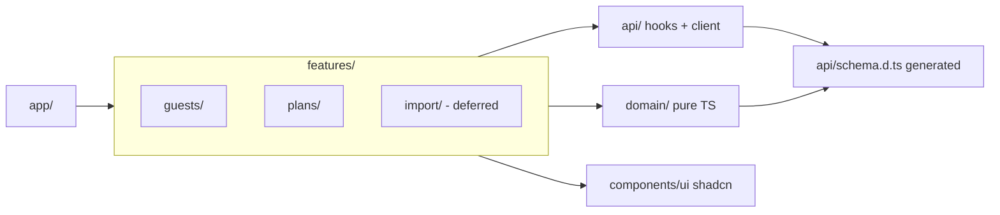
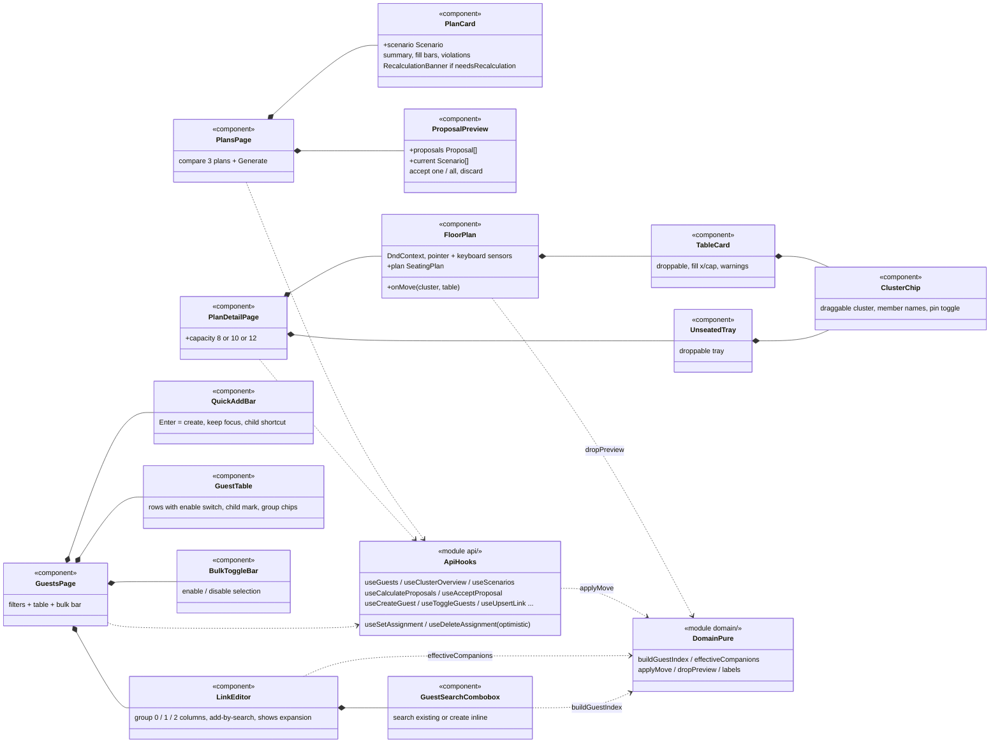

# 003 — Frontend design (React SPA): modules, components, state ownership, audit

Task 003, Phase 5 (Skills 13–16). Contract: [`docs/openapi.yaml`](../../openapi.yaml). Interaction states: [001-state-machine.md](001-state-machine.md). Flows: [003-sequences.md](003-sequences.md). The UI language is Polish. Frontend-web loads the `frontend-design` skill before building screens.

## 1. Modules and dependency rule

```
frontend-web/src/
├── app/                 App.tsx (router, basename /wesele), Layout (tabs: Plany | Goście), queryClient.ts
├── api/                 schema.d.ts (GENERATED by openapi-typescript from docs/openapi.yaml)
│                        client.ts (openapi-fetch, baseUrl API_BASE='/wesele/api'), errors.ts (ApiError from envelope)
│                        keys.ts (query keys), guests.ts, clusters.ts, scenarios.ts (TanStack hooks), import.ts (DEFERRED)
├── domain/              PURE TS, no React: guestIndex.ts, companions.ts, optimistic.ts, dropPreview.ts, labels.ts (Polish copy for codes)
├── features/
│   ├── guests/          GuestsPage, QuickAddBar, GuestTable, GuestRow, GuestFilters, BulkToggleBar,
│   │                    GuestEditDialog, LinkEditor, GuestSearchCombobox, ClusterWarnings
│   ├── plans/           PlansPage (compare), PlanCard, GenerateButton, ProposalPreview, RecalculationBanner,
│   │                    PlanDetailPage, FloorPlan, TableCard, ClusterChip, UnseatedTray, GuestDetailsPanel,
│   │                    PlanSearch, PrintView
│   └── import/          ImportPage (DEFERRED)
└── components/ui/       shadcn/ui primitives (copy-paste), nothing app-specific
```



*Legend:*
- `domain/` imports only **types** from the generated schema. It has no React, no fetch and no state, so it gets plain Vitest unit tests.
- Features never call `fetch`; they use the `api/` hooks.
- Features do not import each other. Shared bits move to `domain/` or `components/ui/`.

## 2. Core module interfaces (Skill 13)

```ts
// api/client.ts
export const API_BASE = '/wesele/api';
export const client = createClient<paths>({ baseUrl: API_BASE });
export class ApiError extends Error { status: number; errors: ErrorItem[] }  // thrown by every hook on non-2xx

// api/keys.ts
export const keys = { guests: ['guests'], clusters: ['clusters'], scenarios: ['scenarios'], proposals: ['proposals'] } as const;

// api/guests.ts
useGuests(): UseQueryResult<Guest[]>
useCreateGuest(), useUpdateGuest(), useToggleGuests(), useDeleteGuest()      // onSuccess: invalidate guests, clusters, scenarios
useUpsertLink(), useDeleteLink()                                              // onSuccess: invalidate guests, clusters, scenarios
// api/clusters.ts
useClusterOverview(): UseQueryResult<ClusterOverview>
// api/scenarios.ts
useScenarios(): UseQueryResult<Scenario[]>                                    // 3, ordered 8/10/12
useCalculateProposals()   // onSuccess: setQueryData(keys.proposals, proposals)  (transient preview lives in the query cache)
useAcceptProposal()       // onSuccess: replace that scenario in keys.scenarios; on 409: refetch scenarios + toast
useSetAssignment(), useDeleteAssignment()                                     // OPTIMISTIC (domain/optimistic.ts), rollback on error,
                                                                              // onSuccess: replace scenario with the server's evaluated copy
useAddTable(), useDeleteTable()

// domain/guestIndex.ts
buildGuestIndex(guests: Guest[]): GuestIndex                    // byId, search(query) — case- and diacritics-insensitive ("Michal" finds "Michał")
// domain/companions.ts
effectiveCompanions(guestId, guests, overview): Companion[]     // {guestId, level, via?: guestId} — "Ola, via Michał's group 0"
clusterOf(guestId, overview): Cluster
// domain/optimistic.ts
applyMove(plan: SeatingPlan, cluster: ClusterPlacement, toTable: number | null): SeatingPlan   // moves the placement, recomputes fills only
// domain/dropPreview.ts
dropPreview(plan, cluster, toTable, capacity, overview): { fillAfter, overCapacity, underFloorSource, preferredHere: number }
// domain/labels.ts
violationLabel(v: Violation): string; warningLabel(w: DataWarning): string; errorLabel(e: ErrorItem): string   // Polish copy
```

The `domain/` functions only **display** hints (fill after a drop, who is "via" whom). Scores, violations and `needsRecalculation` always come from the server; the client never re-implements scoring.

## 3. Component / hook class diagram (Skill 15)



*Legend*

| Element | Pattern / principle | Why |
|---|---|---|
| `api/` hooks | **Gateway** (one typed access point) + **DRY** | Types are generated from the contract; invalidation rules are written once per mutation. |
| `domain/` | **Functional core** | Display logic is pure and unit-tested without React. |
| Pages → presentational children | **Container / presentational split** | Pages own the hooks; children get props, so they are easy to test and to print. |
| Optimistic moves | **Optimistic UI with rollback** (TanStack `onMutate` / `onError`) | The drag must feel instant (state machine §3). |
| Proposals in the query cache (`keys.proposals`) | **YAGNI** over a client store | Transient server-derived data. A Zustand store is not needed. |
| `@dnd-kit` sensors | **Accessibility** | Keyboard drag is a requirement. |

## 4. State ownership

| State | Owner | Notes |
|---|---|---|
| Guests, clusters, scenarios | TanStack Query (`keys.*`) | Refetch on window focus. Mutations invalidate or replace. |
| Proposals (preview) | TanStack Query cache `keys.proposals` | Cleared on accept-all or discard. |
| Guest filters, selection for bulk toggle, search text | `GuestsPage` local state (filters mirrored to the URL query string so a reload keeps them) | — |
| Active drag | dnd-kit (`DndContext`) | — |
| Selected guest in a plan (details panel) | `PlanDetailPage` local state + URL param `?guest=` | Deep link: "where does Ania sit". |
| Remembered tab / last plan opened | `localStorage` (wrapped in try/catch) | Convenience only. |

## 5. Manual-entry UX (MVP data entry, first-class)

- **QuickAddBar:** a single input at the top of the guest list. "Imię Nazwisko" + Enter creates the guest (`POST /guests`) and the input stays focused. `Ctrl+D` toggles the child mark for the next add. A duplicate name shows the server's `duplicate_name` inline and keeps the text so it can be fixed. Typing speed is the limit; there is no batch endpoint (A-20).
- **LinkEditor:** opens for the selected guest. It has three columns, Grupa 0 / 1 / 2, each with a `GuestSearchCombobox`. Picking a guest calls `PUT /guest-links/{a-b}`. If no guest matches, "Dodaj «Karolina» jako nowego gościa" creates the guest and links them in one gesture (two calls). Under group 1/2 the editor shows the **expansion** from `effectiveCompanions`: "+ Ola (przez grupę 0 Michała)".
- **BulkToggleBar:** filter "Dzieci" → select all → "Wyłącz zaznaczonych" (`PATCH /guests`). Per-row switches use the same endpoint with one id.
- Data warnings (cluster > 8 / > 12, conflicting levels) are shown inline next to the guests involved.

## 6. Pattern evaluation and audit (Skills 14, 16)

| Candidate | Verdict | Why |
|---|---|---|
| Zustand / global client store | rejected | Every piece of state has an owner in §4. |
| Redux / context-based store | rejected | Same reason. |
| Canvas library (Konva) | rejected | DOM/SVG keeps dnd-kit accessible (ADR-001). |
| Command/undo stack | rejected | No undo (user-confirmed). |
| Client-side scoring | rejected | The server is the single source of truth (DRY). Only display hints are computed client-side. |
| Form library for QuickAddBar | rejected | One input. React Hook Form + Zod only in `GuestEditDialog`. |
| MSW (Mock Service Worker) for hook/component tests | **adopted, test-only** | Free (MIT). Tests the real fetch layer against contract-shaped responses (`schema.d.ts` types). |

**Audit.**
- SRP: pages fetch, children render, `domain/` computes, `api/` talks HTTP.
- DRY: one API client, generated types, one place for Polish labels.
- YAGNI: no global store, no undo, no canvas, no batch-create endpoint, import screen deferred.
- Found and fixed:
  1. The drop-preview "satisfaction hint" in state machine §3 could have turned into client-side scoring. It is limited to counting preferred companions already at the target table (`dropPreview.preferredHere`).
  2. The proposal preview initially needed a client store. The query cache is enough.
