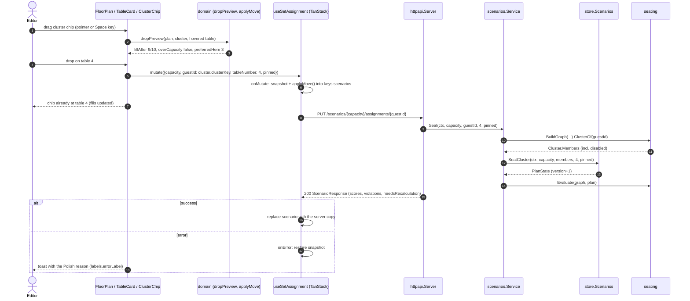
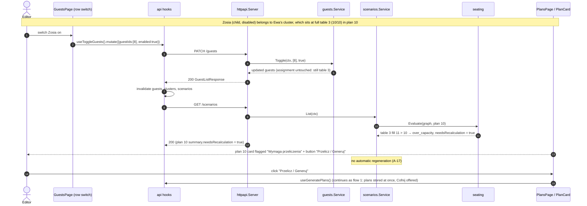
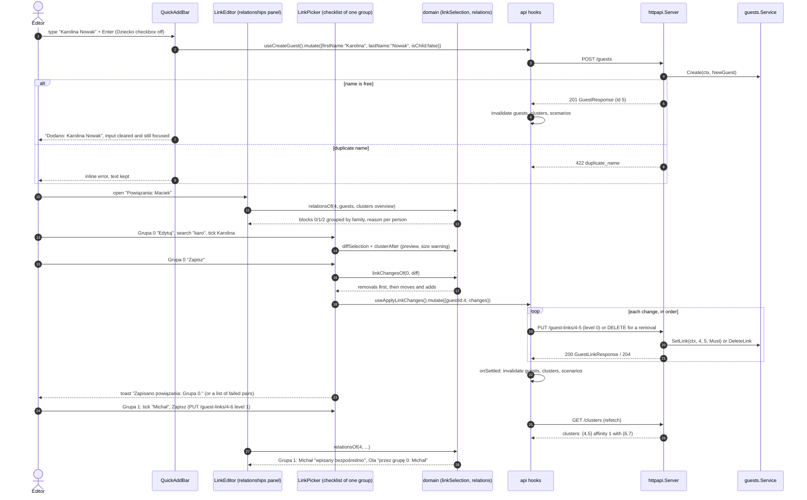
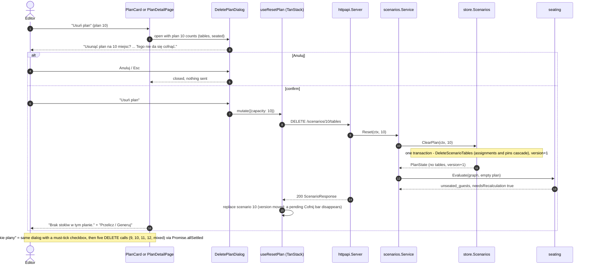
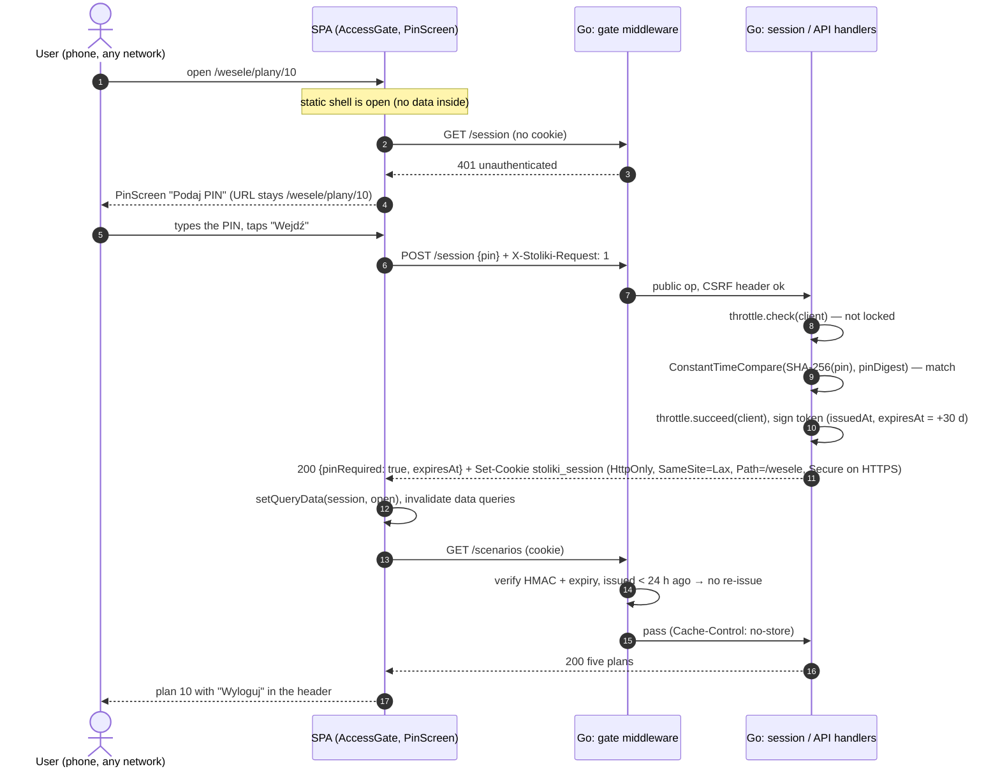
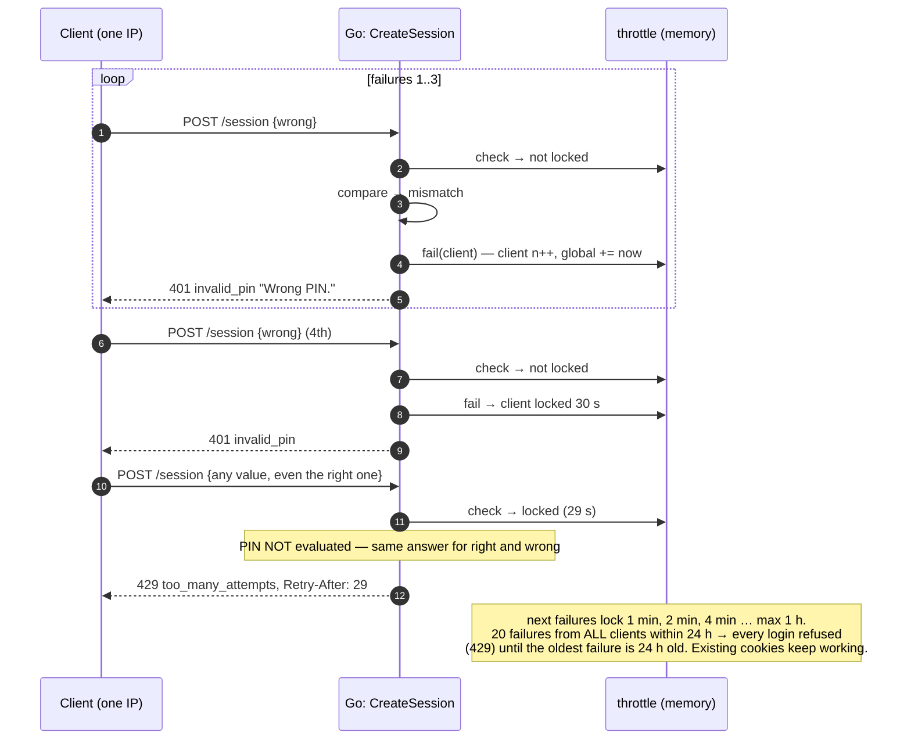
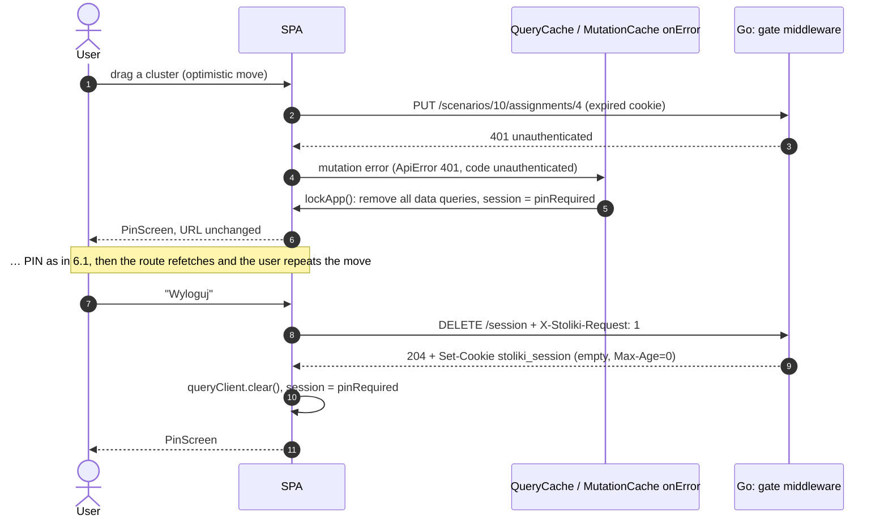

# 003 — Sequence diagrams for the UI-driven flows

Task 003, Phase 5. The participants are the components and packages from [003-frontend-design.md](003-frontend-design.md) and [003-backend-design.md](003-backend-design.md). All HTTP paths are relative to `/wesele/api` ([`docs/openapi.yaml`](../../openapi.yaml)).

1. [Generate all five plans → stored at once → Cofnij](#1-generate-all-five-plans--stored-at-once--cofnij) (tasks 007, 013)
2. [Move a cluster (drag & drop, optimistic)](#2-move-a-cluster-drag--drop-optimistic)
3. [Re-enable a guest → plan needs recalculation → regenerate](#3-re-enable-a-guest--plan-needs-recalculation--regenerate)
4. [Quick-add a guest and link them through the group checklist](#4-quick-add-a-guest-and-link-them-through-the-group-checklist)
5. [Delete a plan](#5-delete-a-plan-task-005-uc-17)
6. [Access gate: PIN login, throttling, expiry, logout](#6-access-gate-pin-login-throttling-expiry-logout) (task 009)

## 1. Generate all five plans → stored at once → Cofnij

Task 007 (user decision "Zapisuj od razu"): no preview, no accept, no confirmation. Rules: [../03-seating-model.md](../03-seating-model.md) § Storing a Generate / § Undoing a Generate.

```mermaid
sequenceDiagram
    autonumber
    actor E as Editor
    participant UI as GenerateButton / UndoGenerateBar (PlansPage or PlanDetailPage)
    participant Q as api hooks (TanStack Query)
    participant H as httpapi.Server
    participant S as scenarios.Service
    participant G as store.Guests (GuestSource)
    participant P as store.Scenarios
    participant C as seating

    E->>UI: click "Generuj plany" (or "Przelicz / Generuj")
    UI->>Q: useGeneratePlans().mutateAsync()
    Q->>H: GET /scenarios (fetchQuery, staleTime 0)
    H-->>Q: 5 Scenarios = undo snapshot (versions v9..v12, vMixed)
    Q->>H: POST /scenarios/calculate
    H->>S: Calculate(ctx)
    S->>G: List(ctx)
    S->>P: List(ctx)
    par plans 9, 10, 11, 12, mixed (goroutines, one read-only Graph)
        S->>C: Propose(graph, current plan) then Evaluate
        Note over C: mixed (task 015): for k = ceil(N/12) .. floor(N/9) solve with 9-12 guests per table; keep the highest bilans (score - 2 x stranger pairs), ties fewer tables
    end
    H-->>Q: 200 ProposalListResponse (5, ordered 9, 10, 11, 12, mixed)
    Q->>H: PUT /scenarios {plans: 5 x (key, basedOnVersion = snapshot version, tables + pinnedGuestIds)}
    H->>S: Replace(ctx, 5 PlanInput)
    S->>G: List(ctx)
    S->>C: validLayout, pins to whole cluster, ExpandDisabled (x5)
    S->>P: ReplacePlans(ctx, 5 PlanReplace)
    Note over P: ONE transaction - per plan version CAS, delete tables, insert tables + assignments
    alt all five versions match
        P-->>S: 5 PlanState (version+1 each)
        S->>C: Evaluate x5
        H-->>Q: 200 ScenarioListResponse
        Q->>Q: setQueryData keys.scenarios + keys.generateUndo (previous snapshot, generatedVersions)
        UI-->>E: new tables and guests on screen + bar "Wygenerowano nowe plany. [Cofnij] [x]"
    else any plan changed since the snapshot
        P-->>S: ErrVersionConflict (rolled back, nothing written)
        H-->>Q: 409 version_conflict
        Q->>Q: invalidate keys.scenarios
        UI-->>E: toast "Plany zmieniły się w międzyczasie — kliknij Generuj plany jeszcze raz."
    end

    opt Cofnij (bar visible only while every version == generatedVersions)
        E->>UI: "Cofnij"
        UI->>Q: useUndoGenerate().mutate()
        Q->>H: PUT /scenarios {plans: snapshot layouts, basedOnVersion = generatedVersions}
        H->>S: Replace(ctx, 5 PlanInput)
        S->>P: ReplacePlans(ctx, ...)
        alt no plan changed since the Generate
            H-->>Q: 200 ScenarioListResponse (previous plans, version+1 each)
            Q->>Q: setQueryData keys.scenarios + clear keys.generateUndo
            UI-->>E: previous plans back, toast "Przywrócono poprzednie plany."
        else a plan was edited meanwhile (409) or a guest was deleted (422)
            H-->>Q: 409 version_conflict / 422 validation_failed (nothing written)
            Q->>Q: clear keys.generateUndo + invalidate keys.scenarios
            UI-->>E: toast "Nie można cofnąć — plany zmieniono po wygenerowaniu."
        end
    end
```

*Legend:* Generate = one **query** (`calculate`, pure, CQS) + one **command** (`PUT /scenarios`). The command is atomic over the five scenarios (one store method = one transaction) and guarded by the **Optimistic Offline Lock** with the snapshot's versions, so the snapshot is exactly what was overwritten. Cofnij re-sends that snapshot through the same command (a one-slot Memento held in the client's query cache; no server-side snapshot, no migration). All five proposals come from one `Graph` (DRY, consistent input). The mixed plan is the same pipeline at capacity 12 with one extra, strictly isolation-driven decision (no Strategy); its table sizes are not in the payload — the client derives them from `fill` (03-seating-model § The mixed plan). Expected duration on the Pi ≈ 4–5 s (five or six solves on four saturated cores).

## 2. Move a cluster (drag & drop, optimistic)



*Legend:* the client shows **optimistic fills only**. Scores and violations arrive in the response (single source of truth). The whole cluster moves on the server even though the client sends a single guest id.

## 3. Re-enable a guest → plan needs recalculation → regenerate



*Legend:* `needsRecalculation` is **derived** (any violation) and never stored, so nothing can go stale. Zosia **must** sit with her cluster (user rule), which is why the overfill is reported instead of moving her to the tray.

## 4. Quick-add a guest and link them through the group checklist



*Legend:* there is no batch endpoint. Each Enter is one `POST /guests`, which is fast enough for ~100 guests typed by hand (A-20). A checklist Save is one mutation that sends one request per changed pair (removals first, so a moved pair never collides). "Dodaj «X» jako nowego gościa" in the picker is only the `POST /guests` + tick; the link goes with Zapisz. Group 0 and the "przez …" reasons come from the server's clusters and affinities; the client only derives labels (display logic, not scoring).

## 5. Delete a plan (task 005, UC-17)



*Legend:* a **command** with no body and no version check (like the other manual plan edits); it bumps the version, so a pending Cofnij of a Generate becomes impossible. Unknown plan key → 404 `not_found`. The mixed plan is deleted the same way (`DELETE /scenarios/mixed/tables`). No undo for a delete; the confirmation dialog stands in for it. "Delete all" is five independent commands, not a batch endpoint: each delete is safe on its own and idempotent, unlike a Generate, which must replace all five plans atomically (`PUT /scenarios`).

## 6. Access gate: PIN login, throttling, expiry, logout (task 009)

Rules: [../05-access-gate.md](../05-access-gate.md). Components: [003-frontend-design.md](003-frontend-design.md) §10, [003-backend-design.md](003-backend-design.md) §7. Gate on (`STOLIKI_PIN` set). `<PIN>` stands for the real value, which is never written down.

### 6.1 First visit → PIN → the app



*Legend:* the only open calls are `GET /health`, `POST /session` and `DELETE /session`; everything else meets the middleware first. The URL never changes, so the user lands where the link pointed.

### 6.2 Wrong PINs and the throttle



*Legend:* the lock check happens **before** the comparison, so a 429 never confirms a guess. Wrong-PIN responses are identical (no "attempts left"). Logs carry counts only.

### 6.3 Cookie expired or invalid mid-use, then logout



*Legend:* one global error hook turns any `unauthenticated` 401 into the PIN screen and drops cached guest data. Logout is stateless: it clears this browser's cookie only (log out everywhere = change the PIN + restart).
