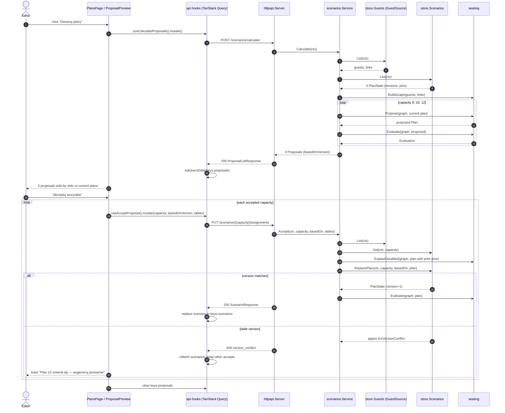
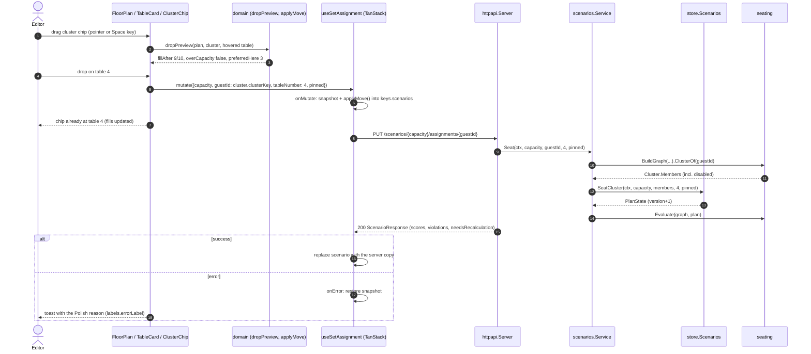
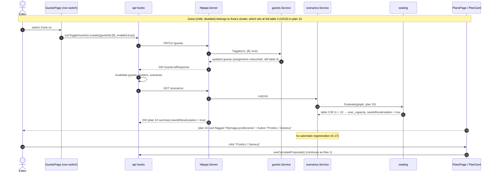
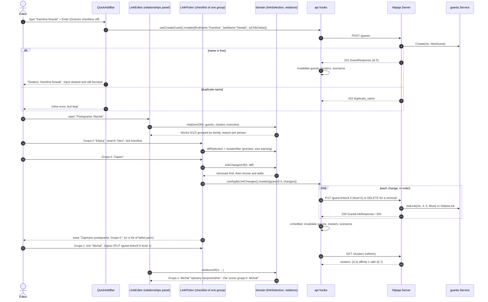
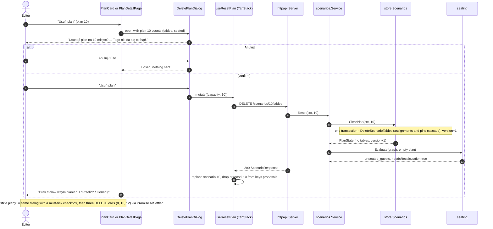

# 003 — Sequence diagrams for the UI-driven flows

Task 003, Phase 5. The participants are the components and packages from [003-frontend-design.md](003-frontend-design.md) and [003-backend-design.md](003-backend-design.md). All HTTP paths are relative to `/wesele/api` ([`docs/openapi.yaml`](../../openapi.yaml)).

1. [Generate all three plans → preview → accept](#1-generate-all-three-plans--preview--accept)
2. [Move a cluster (drag & drop, optimistic)](#2-move-a-cluster-drag--drop-optimistic)
3. [Re-enable a guest → plan needs recalculation → regenerate](#3-re-enable-a-guest--plan-needs-recalculation--regenerate)
4. [Quick-add a guest and link them through the group checklist](#4-quick-add-a-guest-and-link-them-through-the-group-checklist)
5. [Delete a plan](#5-delete-a-plan-task-005-uc-17)

## 1. Generate all three plans → preview → accept

*Legend:* Generate is a pure **query** (CQS) that stores nothing. Each accept is an independent **command** guarded by the **Optimistic Offline Lock**. All three proposals come from one `Graph` built once (DRY, consistent input).

## 2. Move a cluster (drag & drop, optimistic)

*Legend:* the client shows **optimistic fills only**. Scores and violations arrive in the response (single source of truth). The whole cluster moves on the server even though the client sends a single guest id.

## 3. Re-enable a guest → plan needs recalculation → regenerate

*Legend:* `needsRecalculation` is **derived** (any violation) and never stored, so nothing can go stale. Zosia **must** sit with her cluster (user rule), which is why the overfill is reported instead of moving her to the tray.

## 4. Quick-add a guest and link them through the group checklist

*Legend:* there is no batch endpoint. Each Enter is one `POST /guests`, which is fast enough for ~100 guests typed by hand (A-20). A checklist Save is one mutation that sends one request per changed pair (removals first, so a moved pair never collides). "Dodaj «X» jako nowego gościa" in the picker is only the `POST /guests` + tick; the link goes with Zapisz. Group 0 and the "przez …" reasons come from the server's clusters and affinities; the client only derives labels (display logic, not scoring).

## 5. Delete a plan (task 005, UC-17)

*Legend:* a **command** with no body and no version check (like the other manual plan edits); it bumps the version, so older proposals become stale. Unknown capacity → 404 `not_found`. No undo (Command/Memento rejected); the confirmation dialog stands in for it. "Delete all" is three independent commands, not a batch endpoint (independent aggregates, idempotent calls, same reasoning as "accept all").
