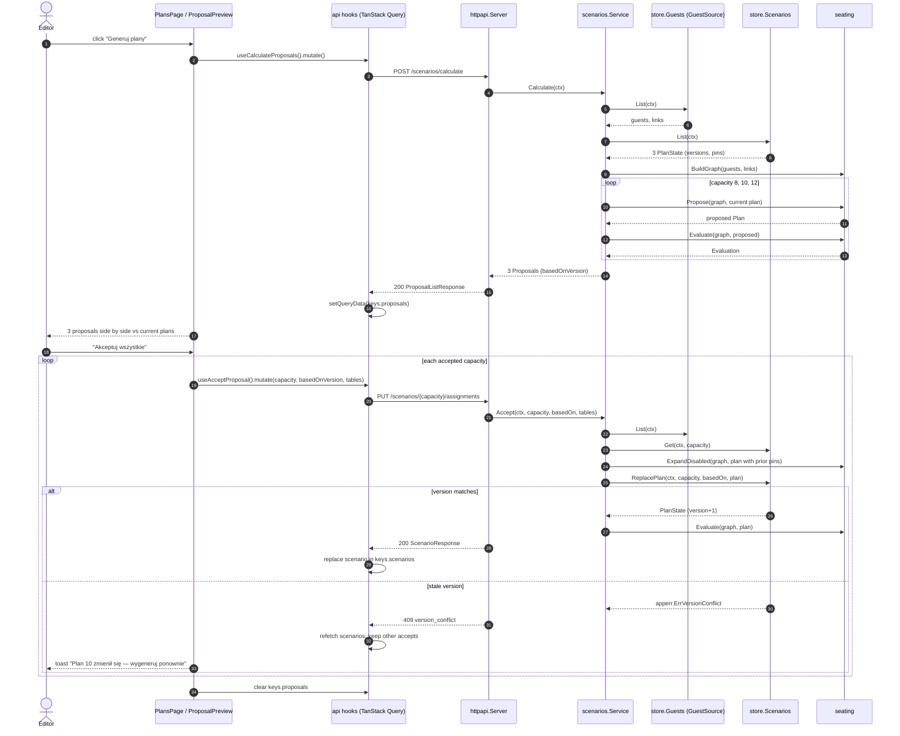
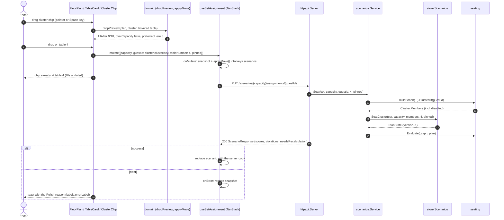
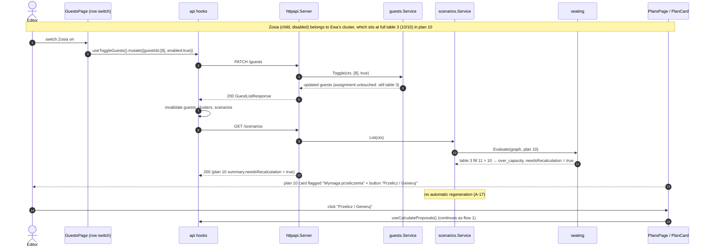
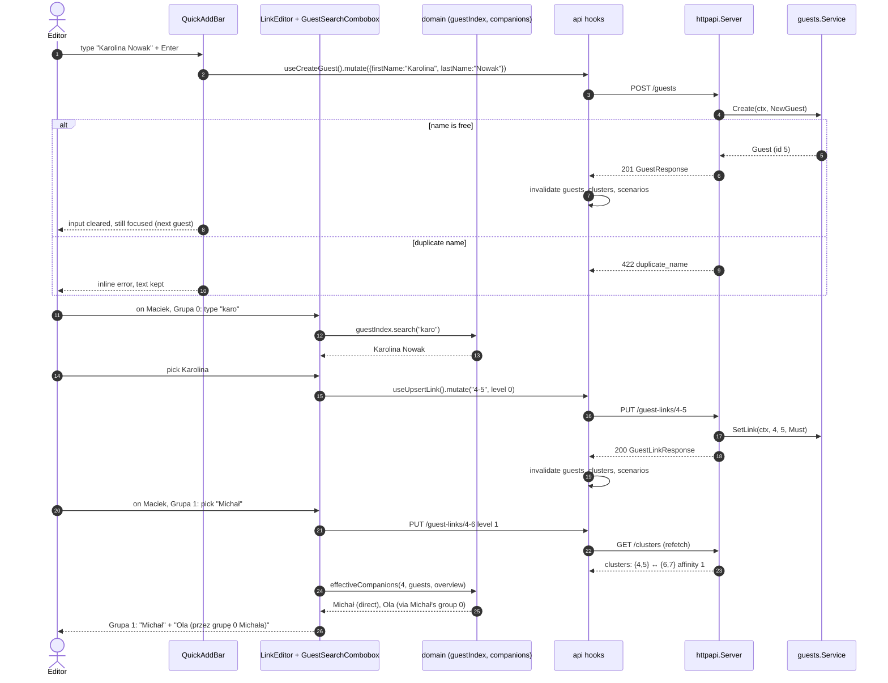

# 003 — Sequence diagrams for the UI-driven flows

Task 003, Phase 5. The participants are the components and packages from [003-frontend-design.md](003-frontend-design.md) and [003-backend-design.md](003-backend-design.md). All HTTP paths are relative to `/wesele/api` ([`docs/openapi.yaml`](../../openapi.yaml)).

1. [Generate all three plans → preview → accept](#1-generate-all-three-plans--preview--accept)
2. [Move a cluster (drag & drop, optimistic)](#2-move-a-cluster-drag--drop-optimistic)
3. [Re-enable a guest → plan needs recalculation → regenerate](#3-re-enable-a-guest--plan-needs-recalculation--regenerate)
4. [Quick-add a guest and link them, with cluster expansion](#4-quick-add-a-guest-and-link-them-with-cluster-expansion)

## 1. Generate all three plans → preview → accept

*Legend:* Generate is a pure **query** (CQS) that stores nothing. Each accept is an independent **command** guarded by the **Optimistic Offline Lock**. All three proposals come from one `Graph` built once (DRY, consistent input).

## 2. Move a cluster (drag & drop, optimistic)

*Legend:* the client shows **optimistic fills only**. Scores and violations arrive in the response (single source of truth). The whole cluster moves on the server even though the client sends a single guest id.

## 3. Re-enable a guest → plan needs recalculation → regenerate

*Legend:* `needsRecalculation` is **derived** (any violation) and never stored, so nothing can go stale. Zosia **must** sit with her cluster (user rule), which is why the overfill is reported instead of moving her to the tray.

## 4. Quick-add a guest and link them, with cluster expansion

*Legend:* there is no batch endpoint. Each Enter is one `POST /guests`, which is fast enough for ~100 guests typed by hand (A-20). The expansion is computed from the server's cluster affinities; the client only derives the "via" label (display logic, not scoring).
